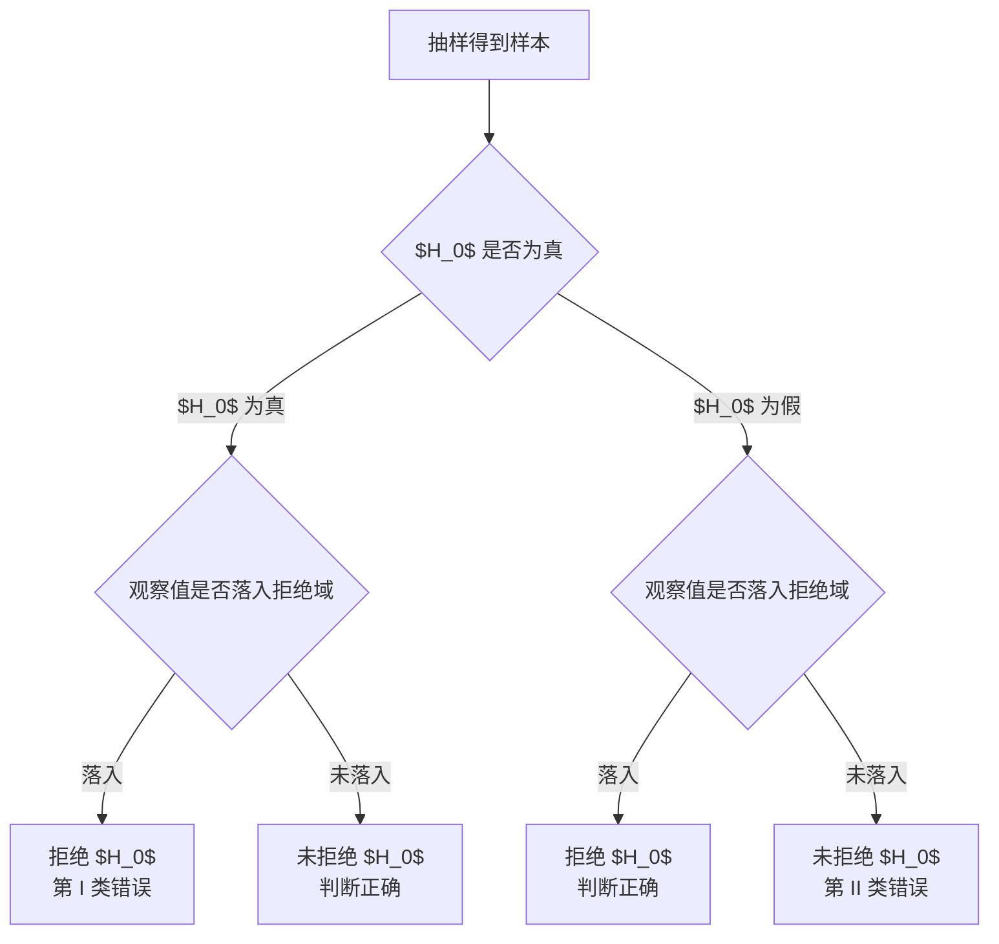

# 假设检验的两类错误（弃真错误/第I类错误、纳伪错误/第II类错误）

## 两类错误：为什么"没拒绝"不等于"接受"

假设检验的本质是**小概率反证法**：先假设 $H_0$ 成立，如果样本数据出现的概率小于 $\alpha$，就拒绝 $H_0$。但样本具有随机性，判断可能出错。关键是：**原假设 $H_0$ 的真假是固定的，而判断是随机的**，这就产生了两类错误。

## 两类错误的定义

| | 拒绝 $H_0$ | 未拒绝 $H_0$ |
|---|---|---|
| **$H_0$ 为真** | ==第 I 类错误（弃真）== 概率 $=\alpha$ | 判断正确 概率 $=1-\alpha$ |
| **$H_0$ 为假** | 判断正确（功效） 概率 $=1-\beta$ | ==第 II 类错误（纳伪）== 概率 $=\beta$ |

- **弃真错误（第 I 类错误）**：$H_0$ 实际上为真，但样本观察值落入拒绝域，我们错误地拒绝了 $H_0$，即"以真为假"。犯此错误的概率就是**显著性水平 $\alpha$**：
  $$P\{\text{当 } H_0 \text{ 为真，拒绝 } H_0\} \leq \alpha$$
  
- **纳伪错误（第 II 类错误）**：$H_0$ 实际上为假，但样本观察值未落入拒绝域，我们没有拒绝 $H_0$，即"以假为真"。犯此错误的概率记为 $\beta$。

> [!IMPORTANT]
> 两类错误的概率此消彼长：样本容量 $n$ 固定时，减小 $\alpha$ 会使拒绝域变小，导致 $\beta$ 增大；反之亦然。若要同时减小 $\alpha$ 和 $\beta$，只能**增大样本容量**。

## 为什么不能"接受"原假设

> [!WARNING]
> 假设检验的结论应表述为"**拒绝 $H_0$**"或"**没有充分理由拒绝 $H_0$**"，而非"接受 $H_0$"。因为未拒绝可能只是证据不足（犯了第 II 类错误），而非证明了 $H_0$ 为真。

## 计算示例

设总体 $X \sim N(\mu, \sigma^2)$，$\sigma^2$ 已知，检验：
$$H_0: \mu = \mu_0, \quad H_1: \mu \neq \mu_0$$

取显著性水平 $\alpha$，拒绝域为：
$$W = \left\{ \left| \frac{\bar{X} - \mu_0}{\sigma/\sqrt{n}} \right| > z_{\alpha/2} \right\}$$

**求第 I 类错误概率**：当 $H_0$ 为真（即 $\mu = \mu_0$）时，
$$P_{\mu_0}\{|Z| > z_{\alpha/2}\} = \alpha$$

**求第 II 类错误概率**：当 $H_0$ 为假（设真实 $\mu = \mu_1 > \mu_0$）时，
$$\beta = P_{\mu_1}\left\{ \left| \frac{\bar{X} - \mu_0}{\sigma/\sqrt{n}} \right| \leq z_{\alpha/2} \right\} = \Phi\left(z_{\alpha/2} - \frac{\mu_1 - \mu_0}{\sigma/\sqrt{n}}\right) - \Phi\left(-z_{\alpha/2} - \frac{\mu_1 - \mu_0}{\sigma/\sqrt{n}}\right)$$

可见 $\beta$ 与 $\mu_1$ 有关：真实值 $\mu_1$ 越接近 $\mu_0$，$\beta$ 越大。

> [!TIP]
> 记忆口诀：**"弃真"是"真的被抛弃"（$\alpha$），"纳伪"是"假的被接纳"（$\beta$）**。$\alpha$ 是我们事先设定的显著性水平，而 $\beta$ 需要通过具体计算求得，且通常随样本量 $n$ 增大而减小。
