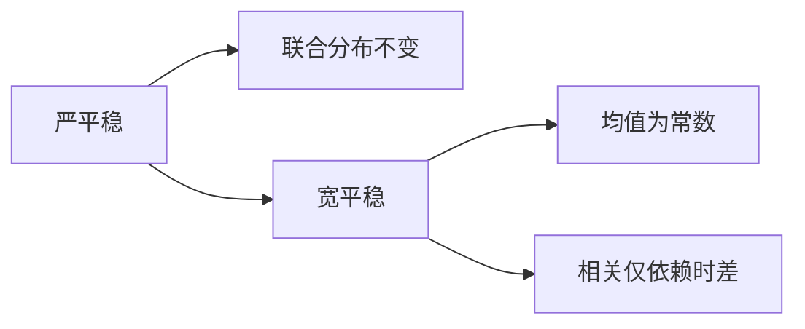

# 严平稳随机过程的定义与数字特征

## 定义与意义

平稳随机过程是一类“统计特性不随时间整体平移而改变”的随机过程。工程中的白噪声、许多通信噪声和干扰都具有这种特征，因此平稳性是相关理论分析的起点。

> [!IMPORTANT]
> 严平稳要求任意有限维联合分布不随时间平移改变，是最严格、最一般的平稳性。

具体地，若对任意正整数 $n$、任意 $t_1,\ldots,t_n\in T$ 及任意实数 $h$，只要 $t_i+h\in T$，就有  
$$
X(t_1),\ldots,X(t_n)
\overset{d}=
X(t_1+h),\ldots,X(t_n+h),
$$
则称 $\{X(t),t\in T\}$ 为**严平稳随机过程**，简称平稳过程。

这里“分布相同”包括联合分布，而不只是均值、方差相同。

## 数字特征

直接验证严平稳性需要确定各有限维分布，通常很困难。工程上常采用二阶矩理论，只研究均值函数和自相关函数。

若 $X(t)$ 具有有限二阶矩，则其均值为
$$
\mu_X(t)=E[X(t)],
$$
自相关函数为
$$
R_X(t,s)=E[X(t)X(s)].
$$

如果均值不随时间变化，且自相关函数只与时间差 $s-t$ 有关，即
$$
\mu_X(t)=\mu_X,\qquad
R_X(t,s)=R_X(s-t),
$$
则称该过程为**宽平稳过程**或**二阶平稳过程**。

> [!NOTE]
> 严平稳通常推出宽平稳；反过来一般不成立。若过程是宽平稳且高斯过程，则它也是严平稳过程。

宽平稳过程的方差函数同样与时间无关：
$$
\sigma_X^2(t)=D[X(t)]=R_X(0).
$$

## 严平稳与宽平稳的区别

| 比较项 | 严平稳 | 宽平稳 |
|---|---|---|
| 判断依据 | 任意有限维联合分布 | 均值与自相关函数 |
| 要求 | 分布层面 | 二阶矩层面 |
| 强弱 | 更强 | 较弱 |
| 适用场景 | 完整概率结构 | 工程相关理论 |

> [!WARNING]
> 仅证明“均值为常数、自相关只依赖 $\tau$”，只能得到宽平稳，不能据此断言严平稳。

## 例：随机相位正弦波

设
$$
X(t)=a\sin(\omega_0t+\Theta),\qquad
\Theta\sim U(0,2\pi).
$$

其均值为
$$
E[X(t)]
=\frac{a}{2\pi}\int_0^{2\pi}\sin(\omega_0t+\theta)\,d\theta
=0.
$$

自相关函数为
$$
\begin{aligned}
R_X(t,t+\tau)
&=E[X(t)X(t+\tau)]\\
&=\frac{a^2}{2}E\!\left[
\cos(\omega_0\tau)
-\cos(2\omega_0t+\omega_0\tau+2\Theta)
\right]\\
&=\frac{a^2}{2}\cos(\omega_0\tau).
\end{aligned}
$$

因此均值恒定，自相关只与时间差 $\tau$ 有关，$X(t)$ 是宽平稳过程。

若要进一步证明严平稳，可令 $\Phi=\omega_0t+\Theta$。由于 $\Theta$ 在一个周期上均匀分布，$\Phi$ 也在对应长度为 $2\pi$ 的区间上均匀分布，因而
$$
X(t)\overset d=a\sin\Phi.
$$
对任意时刻平移都只改变均匀随机变量的区间位置而不改变其分布，所以该过程实际上是严平稳过程。

> [!TIP]
> 判断随机相位正弦波严平稳时，关键看“随机相位是否覆盖完整周期且均匀分布”，而不是只计算均值和相关函数。
