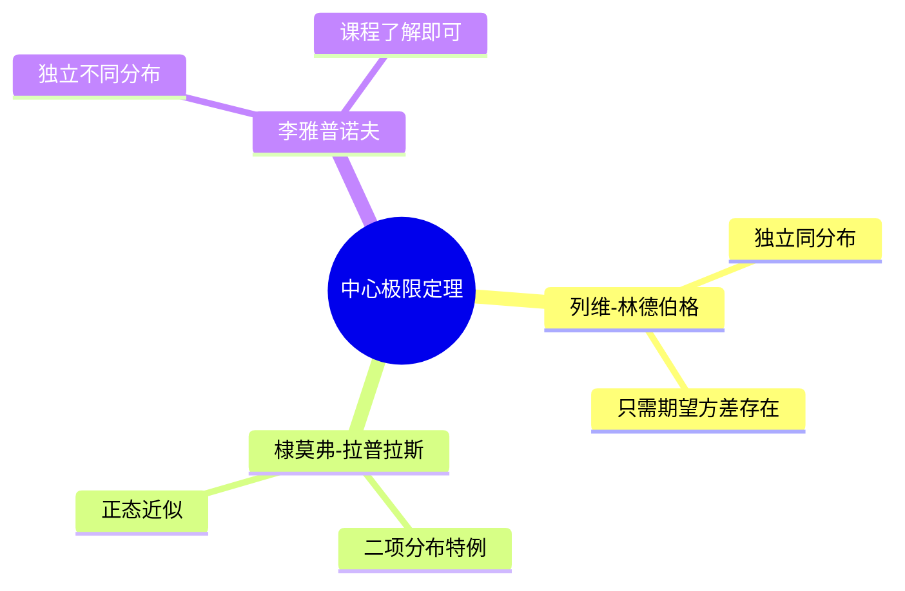

# 中心极限定理（独立同分布中心极限定理、棣莫弗-拉普拉斯中心极限定理）

## 中心极限定理是什么

大数定律告诉我们：大量随机变量取平均后会"稳定"在期望附近。但它没说**偏离期望的幅度有多大**。

中心极限定理（CLT）补上了这一环：==无论 $X_i$ 原来服从什么分布，只要独立同分布且方差有限，当 $n$ 充分大时，其和的标准化变量的分布就趋于标准正态分布 $N(0,1)$==。

研究的问题形式化为：设 $\{X_n\}$ 为随机变量序列，构造

$$
F_n(x)=P\left\{\frac{\sum_{k=1}^{n}X_k-E\left(\sum_{k=1}^{n}X_k\right)}{\sqrt{D\left(\sum_{k=1}^{n}X_k\right)}}\le x\right\}
$$

凡使 $F_n(x)\xrightarrow{n\to\infty}\Phi(x)$ 一致成立的定理都称为中心极限定理。$\Phi(x)$ 即标准正态分布函数。

## 独立同分布中心极限定理（列维—林德伯格）

设 $X_1,X_2,\cdots$ **相互独立、服从同一分布**，且 $E(X_k)=\mu$，$D(X_k)=\sigma^2>0$，则标准化变量

$$
Y_n=\frac{\sum_{k=1}^{n}X_k-n\mu}{\sqrt{n}\,\sigma}
$$

的分布函数 $F_n(x)$ 对任意 $x$ 满足 $\lim\limits_{n\to\infty}F_n(x)=\Phi(x)$。

> [!IMPORTANT]
> 实际解题用的是**近似**形式：$n$ 较大时
> $$\sum_{k=1}^{n}X_k\ \dot{\sim}\ N(n\mu,\;n\sigma^2)$$
> 即"和近似正态，期望乘 $n$，方差也乘 $n$"。

## 棣莫弗—拉普拉斯中心极限定理

它是列维—林德伯格定理在伯努利分布下的推论：若 $\eta_n\sim B(n,p)$，则对任意 $x$

$$
\lim_{n\to\infty}P\left\{\frac{\eta_n-np}{\sqrt{np(1-p)}}\le x\right\}=\Phi(x)
$$

即 $n$ 大时 $\eta_n\ \dot{\sim}\ N\big(np,\;np(1-p)\big)$。

> [!NOTE]
> 与二项分布的正态近似是同一回事。二项分布 $B(n,p)$ 可看成 $n$ 个 $0\text{-}1$ 变量之和，$\mu=p$，$\sigma^2=p(1-p)$，代入独立同分布 CLT 即得。

## 三个定理对比

| 定理 | 条件 | 结论 | 课程地位 |
|---|---|---|---|
| 列维—林德伯格 | 独立**同分布**，$\mu,\sigma^2$ 存在 | $Y_n\xrightarrow{d}N(0,1)$ | ==核心考点== |
| 棣莫弗—拉普拉斯 | $\eta_n\sim B(n,p)$ | 二项分布近似正态 | 必考应用 |
| 李雅普诺夫 | 独立不同分布，满足 $\delta$ 矩条件 | 标准化和趋于 $\Phi(x)$ | 了解 |

## 怎么用：四步套路

1. **设变量**：把题目对象写成 $X=\sum_{k=1}^{n}X_k$，求出 $\mu=E(X_k)$、$\sigma^2=D(X_k)$；
2. **算参数**：$E(X)=n\mu$，$D(X)=n\sigma^2$；
3. **标准化**：$P\{X\le a\}\approx\Phi\left(\dfrac{a-n\mu}{\sqrt{n}\sigma}\right)$；
4. **查 $\Phi$ 表**：代入 $\Phi$ 值（题目常给 $\Phi(2)=0.977$、$\Phi(1.28)=0.9$ 等）。

> [!TIP]
> 记住一句：==问概率就标准化，问临界值就反查表==。分位数问题（"最多装多少箱"）令 $\Phi(\cdot)=$ 给定概率，解方程即可。

## 算对的例子（考试原题）

> 计算器舍入误差相互独立且 $\sim U(-0.5,0.5)$，1200 个数相加，求误差总和绝对值小于 10 的概率。

**第一步**：设 $X_k$ 为第 $k$ 个舍入误差，$X_k\sim U(-0.5,0.5)$，故

$$
\mu=E(X_k)=0,\qquad \sigma^2=D(X_k)=\frac{(0.5-(-0.5))^2}{12}=\frac{1}{12}
$$

**第二步**：总和 $X=\sum_{k=1}^{1200}X_k$，$E(X)=0$，$D(X)=1200\times\frac{1}{12}=100$，$\sqrt{D(X)}=10$。

**第三步**：由独立同分布中心极限定理，

$$
P\{|X|<10\}=P\left\{\left|\frac{X-0}{10}\right|<1\right\}\approx 2\Phi(1)-1
$$

**第四步**：查表 $\Phi(1)=0.8413$，得 $P\approx 2\times0.8413-1=\mathbf{0.6826}$。

> [!WARNING]
> 常见错误：① 均匀分布方差记错——$U(a,b)$ 的方差是 $\frac{(b-a)^2}{12}$，这里 $b-a=1$ 不是 $0.5$；② 忘乘 $n$——方差是 $n\sigma^2$ 不是 $\sigma^2$；③ 绝对值概率忘用 $2\Phi(x)-1$。

> [!CAUTION]
> 二项分布用棣莫弗—拉普拉斯近似时，方差是 $np(1-p)$，标准化分母是 $\sqrt{np(1-p)}$，不要把 $p(1-p)$ 漏开根号或写成 $npq$ 整体开两次根。

> [!NOTE]
> 大数定律回答"平均结果收敛到 $\mu$"（定性），CLT 回答"偏离 $\mu$ 的涨落约 $\sigma/\sqrt{n}$ 量级、呈正态"（定量），这是数理统计中置信区间与假设检验的理论基石。
