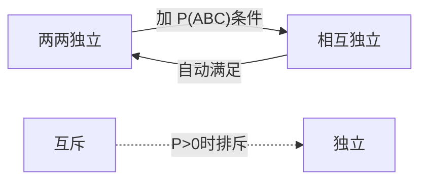

# 事件的相互独立性

## 什么是事件的相互独立性

在计算复杂系统概率时，我们常面临一个问题：事件 $A$ 的发生是否会改变事件 $B$ 发生的可能性？如果 ==$A$ 的发生对 $B$ 毫无影响==，即 $P(B|A) = P(B)$，我们就称 $A, B$ 相互独立。将条件概率公式代入，便得到独立性的核心判定式：

$$
P(AB) = P(A)P(B)
$$

> [!IMPORTANT]
> 独立性是**乘法公式成立的前提**。只有确认独立，才能将联合概率拆解为边缘概率之积，这是简化多步随机试验计算的基石。

为什么需要这个概念？因为现实中的可靠性分析（如元件串并联）、重复试验等模型，都依赖于“各部分互不影响”这一假设。若无法拆分，复杂的系统概率将无法求解。

## 独立性与互斥的区别

这是考试中最容易混淆的概念，务必通过下表厘清：

| 维度 | 相互独立 | 互斥（不相容） |
| :--- | :--- | :--- |
| **定义** | $P(AB)=P(A)P(B)$ | $AB=\varnothing \Rightarrow P(AB)=0$ |
| **直观含义** | 一个发生不影响另一个 | 两个不能同时发生 |
| **概率关系** | 通常 $P(AB)>0$ | 必然 $P(AB)=0$ |
| **能否共存** | 当 $P(A),P(B)>0$ 时，==独立必不互斥== | 当 $P(A),P(B)>0$ 时，==互斥必不独立== |

> [!CAUTION]
> 若 $P(A)>0, P(B)>0$ 且 $A,B$ 互斥，则 $P(AB)=0 \neq P(A)P(B)$，此时它们**一定不独立**。切勿将“没关系”等同于“不同时发生”。

## 如何判定与使用独立性

判定时优先看题设是否直接给出“独立”字样；若无，则需验证 $P(AB)=P(A)P(B)$ 是否成立。例如证明题中给出 $P(B|A)+P(\overline{B}|\overline{A})=1$，可推导出 $P(B|A)=P(B|\overline{A})$，进而证得 $P(AB)=P(A)P(B)$。

使用时注意以下性质拓展：

-   若 $A,B$ 独立，则 $A,\overline{B}$、$\overline{A},B$、$\overline{A},\overline{B}$ 均独立。
-   ==两两独立 $\neq$ 相互独立==。三事件相互独立需同时满足三个两两独立条件及 $P(ABC)=P(A)P(B)P(C)$。

## 典型例题解析

以系统可靠性问题为例：4个独立元件可靠性均为 $p$，求系统可靠度。

> [!TIP]
> 解题关键：先识别结构中的独立单元，再用串并联公式组合。串联用乘法，并联用 $1-(1-p)^n$。

设系统正常工作为事件 $A$。若结构为两组并联再串联，每组可靠度为 $1-(1-p)^2$，由组间独立性得：

$$
P(A) = [1-(1-p)^2]^2 = p^2(2-p)^2
$$

此题正是利用了元件间的独立性，才能将整体概率分解为子模块概率的乘积。若元件不独立，该解法完全失效。

> [!WARNING]
> 计算 $P(\overline{A}\cap\overline{B})$ 时，若已知 $A,B$ 独立，应转化为 $(1-P(A))(1-P(B))$ 而非 $1-P(A\cup B)$，后者虽数值相等但易出错。
