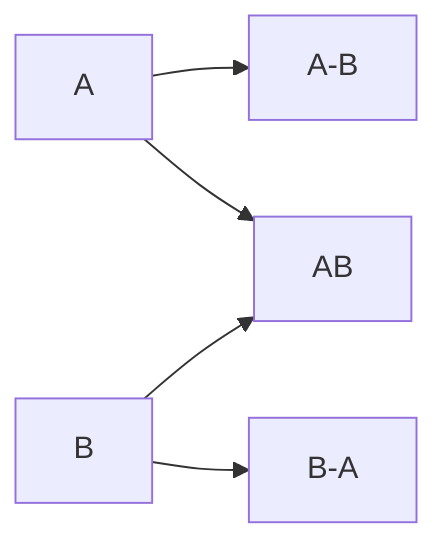

# 事件的运算规律（交换律、结合律、分配律、德摩根律）

事件的运算规律是把「与、或、非」组合成复杂事件时的化简与变形依据。学会了交换律、结合律、分配律和德摩根律，你就能把题干里冗长的事件表达式==化简成最好算概率的等价形式==，也才能把"至多""至少"这类自然语言准确翻译成事件式。

## 交换律与结合律

事件的并 $A\cup B$ 与交 $AB$ 都不依赖书写顺序和分组：

$$
A\cup B = B\cup A,\qquad AB = BA
$$

$$
(A\cup B)\cup C = A\cup(B\cup C),\qquad (AB)C = A(BC)
$$

所以 $A\cup B\cup C$、$ABC$ 之类的写法不必加括号，含义唯一。

## 分配律

交对并、并对交都可"打开括号"，与代数乘法对加法的分配律同形：

$$
A(B\cup C) = AB \cup AC
$$

$$
A\cup BC = (A\cup B)(A\cup C)
$$

> [!WARNING]
> 第二条（并对交的分配）在初等代数里没有对应物，很容易忘。反向用它做"提公因式"化简尤其方便。

## 德摩根律

这是==考试最高频的一条==，负责在"并/交"与"非"之间来回切换：

$$
\overline{A\cup B} = \bar A\bar B,\qquad \overline{AB} = \bar A\cup \bar B
$$

推广到 $n$ 个事件："并的补等于补的交，交的补等于补的并"，且每个事件头上都要加一条横线：

$$
\overline{A_1\cup\cdots\cup A_n} = \bar A_1\cdots \bar A_n,\qquad
\overline{A_1\cdots A_n} = \bar A_1\cup\cdots\cup \bar A_n
$$

> [!TIP]
> 记忆口诀："帽子脱下来，符号反过来。" $\cup$ 变 $\cap$、$\cap$ 变 $\cup$，每个事件各戴一顶帽子。

## 与相近记号的区别

| 记号 | 含义 | 关键点 |
|---|---|---|
| $A-B$ | $A$ 发生且 $B$ 不发生 | $A-B = A\bar B = A-AB$ |
| $\bar A B$ | $B$ 发生且 $A$ 不发生 | 与 $B-A$ 等价 |
| $\overline{AB}$ | $A$、$B$ 不同时发生 | 注意横线盖住整体，$\overline{AB}\neq \bar A\bar B$ |

> [!CAUTION]
> $\overline{AB}$ 是"不都发生"，$\bar A\bar B$ 是"都不发生"，两者相差甚远，横线的覆盖范围必须看清。

## 算对一个例子

设 $P(A)=0.7,\;P(B)=0.3,\;P(A-B)=0.5$，求 $P(A\cup B)$ 与 $P(B-A)$。

由 $A = (A-B)\cup AB$ 且两部分互斥，得

$$
P(AB) = P(A)-P(A-B) = 0.7-0.5 = 0.2
$$

于是

$$
P(A\cup B) = P(A)+P(B)-P(AB) = 0.7+0.3-0.2 = 0.8
$$

$$
P(B-A) = P(B)-P(AB) = 0.3-0.2 = 0.1
$$

> [!NOTE]
> 画一张简单的韦恩图或把 $A$、$B$ 拆成三块 $A-B$、$B-A$、$AB$，几乎能解决所有"差事件"相关的概率小题。
