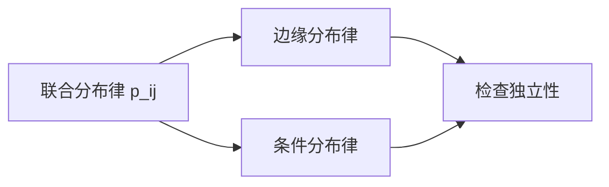

# 二维离散型随机变量的联合分布律

## 它是什么

在一维随机变量中，我们只关心一个指标 $X$；实际问题里常要同时关心两个指标（比如取到的黑球数 $X$ 与白球数 $Y$），于是引入**二维随机变量** $(X,Y)$。当 $X,Y$ 都是离散型时，把它们**所有可能取值组合的概率**一次性列成表格或公式，就叫 ==二维离散型随机变量的联合分布律==：

$$
P\{X=x_i,\;Y=y_j\}=p_{ij},\qquad i,j=1,2,\cdots
$$

它必须满足两条性质：

- 非负性：$p_{ij}\ge 0$；
- 归一性：$\displaystyle\sum_i\sum_j p_{ij}=1$。

> [!IMPORTANT]
> 联合分布律是==第 3 章所有计算的起点==：边缘分布、条件分布、独立性判断、$Z=g(X,Y)$ 的分布，全部由 $p_{ij}$ 出发。

## 为什么需要它

只给 $X$ 的分布（边缘）和 $Y$ 的分布，是**不足以**刻画 $(X,Y)$ 的：同样的 $X,Y$ 边缘分布可以对应完全不同的联合分布（耦合关系不同）。联合分布律把 "$X$ 取某值且 $Y$ 取某值" 的==同时概率==固定下来，才能回答 "$X+Y\ge 2$ 的概率是多少""$X,Y$ 是否独立"这类问题。

## 怎么做

求联合分布律的标准动作：

1. 列出 $(X,Y)$ 所有可能取值 $(x_i,y_j)$；
2. 对每一格用古典概型（组合数）或事件分解算 $p_{ij}$；
3. 画成表格，==行和列各自相加==即得边缘分布律 $p_{i\cdot},p_{\cdot j}$；
4. 校验 $\sum_i\sum_j p_{ij}=1$。

由联合分布求函数 $Z=g(X,Y)$ 的分布律，做法是**按 $Z$ 的取值合并同类项**：

$$
P\{Z=z\}=\sum_{(i,j):\,g(x_i,y_j)=z} p_{ij}.
$$

## 与相近概念的区别

| 概念 | 记号 | 用途 |
| --- | --- | --- |
| 联合分布律 | $p_{ij}=P\{X=x_i,Y=y_j\}$ | 刻画 $(X,Y)$ 整体 |
| 边缘分布律 | $p_{i\cdot}=\sum_j p_{ij}$ | 只看 $X$ |
| 条件分布律 | $P\{Y=y_j\mid X=x_i\}=p_{ij}/p_{i\cdot}$ | 已知 $X$ 后看 $Y$ |
| 联合概率密度 | $f(x,y)$ | 二维**连续型**对应物 |

> [!NOTE]
> 边缘分布律由联合**唯一确定**；反过来不成立——联合分布律是更强的信息。

## 常见的坑

- **概率写成 0 也要写**：比如样本里 $X=2,Y=2$ 不可能，$p_{22}=0$ 不能省，否则表格不全、和不为 1。
- **行列边缘相加对不上**：忘记 $X,Y$ 的取值受样本约束（如共取 2 只球 ⇒ $X+Y\le 2$），产生非法格。
- **独立性误判**：看到 $p_{ij}$ 表就以为独立。正确判据是 ==对所有 $i,j$ 都有 $p_{ij}=p_{i\cdot}p_{\cdot j}$==，只要有一格不等就**不独立**。
- **连续 vs 离散混用**：$f(x,y)$ 是密度，不是概率，$P\{X=x,Y=y\}=0$；离散型才用 $p_{ij}$。

> [!WARNING]
> 独立性只需验证**一格反例**即可否定，但要确认独立必须==所有格子==都满足乘积关系。

## 一个算对了的例子

设口袋中有 2 黑、2 白、3 蓝球，任取 2 只，$X$=黑球数，$Y$=白球数。总样本数 $C_7^2=21$。

$$
P\{X=0,Y=0\}=\frac{C_3^2}{21}=\frac17,\quad
P\{X=1,Y=0\}=\frac{C_2^1C_3^1}{21}=\frac27,\quad
P\{X=2,Y=2\}=0.
$$

得到联合分布律与边缘（行和列相加）：

| $Y\backslash X$ | 0 | 1 | 2 | $p_{\cdot j}$ |
| --- | --- | --- | --- | --- |
| 0 | $\frac17$ | $\frac27$ | $\frac1{21}$ | $\frac{10}{21}$ |
| 1 | $\frac27$ | $\frac4{21}$ | 0 | $\frac{10}{21}$ |
| 2 | $\frac1{21}$ | 0 | 0 | $\frac1{21}$ |
| $p_{i\cdot}$ | $\frac{10}{21}$ | $\frac{10}{21}$ | $\frac1{21}$ | $1$ |

求 $P\{X+Y\ge 2\}$，只需把满足条件的格子相加：

$$
P\{X{+}Y\ge2\}=P\{0,2\}+P\{2,0\}+P\{1,1\}+P\{2,1\}+P\{1,2\}+P\{2,2\}
=\frac{1}{21}+\frac{1}{21}+\frac{4}{21}=\frac27.
$$

> [!TIP]
> 表格法口诀：==先填格、再校和、边缘靠相加、事件靠加格==。求 $g(X,Y)$ 的分布时，把表格中同一函数值的格子圈起来相加即可。
