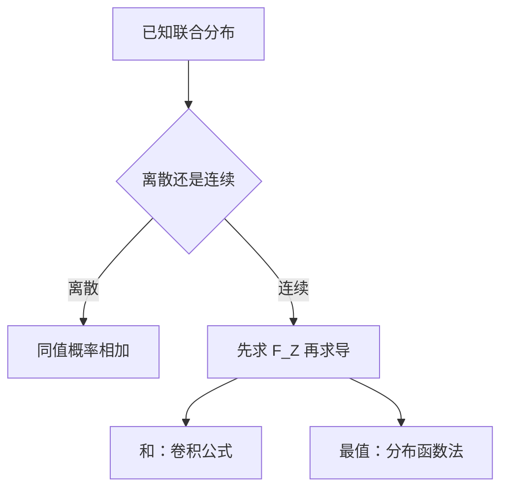

# 二维随机变量函数的分布（和的分布、最大值最小值分布）

## 问题与方法总览

设 $(X,Y)$ 是二维随机变量，$g(x,y)$ 是二元函数，则 $Z=g(X,Y)$ 是一维随机变量。已知 $(X,Y)$ 的联合分布律或概率密度，求 $Z$ 的分布，核心思路是：**先求分布函数 $F_Z(z)=P\{g(X,Y)\le z\}$，再求导得密度（连续型）；离散型则把取相同函数值的概率相加**。本节重点掌握 $Z=X+Y$、$M=\max(X,Y)$、$N=\min(X,Y)$ 三类。

## 和的分布

**离散型**：若 $P\{X=x_i,Y=y_j\}=p_{ij}$，则
$$P\{Z=z_k\}=\sum_{g(x_i,y_j)=z_k}p_{ij}.$$
即把 $X+Y$ 取同一值的所有情形概率相加。

**连续型**：设 $(X,Y)$ 的概率密度为 $f(x,y)$，则
$$F_Z(z)=\iint_{x+y\le z}f(x,y)\,dxdy=\int_{-\infty}^{+\infty}\!\left[\int_{-\infty}^{z-x}f(x,y)\,dy\right]dx,$$
求导得
$$f_Z(z)=\int_{-\infty}^{+\infty}f(x,z-x)\,dx=\int_{-\infty}^{+\infty}f(z-y,y)\,dy.$$

> [!IMPORTANT]
> 若 $X,Y$ ==相互独立==，则 $f(x,y)=f_X(x)f_Y(y)$，得**卷积公式**
> $$f_Z(z)=\int_{-\infty}^{+\infty}f_X(x)f_Y(z-x)\,dx=f_X*f_Y.$$

**正态分布的可加性**：若 $X\sim N(\mu_1,\sigma_1^2)$，$Y\sim N(\mu_2,\sigma_2^2)$ 且独立，则 $aX+bY\sim N(a\mu_1+b\mu_2,\ a^2\sigma_1^2+b^2\sigma_2^2)$。特别地 $X-Y$ 的方差是 $\sigma_1^2+\sigma_2^2$（不是相减）。

## 最大值与最小值的分布

设 $X,Y$ 相互独立，分布函数分别为 $F_X,F_Y$。关键在于事件的等价转化：

- $M=\max(X,Y)\le z \iff X\le z$ 且 $Y\le z$，故
$$F_{\max}(z)=F_X(z)F_Y(z).$$
- $N=\min(X,Y)>z \iff X>z$ 且 $Y>z$，用对立事件得
$$F_{\min}(z)=1-[1-F_X(z)][1-F_Y(z)].$$

推广到 $n$ 个相互独立的随机变量：
$$F_{\max}(z)=\prod_{i=1}^{n}F_{X_i}(z),\qquad F_{\min}(z)=1-\prod_{i=1}^{n}[1-F_{X_i}(z)].$$
若还同分布（分布函数都是 $F$），则 $F_{\max}(z)=[F(z)]^n$，$F_{\min}(z)=1-[1-F(z)]^n$。

> [!TIP]
> 口诀：==最大值直接乘，最小值用“1 减”补==。最大值想“都不超过”，最小值想“都超过”再取对立。

## 与相近概念的区别

| 对比项 | 说明 |
|---|---|
| 独立 vs 不独立 | 卷积公式 $f_X*f_Y$ 与最值的乘积公式都以独立为前提；不独立时只能用一般式 $f_Z(z)=\int f(x,z-x)dx$ 或 $F_{\max}(z)=F(z,z)$ |
| 和的分布 vs 边缘分布 | 边缘分布是对另一变量“积掉/加掉”；和的分布是沿直线 $x+y=z$ 累积概率 |
| $\max$ 与 $\min$ | $\max\le z$ 是“且”，直接交事件；$\min\le z$ 不能写成 $P\{X\le z\}P\{Y\le z\}$，必须走对立事件 |

## 常见的坑

> [!WARNING]
> - 用卷积公式时==先确定被积函数非零的积分区间==，再按 $z$ 分段讨论，切忌直接对 $(-\infty,+\infty)$ 套一个原函数。
> - $X-Y$ 的密度是 $\int f_X(x)f_Y(x-z)dx$；独立正态相减，方差仍相加。
> - 求 $f_Z$ 前若已得 $F_Z$，注意分段点处密度可任取，不影响概率。
> - 最值公式中 $z$ 是同一个数，两个分布函数都在 $z$ 处取值。

## 一个算对的例子

**例** 设 $X,Y$ 相互独立，均在 $(0,1)$ 上服从均匀分布，求 $Z=X+Y$ 的密度。

解：$f_X(x)=f_Y(y)=1\ (0<t<1)$。由卷积公式，被积函数非零需
$$0<x<1,\quad 0<z-x<1\ \Longrightarrow\ \max(0,z-1)<x<\min(1,z).$$

- 当 $0<z<1$：$f_Z(z)=\int_0^z 1\,dx=z$；
- 当 $1\le z<2$：$f_Z(z)=\int_{z-1}^{1}1\,dx=2-z$；
- 其余：$f_Z(z)=0$。

即
$$f_Z(z)=\begin{cases}z,&0<z<1,\\2-z,&1\le z<2,\\0,&\text{其它}.\end{cases}$$
这就是三角分布，图像在 $z=1$ 处达到峰值 $1$，且 $\int_0^2 f_Z(z)dz=1$，验证无误。
