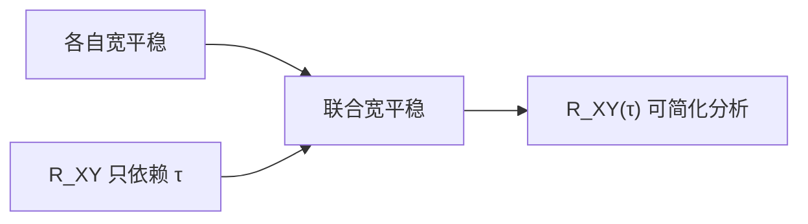

# 二维随机过程（互相关函数、互协方差函数）

## 它是什么

研究一个随机过程时，我们关心它在不同时刻的"自我联系"（自相关、自协方差）。但现实中常常要**同时观察两个随机过程**：比如通信系统里发送信号 $X(t)$ 和接收信号 $Y(t)$，它们依赖同一参数 $t\in T$，对每个 $t$，$(X(t),Y(t))$ 是一个二维随机变量，整体 $\{(X(t),Y(t)),t\in T\}$ 就称为**二维随机过程**。

它的统计规律由联合分布函数刻画：任取两组时刻 $t_1,\dots,t_n$ 与 $t'_1,\dots,t'_m$，$n+m$ 维随机变量
$$(X(t_1),\dots,X(t_n);Y(t'_1),\dots,Y(t'_m))$$
的分布函数 $F(x_1,\dots,x_n;t_1,\dots,t_n;y_1,\dots,y_m;t'_1,\dots,t'_m)$ 称为该二维随机过程的 $n+m$ 维联合分布函数。

## 为什么需要互相关与互协方差

联合分布函数信息虽全，却难以求得。工程上更关心一个可计算的问题：**$X$ 在 $t_1$ 时刻的取值，与 $Y$ 在 $t_2$ 时刻的取值，关联有多强？** 这就需要两个数字特征：

$$R_{XY}(t_1,t_2)=E[X(t_1)Y(t_2)] \quad\text{（互相关函数）}$$

$$C_{XY}(t_1,t_2)=E\big[(X(t_1)-\mu_X(t_1))(Y(t_2)-\mu_Y(t_2))\big] \quad\text{（互协方差函数）}$$

> [!IMPORTANT]
> 二者关系与一维情形完全平行：==$C_{XY}(t_1,t_2)=R_{XY}(t_1,t_2)-\mu_X(t_1)\mu_Y(t_2)$==。互相关是"原始二阶矩"，互协方差是"中心化二阶矩"。

若对任意 $t_1,t_2\in T$ 恒有 $C_{XY}(t_1,t_2)=0$，则称 $X(t)$ 与 $Y(t)$ **不相关**。

## 与相近概念的区别

| 概念 | 作用对象 | 表达式 | 退化为 |
|---|---|---|---|
| 自相关 $R_X(t_1,t_2)$ | 同一过程两时刻 | $E[X(t_1)X(t_2)]$ | — |
| 互相关 $R_{XY}(t_1,t_2)$ | 两个过程各取一时刻 | $E[X(t_1)Y(t_2)]$ | $Y=X$ 时即 $R_X$ |
| 互协方差 $C_{XY}$ | 两个过程（去均值） | $\mathrm{Cov}[X(t_1),Y(t_2)]$ | $Y=X$ 时即 $C_X$ |

> [!TIP]
> 几个随机过程之和的自相关函数 = 各自自相关函数 + 各对互相关函数之和。例如 $Z=X+Y$，则 $R_Z=R_X+R_Y+R_{XY}+R_{YX}$。

## 平稳相关

若 $X(t)$、$Y(t)$ 各自平稳，且互相关函数只依赖时间差 $\tau$：
$$R_{XY}(t,t+\tau)=E[X(t)Y(t+\tau)]=R_{XY}(\tau),$$
则称两过程**平稳相关**（联合宽平稳）。

> [!WARNING]
> 平稳相关要求**两个条件同时成立**：各自平稳 + 互相关只依赖 $\tau$。只验证其一不算联合平稳。另外注意 $R_{XY}(\tau)$ 一般**不是偶函数**，$R_{XY}(\tau)=R_{YX}(-\tau)$，不要套用自相关函数的对称性。

## 一个算对的例子

设 $X(t)=A\cos\omega t$，$Y(t)=A\sin\omega t$，其中 $A\sim N(0,\sigma^2)$。求互相关函数并判断是否平稳相关。

**解：** $\mu_X=\mu_Y=0$，故
$$R_{XY}(t_1,t_2)=E[A^2]\cos\omega t_1\sin\omega t_2=\sigma^2\cos\omega t_1\sin\omega t_2.$$

它依赖于 $t_1,t_2$ 本身而非仅 $\tau=t_2-t_1$（取 $t_1=0$ 得 $0$，取 $t_1=\frac{\pi}{2\omega}$ 得 $\sigma^2\sin\omega t_2$），所以**不平稳相关**。又 $C_{XY}=R_{XY}-0=R_{XY}$，只在满足 $\cos\omega t_1\sin\omega t_2=0$ 的时刻对上为零，并非恒零，故两过程**不是不相关**。

> [!CAUTION]
> 验证平稳相关时，务必把结果化成只含 $\tau$ 的形式；含单独的 $t$ 就直接判定不满足。判断"不相关"则要求对**任意** $t_1,t_2$ 恒有 $C_{XY}=0$，个别时刻为零不算数。
