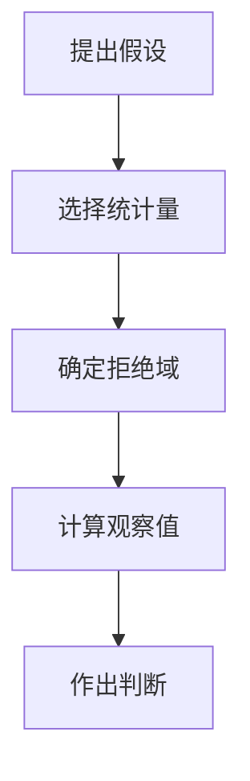
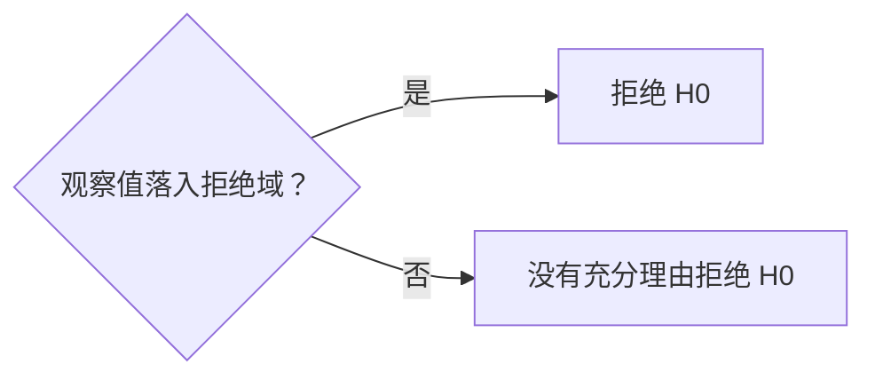

# 假设检验的一般步骤
先想一个问题：袋子里有 100 个球，商家说“全是白球”。你摸出 1 个，是黑球。你会怎么判断？

你会想：如果商家说的是真的，摸出黑球这件事概率极小（几乎不可能），但它居然发生了——这说明**商家的说法很可能不对**。

这就是假设检验的核心逻辑：==小概率反证法==。

[!IMPORTANT]
> 先假定原假设成立，若在此前提下样本结果出现的概率很小（小于显著性水平 $\alpha$），就认为原假设不能成立，从而拒绝它。

---

## 两类错误：做判断总要付出代价

由于我们依据的是“样本”而非“总体”，结论就可能出错：

| 错误类型 | 含义 | 概率记号 | 通俗理解 |
|---------|------|---------|---------|
| 弃真错误 | $H_0$ 为真却拒绝了它 | $\alpha$ | 冤枉了好人 |
| 取伪错误 | $H_0$ 为假却接受了它 | $\beta$ | 放过了坏人 |

[!WARNING]
> $\alpha$ 是显著性水平，由研究者事先给定（常用 $0.05$、$0.01$）；$\beta$ 与样本量、真实参数偏移量有关。两类错误不能同时减小（样本量固定时），通常优先控制 $\alpha$。

---

## 五个步骤

### Step 1：提出假设

- **原假设 $H_0$**：通常为“无差异”“无变化”“等于某值”，是受保护的假设。
- **备择假设 $H_1$**：与 $H_0$ 对立，是研究者希望支持的结论。

[!TIP]
> 把“想证明的结论”放在 $H_1$，把“想推翻的现状”放在 $H_0$。例如检验灯泡寿命是否提高到 $1000$ 小时以上，$H_0: \mu \le 1000$，$H_1: \mu > 1000$。

### Step 2：选择统计量

根据总体分布、参数类型（均值/方差）、总体方差已知与否，选取合适的检验统计量：

| 检验对象 | 条件 | 统计量 | 分布 |
|---------|------|--------|------|
| 均值 $\mu$ | 方差 $\sigma^2$ 已知 | $U=\dfrac{\bar{X}-\mu_0}{\sigma/\sqrt{n}}$ | $N(0,1)$ |
| 均值 $\mu$ | 方差未知 | $T=\dfrac{\bar{X}-\mu_0}{S/\sqrt{n}}$ | $t(n-1)$ |
| 方差 $\sigma^2$ | 均值未知 | $\chi^2=\dfrac{(n-1)S^2}{\sigma_0^2}$ | $\chi^2(n-1)$ |

### Step 3：确定拒绝域

拒绝域由 **显著性水平 $\alpha$** 和 **备择假设的方向** 共同决定：

- 双侧检验（$H_1: \mu \ne \mu_0$）：拒绝域在两侧，临界值为 $z_{\alpha/2}$ 或 $t_{\alpha/2}$。
- 右侧检验（$H_1: \mu > \mu_0$）：拒绝域在右尾，临界值为 $z_\alpha$。
- 左侧检验（$H_1: \mu < \mu_0$）：拒绝域在左尾，临界值为 $-z_\alpha$。

[!NOTE]
> 临界值通过查表得到。例如 $\alpha = 0.05$ 的双侧 $U$ 检验，查标准正态分布表得 $z_{0.025}=1.96$，拒绝域为 $|u| > 1.96$。

### Step 4：计算样本观察值

把样本数据代入统计量公式，算出一个具体的数。

### Step 5：作出判断

看计算值是否落入拒绝域：

---

## 常见的坑

[!CAUTION]
> **结论不说“接受 $H_0$”**，而说“没有充分理由拒绝 $H_0$”。因为不拒绝仅仅说明证据不足，不等于 $H_0$ 一定真。

[!WARNING]
> **拒绝域与备择假设方向一致**。$H_1$ 是“大于”，拒绝域在右尾；$H_1$ 是“小于”，拒绝域在左尾。别查错表、取错临界值。

---

## 一个算对的例子

某厂宣称产品某项指标的均值 $\mu_0 = 50$。随机抽取 $n=9$ 个样本，算得 $\bar{x} = 53$，样本标准差 $s = 3$。取 $\alpha = 0.05$，检验均值是否有显著变化。

**Step 1**：$H_0: \mu = 50$，$H_1: \mu \ne 50$（双侧检验）。

**Step 2**：方差未知，用 $T$ 统计量：

$$
t = \frac{\bar{x} - \mu_0}{s/\sqrt{n}} = \frac{53 - 50}{3/\sqrt{9}} = \frac{3}{1} = 3
$$

**Step 3**：查 $t$ 分布表，自由度 $n-1 = 8$，$\alpha = 0.05$ 双侧，得 $t_{0.025}(8) = 2.306$。拒绝域为 $|t| > 2.306$。

**Step 4**：观察值 $t = 3$。

**Step 5**：因为 $|3| > 2.306$，落入拒绝域，==拒绝 $H_0$==，认为均值与 $50$ 有显著差异。

再看一个反例：若算得 $|t| = 0.923$，而临界值 $t_{0.01}(9) = 2.821$，则 $0.923 < 2.821$，==没有充分理由拒绝 $H_0$==。

[!TIP]
> 判断口诀：**“计算值比临界值更极端，就拒绝”**。双侧看绝对值，单侧看方向。
