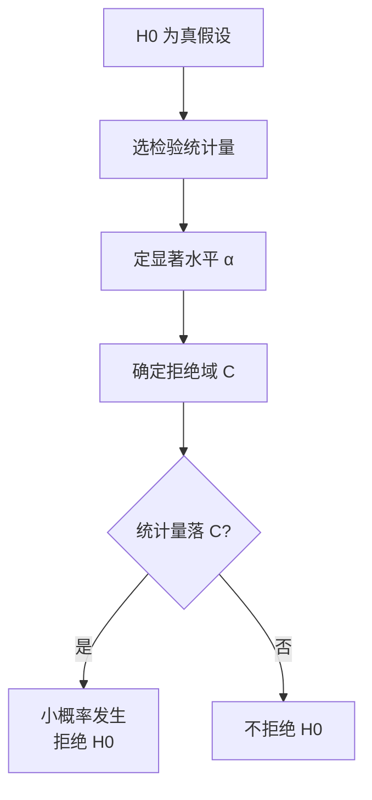

# 假设检验的基本思想与小概率原理

假设检验是统计推断的另一大支柱：**对总体分布的类型或其中的参数提出假设，再用样本信息判断假设是否成立**。它的理论基础只有一个非常朴素的道理——==小概率事件在一次试验中几乎不可能发生==。如果它发生了，我们宁可相信"假设错了"，也不相信"小概率事件碰巧撞上了"。这个思路叫**小概率反证法**。

## 提出假设：$H_0$ 与 $H_1$

检验总是成对地提出两个假设：

- **原假设 $H_0$**：待检验的、通常带有"相等/不低于"含义的假设。
- **备择假设 $H_1$**：与 $H_0$ 对立的假设，是拒绝 $H_0$ 后我们倾向于接受的结论。

> [!IMPORTANT]
> ==把"希望证明的结论"放在 $H_1$，把"需要推翻的对象"放在 $H_0$==。因为我们只能"拒绝 $H_0$"或"不拒绝 $H_0$"，结论方向与备择假设一致。

## 小概率原理与拒绝域

在 $H_0$ 为真的前提下，选取一个合适的**检验统计量**（如 $Z$、$T$、$\chi^2$、$F$），并给定一个==小概率标准==——**显著性水平 $\alpha$**（常用 0.05、0.01）。把使 $H_0$ 被拒绝的统计量取值区域 $C$ 叫**拒绝域**，边界点叫**临界点**。

> [!WARNING]
> 未落入拒绝域时，措辞是"**没有充分理由拒绝 $H_0$**"，而不是"接受 $H_0$ 为真"。样本没提供足够反证，不代表假设一定成立。

## 两类错误

用样本做判断难免出错，错误分两类：

| 错误 | 含义 | 概率 |
| --- | --- | --- |
| ==弃真错误（第 I 类）== | $H_0$ 为真却拒绝它 | $\alpha$（显著性水平） |
| 取伪错误（第 II 类） | $H_0$ 为假却未拒绝它 | $\beta$ |

$\alpha$ 与 $\beta$ 此消彼长：样本量固定时，把 $\alpha$ 压小必然使 $\beta$ 变大，反之亦然。检验法 $C$ 的**施行特征函数（OC 函数）**$\beta(\theta)=P_\theta(\text{接受 }H_0)$ 描述了这一权衡；$1-\beta(\theta)$ 称为**功效函数**，表示在 $H_1$ 中参数真值为 $\theta$ 时做出正确判断的概率。

> [!NOTE]
> 与"置信区间"的区别：区间估计给的是参数的可能范围，假设检验给的是对某一命题"拒绝/不拒绝"的二选一结论。

## 四步做题流程

- **提假设**：写出 $H_0,H_1$（注意方向：双侧、左侧还是右侧）。
- **选统计量**：$\sigma$ 已知用 $Z$，$\sigma$ 未知用 $T$，两总体方差相等未知用合并方差 $T$。
- **定拒绝域**：由 $\alpha$ 与自由度查表得临界值。
- **算值判真**：代入样本算出统计量，==落入拒绝域则拒绝 $H_0$==，否则不拒绝。

## 算对了的例子

一批元件要求平均寿命不低于 1000 小时，随机抽 $n=25$ 件得 $\bar{x}=950$ 小时，已知寿命服从正态分布、$\sigma=100$。在 $\alpha=0.05$ 下检验这批元件寿命是否达标。

**提假设**：$H_0:\mu\ge 1000$，$H_1:\mu<1000$（左侧检验）。

**选统计量**：$\sigma$ 已知，
$$Z=\frac{\bar{X}-1000}{\sigma/\sqrt{n}}$$

**定拒绝域**：左侧检验，$z\le -Z_\alpha=-Z_{0.05}=-1.645$。

**算值判真**：
$$z=\frac{950-1000}{100/\sqrt{25}}=-2.5<-1.645$$

落入拒绝域，==拒绝 $H_0$==，认为该批元件平均寿命小于 1000 小时。

> [!CAUTION]
> 常见坑：方向搞反（$H_1:\mu<1000$ 却查 $+Z_\alpha$）；忘了"不拒绝"≠"接受"；混用单双侧临界值（双侧是 $Z_{\alpha/2}$）。
