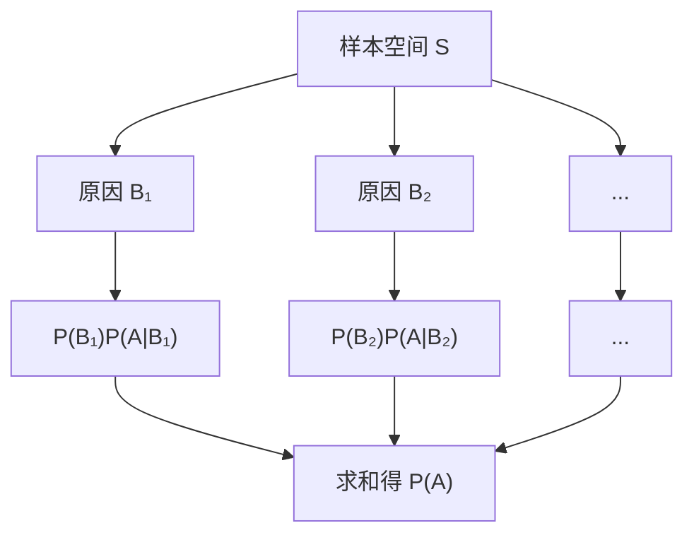

# 全概率公式

---
requires: [概率论与数理统计/条件概率, 概率论与数理统计/事件的独立性]
---

## 它是什么

想象一个试验可以分“两步”做：第一步先发生某个“原因”，第二步再观察“结果”。如果我们只关心第二步中事件 $A$ 发生的总概率，却没法直接算，怎么办？

> [!IMPORTANT]
> ==全概率公式==的核心思想是“化整为零”：把复杂事件 $A$ 的概率，拆解到若干个互不相容的“原因”上分别计算，再加起来。

设 $S$ 是试验 $E$ 的样本空间，$B_1, B_2, \dots, B_n$ 是 $S$ 的一个**划分**（也叫完备事件组），即满足：
1. $B_i B_j = \varnothing \ (i \neq j)$（两两互斥）
2. $\bigcup_{i=1}^n B_i = S$（穷尽所有可能）

且 $P(B_i) > 0$，则对 $E$ 的任一事件 $A$，有：

$$P(A) = \sum_{i=1}^{n} P(B_i) P(A \mid B_i)$$

用一张图来理解这个“拆分”过程：

## 为什么需要

很多实际问题中，事件 $A$ 的发生依赖于前置的“状态”或“来源”。比如：从多个箱子中随机选一个再取球、按性别分类讨论患病率等。直接算 $P(A)$ 很困难，但==在已知某个具体原因 $B_i$ 的条件下算 $P(A|B_i)$ 往往很简单==。全概率公式就是连接“局部”与“整体”的桥梁。

> [!TIP]
> **判断口诀**：试验分两步，求“第二步”某结果的概率 $\Rightarrow$ 用全概率公式；若反过来，已知第二步结果求“第一步原因”的概率 $\Rightarrow$ 用贝叶斯公式（逆概率公式）。

## 怎么做

解题只需三步：
1. **找划分**：确定第一步的所有互斥且穷尽的情况 $B_1, B_2, \dots, B_n$。
2. **查数据**：找出每个原因的先验概率 $P(B_i)$，以及对应条件下目标事件的条件概率 $P(A|B_i)$。
3. **套公式**：相乘后求和。

### 算对了的例子

**题目**：已知男子有 5% 是色盲患者，女子有 0.25% 是色盲患者。今从男女人数相等的人群中随机挑选一人，求此人是色盲患者的概率。

**解**：
设 $A$ = “挑到色盲患者”，$B$ = “挑到男子”，$\overline{B}$ = “挑到女子”。
显然 $B$ 与 $\overline{B}$ 构成样本空间的一个划分。

- 第一步的概率：$P(B) = 0.5,\ P(\overline{B}) = 0.5$
- 第二步的条件概率：$P(A \mid B) = 0.05,\ P(A \mid \overline{B}) = 0.0025$

代入全概率公式：
$$
\begin{aligned}
P(A) &= P(B)P(A \mid B) + P(\overline{B})P(A \mid \overline{B}) \\
&= 0.5 \times 0.05 + 0.5 \times 0.0025 \\
&= 0.025 + 0.00125 \\
&= 0.02625
\end{aligned}
$$

## 和相近概念的区别

| 对比项 | 全概率公式 | 贝叶斯公式（逆概率公式） |
| :--- | :--- | :--- |
| **求解方向** | 由“原因”推“结果” | 由“结果”溯“原因” |
| **所求对象** | $P(A)$（第二步事件概率） | $P(B_j \mid A)$（已知结果求某原因） |
| **公式形态** | $\sum P(B_i)P(A\|B_i)$ | 分子是全概率中的一项，分母是全概率 |

## 常见的坑

> [!WARNING]
> **划分不完整**：找的 $B_i$ 必须既互斥又穷尽（并集为 $S$）。例如“袋中取球不放回”问题（如南邮常考的乒乓球题），第二个人取到黄球的概率，必须按第一个人“取到黄球”和“取到白球”两种情况做划分，缺一不可。

> [!CAUTION]
> **混淆 $P(A|B_i)$ 与 $P(AB_i)$**：公式里乘的是条件概率 $P(A|B_i)$，千万别写成联合概率，否则就多乘了一次 $P(B_i)$。
