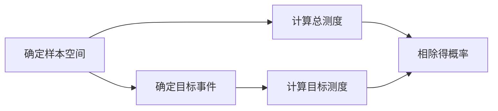

# 几何概型

古典概型要求样本点有限且等可能。但如果我们在区间 $[0, 1]$ 上“随机取一个点”，样本点是无穷多个，古典概型还适用吗？

当试验结果有==无穷多个==且每个结果出现机会均等时，我们需要用区域的“大小”（长度、面积、体积）来度量概率，这就是几何概型。

## 它是什么

设样本空间 $\Omega$ 是某个可度量的几何区域（如线段、平面图形、立体），且向 $\Omega$ 内投点时，点落在任何子区域内的可能性只与该区域的测度成正比，而与位置和形状无关。则事件 $A$ 的概率定义为：

$$P(A) = \frac{L(A)}{L(\Omega)}$$

其中 $L(\cdot)$ 表示测度（一维为长度，二维为面积，三维为体积）。

> [!IMPORTANT]
> 核心公式：概率等于“目标区域测度”除以“总样本空间测度”。

## 怎么做

解题只需三步：画图定区域、算测度、作比值。

**例题**：在单位圆 $\Omega = \{(x,y) \mid x^2 + y^2 \leq 1\}$ 内随机投一点，求该点落在上半圆的概率。

1. **定 $\Omega$**：单位圆，总面积 $L(\Omega) = \pi \times 1^2 = \pi$。
2. **定 $A$**：上半圆，即满足 $y \geq 0$ 的部分，面积 $L(A) = \frac{\pi}{2}$。
3. **算概率**：

$$P(A) = \frac{L(A)}{L(\Omega)} = \frac{\pi/2}{\pi} = \frac{1}{2}$$

这正好对应考卷中填空题答案的 $\frac{1}{2}$；若目标区域面积为 $1$，则概率为 $\frac{1}{\pi}$。

> [!TIP]
> 遇到二维问题先画坐标系！把文字条件翻译成不等式组，阴影部分就是目标区域。

## 与古典概型的区别

| 对比项 | 古典概型 | 几何概型 |
| :--- | :--- | :--- |
| 样本点个数 | ==有限个== | ==无限个== |
| 等可能性 | 每个样本点等可能 | 相同测度的区域等可能 |
| 概率计算 | 点数之比 $\frac{k}{n}$ | 测度之比 $\frac{L(A)}{L(\Omega)}$ |
| 典型场景 | 掷骰子、抽球 | 随机投点、等待时间 |

## 常见的坑

> [!WARNING]
> 零概率事件不一定是不可能事件！在几何概型中，单点的测度为 $0$，所以取到某个指定点的概率 $P=0$，但该点确实存在于样本空间中。同理，概率为 $1$ 的事件也不一定是必然事件。

> [!CAUTION]
> 维度必须一致！$\Omega$ 是一维线段，$A$ 也必须用长度算；$\Omega$ 是二维平面，$A$ 必须用面积算。切忌用“长度除以面积”。

> [!NOTE]
> 经典模型“会面问题”：两人约定在某时间段内到达，先到者等候时间 $t$ 后离开。此时 $\Omega$ 是由两人到达时间构成的正方形区域，而能会面的事件 $A$ 是正方形内满足 $|x - y| \leq t$ 的带状区域，需用总面积减去两个边角三角形的面积来求解。
