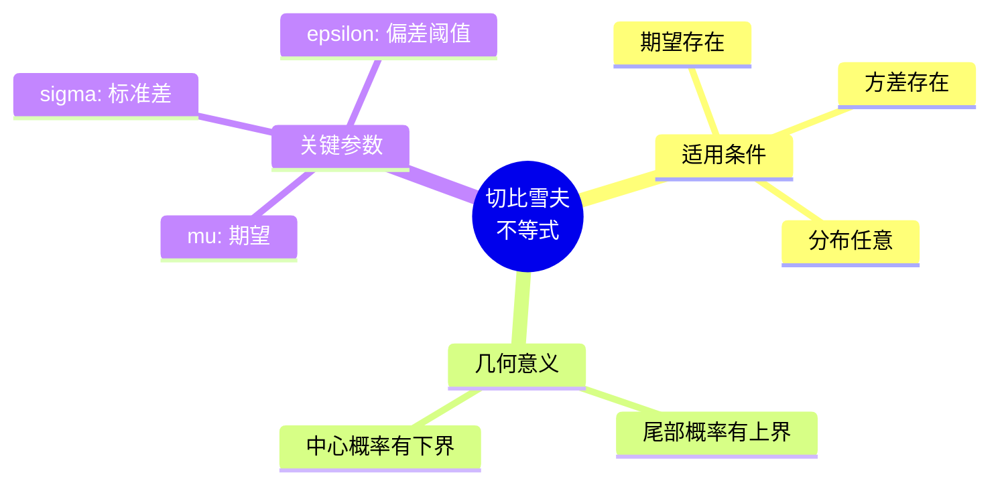

# 切比雪夫不等式
在概率论中，如果我们只知道随机变量 $X$ 的期望 $E(X)=\mu$ 和方差 $D(X)=\sigma^2$，而不知道其具体分布，能否估计 $X$ 落在某个区间的概率？**==切比雪夫不等式==** 给出了这一问题的通用答案：它利用方差来界定随机变量偏离均值的程度。

### 核心定义与公式

设随机变量 $X$ 具有数学期望 $\mu$ 和方差 $\sigma^2$，则对任意正数 $\varepsilon > 0$，有：

$$
P(|X - \mu| \geq \varepsilon) \leq \frac{\sigma^2}{\varepsilon^2}
$$

其等价形式（关注落在区间内的概率）为：

$$
P(|X - \mu| < \varepsilon) \geq 1 - \frac{\sigma^2}{\varepsilon^2}
$$

> [!IMPORTANT]
> **核心结论**：该不等式对**任意分布**均成立。它表明，方差越小，数据越集中在均值附近；$\varepsilon$ 越大，偏离均值的概率上界越小。

### 直观理解

我们可以将方差视为数据的“离散程度”。切比雪夫不等式告诉我们，无论数据分布形状如何（偏态、双峰等），落在均值附近 $k$ 倍标准差范围内的概率至少是多少。

### 解题步骤与示例

**怎么做？**
1. 识别 $\mu$ 和 $\sigma^2$。
2. 确定题目中的偏差阈值 $\varepsilon$（注意是绝对值内部的部分）。
3. 代入公式计算上界或下界。

**典型例题解析**
> 设随机变量 $X$ 的均值为 $\mu$，方差为 $\sigma^2$，求 $P(|X - \mu| \geq 3\sigma)$ 的上界。

**解析**：
此处偏差阈值 $\varepsilon = 3\sigma$。直接代入切比雪夫不等式：
$$
P(|X - \mu| \geq 3\sigma) \leq \frac{\sigma^2}{(3\sigma)^2} = \frac{\sigma^2}{9\sigma^2} = \frac{1}{9}
$$
因此，填空答案为 $\frac{1}{9}$。若问 $P(|X - \mu| < 3\sigma)$，则答案为 $1 - \frac{1}{9} = \frac{8}{9}$。

### 常见误区与辨析

| 比较维度 | 切比雪夫不等式 | 正态分布 $3\sigma$ 准则 |
| :--- | :--- | :--- |
| **适用分布** | ==任意分布== | 仅正态分布 |
| **精度** | 保守估计（界限较宽） | 精确计算 |
| **$3\sigma$ 概率** | $\geq 8/9 \approx 0.889$ | $\approx 0.997$ |

> [!WARNING]
> **易错坑**：
> 1. 混淆 $\geq$ 与 $>$。不等式通常针对 $\geq \varepsilon$ 给出上界，针对 $< \varepsilon$ 给出下界。
> 2. 忽略 $\varepsilon$ 的单位。$\varepsilon$ 必须与 $X$ 同量纲，若题目给的是 $k\sigma$，则 $\varepsilon=k\sigma$。
> 3. 误以为这是精确概率。它只是一个**界限**，实际概率可能远小于上界。

> [!TIP]
> **记忆口诀**：方差除以误差方，偏离概率有上限；一减此值即下限，任意分布都适用。
