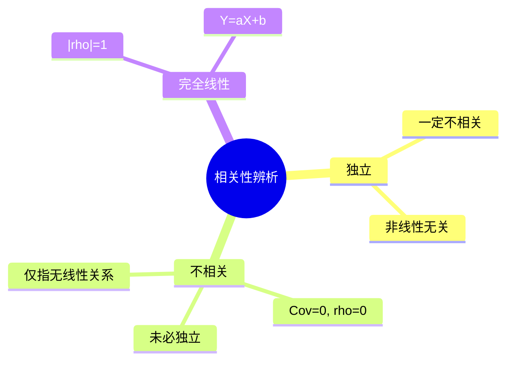

# 协方差及其性质

## 协方差与相关系数

协方差 $\operatorname{Cov}(X, Y)$ 用于衡量两个随机变量变化的**同步性**。若 $X$ 增大时 $Y$ 也倾向于增大，协方差为正；反之则为负。其定义式为：
$$
\operatorname{Cov}(X, Y) = E\{[X - E(X)][Y - E(Y)]\}
$$
实际计算中，更常用简化公式：
$$
\operatorname{Cov}(X, Y) = E(XY) - E(X)E(Y)
$$

> [!IMPORTANT]
> ==核心性质==：$\operatorname{Cov}(X, X) = D(X)$；$\operatorname{Cov}(aX+b, cY+d) = ac\operatorname{Cov}(X, Y)$。

为了消除量纲影响，引入**相关系数** $\rho_{XY}$：
$$
\rho_{XY} = \frac{\operatorname{Cov}(X, Y)}{\sqrt{D(X)}\sqrt{D(Y)}}
$$
$\rho_{XY}$ 的取值范围为 $[-1, 1]$，它刻画了变量间**线性关系**的强弱。

## 独立与不相关的区别

这是考试中最容易混淆的概念。请思考：如果两个变量没有关系（独立），它们之间会有线性关联吗？显然没有。但反过来，如果没有线性关联（不相关），它们就一定没关系吗？

| 概念 | 数学表达 | 含义 | 关系 |
| :--- | :--- | :--- | :--- |
| **独立** | $P(X,Y)=P(X)P(Y)$ | 无任何依赖关系 | 独立 $\Rightarrow$ 不相关 |
| **不相关** | $\rho_{XY}=0$ | 无**线性**依赖 | 不相关 $\nRightarrow$ 独立 |

> [!WARNING]
> **特例**：仅当 $(X, Y)$ 服从**二维正态分布**时，“独立”与“不相关”才是等价的。一般分布下，不相关可能仍存在非线性关系（如 $Y=X^2$）。

## 典型例题解析

**题目**：设 $(X, Y)$ 在区域 $D: 0<x<1, -x<y<x$ 上服从均匀分布，求 $\operatorname{Cov}(X, Y)$。

**解析步骤**：
1.  **确定密度函数**：区域面积 $S = \int_0^1 2x dx = 1$，故 $f(x,y)=1$ (在 $D$ 内)。
2.  **计算期望**：
    $$
    E(Y) = \int_0^1 dx \int_{-x}^x y dy = 0 \quad (\text{奇函数对称区间})
    $$
    $$
    E(XY) = \int_0^1 x dx \int_{-x}^x y dy = 0 \quad (\text{同理})
    $$
3.  **计算协方差**：
    $$
    \operatorname{Cov}(X, Y) = E(XY) - E(X)E(Y) = 0 - E(X)\cdot 0 = 0
    $$

> [!TIP]
> **解题技巧**：利用对称性可快速判断。若积分区域关于 $y$ 轴对称且被积函数含 $y$ 的奇次幂，则积分为 0。本题中 $Y$ 和 $XY$ 关于 $y$ 均为奇函数，故期望均为 0，直接得协方差为 0。

此例中 $\rho_{XY}=0$，即 $X, Y$ 不相关。但观察区域形状可知，$Y$ 的取值范围依赖于 $X$，故两者**不独立**。这再次印证了不相关推不出独立。
