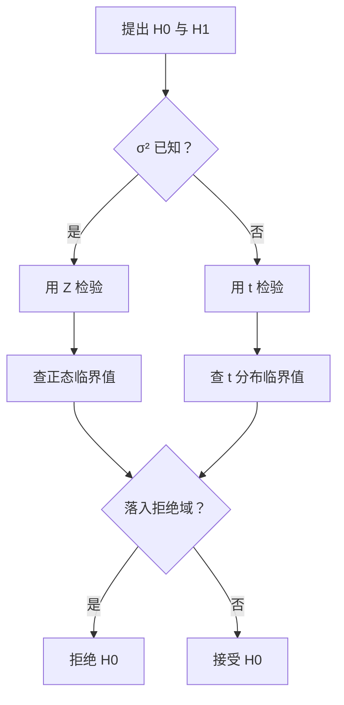

# 单个正态总体均值的假设检验（Z检验与t检验）

> [!IMPORTANT]
> 核心任务：判断正态总体的均值 $\mu$ 是否等于（或大于/小于）某个已知常数 $\mu_0$。

当我们从总体中抽取样本后，如何用样本均值 $\bar{X}$ 去“质疑”一个关于总体均值的假设？关键在于构造一个==在 $H_0$ 为真时分布完全已知==的检验统计量。

## 选 Z 还是选 t

思考一个问题：标准化样本均值 $\bar{X}$ 时，分母应该用什么？如果总体方差 $\sigma^2$ 已知，直接用 $\sigma$；如果未知呢？只能用样本标准差 $S$ 去替代。正是这个“替代”，改变了统计量的分布。

| 对比维度 | Z 检验 | t 检验 |
| :--- | :--- | :--- |
| **前提条件** | 总体服从正态分布，==方差 $\sigma^2$ 已知== | 总体服从正态分布，==方差 $\sigma^2$ 未知== |
| **检验统计量** | $Z=\frac{\bar{X}-\mu_0}{\sigma/\sqrt{n}} \sim N(0,1)$ | $T=\frac{\bar{X}-\mu_0}{S/\sqrt{n}} \sim t(n-1)$ |
| **分母来源** | 总体标准差 $\sigma$ | 样本标准差 $S$ |
| **临界值查表** | 标准正态分布表 $z_\alpha$ | $t$ 分布表 $t_\alpha(n-1)$ |

> [!NOTE]
> 两者都要求总体服从正态分布。若总体非正态但 $n$ 很大（通常 $n \ge 30$），由中心极限定理，Z 检验可近似使用；但小样本且非正态时，两者皆不适用。

## 怎么做：完整解题步骤

无论双侧还是单侧，流程固定为四步：

1. **提假设**：根据题意写出 $H_0$ 和 $H_1$。
2. **选统计量**：看 $\sigma^2$ 是否已知，决定用 $Z$ 还是 $T$。
3. **定拒绝域**：根据 $H_1$ 的形式（$\neq$、$>$、$<$）和显著性水平 $\alpha$ 确定。
   - 双侧（$H_1: \mu \neq \mu_0$）：$|Z| \ge z_{\alpha/2}$ 或 $|T| \ge t_{\alpha/2}(n-1)$
   - 左侧（$H_1: \mu < \mu_0$）：$Z \le -z_\alpha$ 或 $T \le -t_\alpha(n-1)$
4. **算并判**：代入数据计算统计量观测值，看是否落入拒绝域。

> [!WARNING]
> 最容易踩的坑：计算 $t$ 检验统计量时，分母误写成 $\sigma/\sqrt{n}$。题目说“方差未知”时，必须用样本方差 $S^2$ 开根号得到 $S$ 作为分母！

## 算对了的例子

以南邮真题为例：矿石元素含量服从正态分布，均值方差均未知。测定容量 $n=16$ 的样本，得 $\bar{x}=0.4,\ s^2=0.0324$。在 $\alpha=0.05$ 下检验期望是否为 $0.49$。

**第一步：提假设**
$H_0: \mu = 0.49$，$H_1: \mu \neq 0.49$（双侧检验）。

**第二步：选统计量**
题目明确“方差未知”，选用 $t$ 检验。
$$T = \frac{\bar{X} - \mu_0}{S / \sqrt{n}} \sim t(n-1)$$

**第三步：定拒绝域**
双侧检验，显著性水平 $\alpha=0.05$，自由度 $n-1=15$。
拒绝域为：$|T| \ge t_{0.025}(15) = 2.1315$。

**第四步：算并判**
已知 $s = \sqrt{0.0324} = 0.18$，代入计算：
$$|t| = \left| \frac{0.4 - 0.49}{0.18 / \sqrt{16}} \right| = \left| \frac{-0.09}{0.045} \right| = 2$$

因为 $|t| = 2 < 2.1315$，未落入拒绝域，故==接受原假设 $H_0$==，认为该矿石元素含量的期望可以看作 $0.49$。

> [!TIP]
> 记忆口诀：“知方用 Z，未知用 t；双侧切两尾，单侧看方向”。做填空题时，若问“方差未知时所用的检验统计量为____”，直接写 $T=\frac{\bar{X}-\mu_0}{S/\sqrt{n}}$ 即可。
