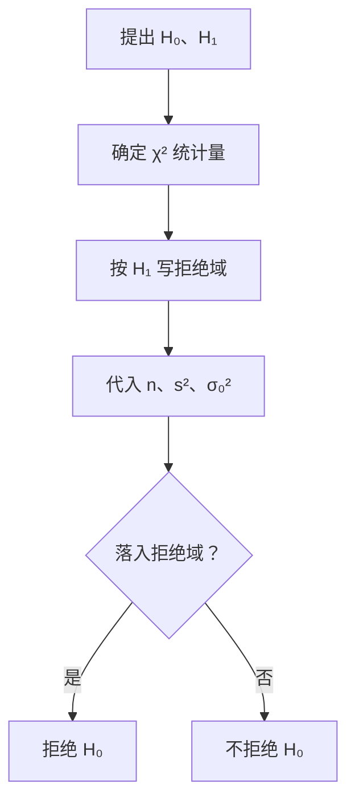

# 单个正态总体方差的假设检验（χ²检验）

## 为什么要用 $\chi^2$ 检验

样本方差 $S^2$ 会随机波动，不能仅凭 $s^2>\sigma_0^2$ 就断定总体方差变大。设 $X\sim N(\mu,\sigma^2)$，$\mu,\sigma^2$ 均未知，$X_1,\ldots,X_n$ 为样本。检验总体方差时，利用

$$
\chi^2=\frac{(n-1)S^2}{\sigma_0^2}
=\frac{\sum_{i=1}^n(X_i-\bar X)^2}{\sigma_0^2}
\sim \chi^2(n-1)\quad(H_0:\sigma^2=\sigma_0^2\text{ 成立时}).
$$

因此，==单个正态总体、均值未知、检验方差，使用自由度为 $n-1$ 的 $\chi^2$ 检验==。

> [!IMPORTANT]
> 原假设通常写为 $H_0:\sigma^2=\sigma_0^2$。统计量分母用原假设中的 $\sigma_0^2$，自由度是 $n-1$，不是 $n$。

## 假设与拒绝域

以下均采用上侧分位数记号：$P\{\chi^2(n-1)>\chi_\alpha^2(n-1)\}=\alpha$。

| 检验类型 | 原假设与备择假设 | 显著性水平为 $\alpha$ 的拒绝域 |
|---|---|---|
| 双侧检验 | $H_0:\sigma^2=\sigma_0^2,\ H_1:\sigma^2\ne\sigma_0^2$ | $\chi^2\ge\chi_{\alpha/2}^2(n-1)$ 或 $\chi^2\le\chi_{1-\alpha/2}^2(n-1)$ |
| 右侧检验 | $H_0:\sigma^2\le\sigma_0^2,\ H_1:\sigma^2>\sigma_0^2$ | $\chi^2\ge\chi_\alpha^2(n-1)$ |
| 左侧检验 | $H_0:\sigma^2\ge\sigma_0^2,\ H_1:\sigma^2<\sigma_0^2$ | $\chi^2\le\chi_{1-\alpha}^2(n-1)$ |

解题仍按五步进行：提出假设、确定统计量、写出拒绝域、计算样本观察值、作出结论。

## 一个算对了的例子

某种导线总体服从正态分布，参数均未知。取 $9$ 根样品，测得 $s^2=0.007^2$。在 $\alpha=0.05$ 下，能否认为这批导线的方差为 $0.005^2$？

提出双侧假设

$$
H_0:\sigma^2=0.005^2,\qquad H_1:\sigma^2\ne0.005^2.
$$

选用

$$
\chi^2=\frac{(n-1)S^2}{0.005^2},
$$

自由度为 $9-1=8$。拒绝域为

$$
\chi^2\ge\chi_{0.025}^2(8)=17.534
\quad\text{或}\quad
\chi^2\le\chi_{0.975}^2(8)=2.180.
$$

代入样本观察值：

$$
\chi^2=\frac{8\times0.007^2}{0.005^2}
=\frac{8\times49}{25}=15.68.
$$

由于 $2.180<15.68<17.534$，样本观察值不在拒绝域内，故==不拒绝 $H_0$==，即在 $\alpha=0.05$ 下，可以认为这批导线的方差为 $0.005^2$。

## 和相近检验的区别

| 比较对象 | 使用统计量 | 关键区别 |
|---|---|---|
| 单个正态总体均值检验，$\sigma^2$ 未知 | $t=\dfrac{\bar X-\mu_0}{S/\sqrt n}$ | 检验的是均值，自由度为 $n-1$ |
| 单个正态总体方差检验 | $\chi^2=\dfrac{(n-1)S^2}{\sigma_0^2}$ | 检验的是方差 |
| 两个正态总体方差比较 | $F=S_1^2/S_2^2$（在 $\sigma_1^2=\sigma_2^2$ 下） | 比较两台机床“精度”通常用 $F$ 检验 |

> [!WARNING]
> “方差不得超过 $\sigma_0^2$”对应的是 $H_1:\sigma^2>\sigma_0^2$ 的右侧检验；只有题目明确问“方差是否为 $\sigma_0^2$”时，才用双侧拒绝域。不要把 $\chi_{0.025}^2$ 与 $\chi_{0.975}^2$ 的位置写反。

> [!CAUTION]
> 计算时保持方差单位一致：$s^2=0.007^2$、$\sigma_0^2=0.005^2$ 都是方差，不能误代成 $0.007$ 和 $0.005$。此外，“不拒绝 $H_0$”不等于已经证明方差绝对等于 $\sigma_0^2$。
