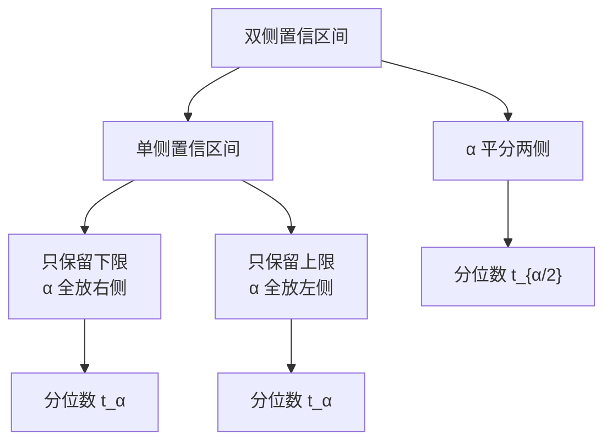

# 单侧置信区间（单侧置信下限与单侧置信上限）

## 单侧置信区间：什么时候只要"一头"

双侧置信区间给出 $\theta$ 的下限和上限，把参数"夹在中间"。但实际问题里，我们常常只关心其中一头：

- 灯泡寿命：平均寿命当然是越长越好，我们只想知道它**至少**有多少——关心**下限**；
- 药品杂质含量：杂质当然越少越好，我们只想知道它**至多**有多少——关心**上限**。

这时就可以把区间的另一端取为 $\pm\infty$，只保留有实际意义的那一头，这就是**单侧置信区间**。

> [!IMPORTANT]
> 设 $\underline{\theta}=\underline{\theta}(X_1,\cdots,X_n)$ 是统计量，若对任意 $\theta\in\Theta$ 有
> $$P\{\theta\ge\underline{\theta}\}=1-\alpha$$
> 则称 $(\underline{\theta},+\infty)$ 为 $\theta$ 的置信水平为 $1-\alpha$ 的**单侧置信区间**，$\underline{\theta}$ 为**单侧置信下限**。
> 类似地，若 $P\{\theta\le\overline{\theta}\}=1-\alpha$，则 $(-\infty,\overline{\theta})$ 为单侧置信区间，$\overline{\theta}$ 为**单侧置信上限**。

## 从双侧到单侧：改哪一步

以正态总体 $N(\mu,\sigma^2)$、$\sigma^2$ 未知为例。双侧置信区间由

$$P\left\{\left|\frac{\bar X-\mu}{S/\sqrt n}\right|<t_{\alpha/2}(n-1)\right\}=1-\alpha$$

得到。现在只关心**下限**，就把概率全部放到分布的一侧：

$$P\left\{\frac{\bar X-\mu}{S/\sqrt n}<t_{\alpha}(n-1)\right\}=1-\alpha$$

解出 $\mu$ 即得单侧置信区间 $(\underline{\mu},+\infty)$，其中

$$\underline{\mu}=\bar X-\frac{S}{\sqrt n}t_{\alpha}(n-1)$$

> [!TIP]
> 从双侧公式改单侧公式只需两处：把 $t_{\alpha/2}$ 换成 $t_{\alpha}$，再把"$\pm$"换成只取你关心的那一头。其余结构完全照搬。

## 正态总体常用单侧置信限

| 待估参数 | 条件 | 单侧置信下限 | 单侧置信上限 |
|---|---|---|---|
| $\mu$ | $\sigma^2$ 已知 | $\bar X-\dfrac{\sigma}{\sqrt n}z_{\alpha}$ | $\bar X+\dfrac{\sigma}{\sqrt n}z_{\alpha}$ |
| $\mu$ | $\sigma^2$ 未知 | $\bar X-\dfrac{S}{\sqrt n}t_{\alpha}(n-1)$ | $\bar X+\dfrac{S}{\sqrt n}t_{\alpha}(n-1)$ |
| $\sigma^2$ | $\mu$ 未知 | $\dfrac{(n-1)S^2}{\chi^2_{\alpha}(n-1)}$ | $\dfrac{(n-1)S^2}{\chi^2_{1-\alpha}(n-1)}$ |

> [!WARNING]
> 查表时容易错：双侧用 $z_{\alpha/2}$、$t_{\alpha/2}$、$\chi^2_{\alpha/2}$ 与 $\chi^2_{1-\alpha/2}$；单侧只用 $z_{\alpha}$、$t_{\alpha}$、$\chi^2_{\alpha}$ 或 $\chi^2_{1-\alpha}$。不要把 $\alpha/2$ 照搬到单侧问题里。

## 算例：清漆干燥时间

9 个样品干燥时间服从 $N(\mu,\sigma^2)$，$\bar x=6$，$\sigma=0.6$ 已知，求 $\mu$ 的置信水平 $0.95$ 的单侧置信上限。

这里 $\alpha=0.05$，$z_{0.05}=1.645$，故

$$\bar x+\frac{\sigma}{\sqrt n}z_{\alpha}=6+\frac{0.6}{\sqrt 9}\times1.645=6.329$$

即单侧置信上限为 $6.329$（小时），单侧置信区间为 $(-\infty,\,6.329)$。

> [!NOTE]
> 同一组数据下，单侧上限 $6.329$ 比双侧上限 $6.392$ 更"紧"——因为把全部 $\alpha$ 集中到一侧后，分位数从 $1.96$ 降到 $1.645$，所需裕量变小。这是单侧区间更精确的直接体现。
