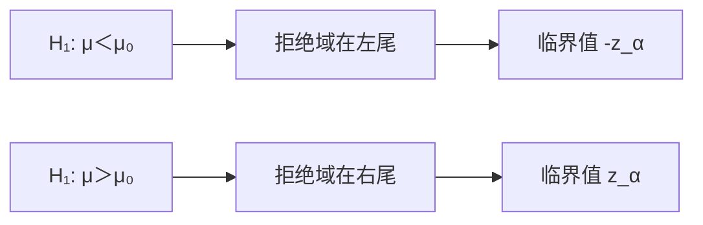

# 单边假设检验（左侧检验与右侧检验）

## 单边假设检验

在上一节双侧检验中，拒绝域被分配在统计量分布的两侧尾部。但很多实际问题关心的不是“是否等于”，而是“是否大于”或“是否小于”。此时需要用**单边假设检验**。

先看一个场景：质检部门怀疑某批次灯泡的平均寿命**不足**标称值 1000 小时。他们真正想验证的是“寿命是否显著**低于** 1000”，而不是“寿命是否**不等于** 1000”。如果寿命远高于标称值，对消费者没有坏处，不应拒绝。这种带有方向性的判断，就是单边检验的出发点。

### 左侧检验与右侧检验

单边检验根据拒绝域所在的位置，分为两种：

| 类型 | 原假设 $H_0$ | 备择假设 $H_1$ | 拒绝域位置 |
|------|-------------|---------------|-----------|
| 左侧检验 | $\mu \geq \mu_0$ 或 $\mu = \mu_0$ | $\mu < \mu_0$ | 分布**左**尾 |
| 右侧检验 | $\mu \leq \mu_0$ 或 $\mu = \mu_0$ | $\mu > \mu_0$ | 分布**右**尾 |

> [!IMPORTANT]
> ==拒绝域的方向永远与备择假设 $H_1$ 的不等号方向一致==：$H_1$ 为“$<$”拒绝域在左尾，$H_1$ 为“$>$”拒绝域在右尾。

以 $\sigma^2$ 已知的正态总体均值检验为例，检验统计量仍为：

$$Z=\frac{\bar{X}-\mu_0}{\sigma/\sqrt{n}}\sim N(0,1)$$

- **左侧检验**（$H_1:\mu<\mu_0$）：拒绝域为 $Z<-z_\alpha$
- **右侧检验**（$H_1:\mu>\mu_0$）：拒绝域为 $Z>z_\alpha$

### 为什么与单侧置信区间有对应关系

双侧检验对应双侧置信区间：检验 $\mu=\mu_0$ 时，看 $\mu_0$ 是否落在 $\mu$ 的双侧置信区间内。

单边检验则对应**单侧置信区间**：

- 左侧检验（$H_1: \mu<\mu_0$）对应**置信上限** $\bar{X}+z_\alpha\frac{\sigma}{\sqrt{n}}$。若 $\mu_0$ 大于该上限，说明 $\mu$ 很可能小于 $\mu_0$，拒绝 $H_0$。
- 右侧检验（$H_1: \mu>\mu_0$）对应**置信下限** $\bar{X}-z_\alpha\frac{\sigma}{\sqrt{n}}$。若 $\mu_0$ 小于该下限，说明 $\mu$ 很可能大于 $\mu_0$，拒绝 $H_0$。

> [!NOTE]
> 回忆区间估计：单侧置信区间的临界值用 $z_\alpha$（不是 $z_{\alpha/2}$），因为只有一侧尾部承担全部显著性水平 $\alpha$。

### 一个算对了的例子

某食品包装标注每袋净含量为 50 g。质检员怀疑包装分量**不足**，随机抽取 9 袋，测得样本均值 $\bar{x}=48.5$ g。已知总体标准差 $\sigma=3$ g，在显著性水平 $\alpha=0.05$ 下检验包装是否显著不足。

**第一步：建立假设。**

问题是“是否不足”，即关心 $\mu$ 是否小于 50：

$$H_0: \mu=50,\quad H_1:\mu<50$$

这是**左侧检验**。

**第二步：计算检验统计量。**

$$Z=\frac{48.5-50}{3/\sqrt{9}}=\frac{-1.5}{1}=-1.5$$

**第三步：确定拒绝域。**

$\alpha=0.05$，左侧检验临界值为 $-z_{0.05}=-1.645$。拒绝域为 $Z<-1.645$。

**第四步：做出决策。**

$Z=-1.5>-1.645$，不落入拒绝域，==不拒绝 $H_0$==。即在 0.05 显著性水平下，没有充分证据认为包装分量显著不足。

> [!TIP]
> “不拒绝”≠“证明等于 50”。只是当前样本证据不够强，不能断言不足。这是初学者最常误读的结论。

### 常见的坑

> [!WARNING]
> **拒绝域方向写反**：把 $H_1:\mu<50$ 的拒绝域写成 $Z>1.645$。记住口诀：“备择指哪边，拒绝域就在哪边”。

> [!CAUTION]
> **用错临界值**：单边检验用 $z_\alpha$，而**不是** $z_{\alpha/2}$。如果本题误用 $z_{0.025}=1.96$ 做比较，结论虽不变，但思考方式已错；若统计量落在 $-1.96$ 与 $-1.645$ 之间，就会得出错误结论。

> [!WARNING]
> **原假设与备择假设写反**：把“研究者想证明的结论”放在备择假设。想证明“不足”，则 $H_1$ 为 $\mu<50$，而不是 $\mu>50$。
