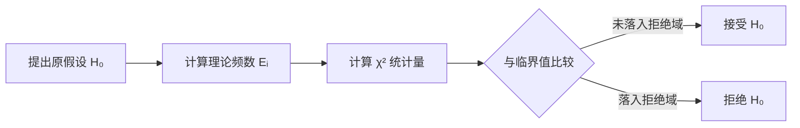

# χ²拟合优度检验法

## 它是什么

$\chi^2$ 拟合优度检验法用于判断==某组实际频数是否与某个理论分布或理论频数相符==。它把各类别的实际频数 $A_i$ 与理论频数 $E_i$ 的偏离程度平方后加权求和：

$$
\chi_0^2=\sum_{i=1}^k\frac{(A_i-E_i)^2}{E_i}
$$

在 $H_0$ 成立、理论频数条件满足时，$\chi_0^2$ 近似服从自由度为 $k-1$ 的 $\chi^2$ 分布；若理论频数由样本估计得到自由度，还要相应扣除估计参数的个数。

## 为什么需要

对于“某产品是否符合指定分布”“投掷结果是否均匀”等问题，仅看某几类的频数可能漏掉整体偏差。$\chi^2$ 检验把所有类别的偏离合并成一个统计量，既能检验离散分布是否吻合，也可用于列联表的独立性检验。

## 怎么做

1. **提出假设**

   拟合优度检验中通常假设总体服从指定分布，即 $H_0$：总体分布为 $F_0$。

2. **确定拒绝域**

   对显著性水平 $\alpha$，查卡方分布上侧临界值 $\chi_\alpha^2(n)$。右侧检验的拒绝域为

   $$
   \chi_0^2\ge \chi_\alpha^2(n).
   $$

   课件中也常给出上下临界值，此时判断统计量是否落在两端组成的拒绝域内。

3. **计算统计量并作判断**

   - $\chi_0^2<\chi_\alpha^2(n)$：接受 $H_0$；
   - $\chi_0^2\ge \chi_\alpha^2(n)$：拒绝 $H_0$。

> [!IMPORTANT]
> 卡方拟合优度检验是右侧检验，统计量越大，越有理由拒绝 $H_0$。

## 与相近概念的区别

| 方法 | 检验对象 | 主要统计量 | 常见结论 |
|---|---|---|---|
| $\chi^2$ 拟合优度检验 | 频数是否服从某分布 | $\sum (A_i-E_i)^2/E_i$ | 接受或拒绝分布假设 |
| $\chi^2$ 独立性检验 | 两个分类属性是否独立 | 列联表卡方统计量 | 判断是否独立 |
| 二项检验 | 成功次数是否满足比例 | 精确二项概率 | 常用于小样本比例检验 |

## 常见坑

> [!WARNING]
> “接受 $H_0$”不等于“证明 $H_0$ 成立”，只表示现有样本没有提供足够证据拒绝它。

- 各组理论频数 $E_i$ 应足够大；课程常用经验准则是 $E_i\ge 5$。
- 类别互斥且穷尽，合计频数必须与理论总频数一致。
- 自由度不能一律写成 $k-1$：若由样本估计了参数，应扣除估计参数的数目。
- 临界值下标表示上侧尾概率，$\chi_{0.05}^2$ 不是“左尾面积为 $0.05$”的临界值。

> [!TIP]
> 记忆：先看自由度，再按 $\alpha$ 查上侧临界值；统计量“越极端”，越拒绝原假设。

## 算对的例子

已知 $\chi_0^2\approx17.858$，自由度为 $4$，显著性水平 $\alpha=0.025$，课件给出

$$
\chi_{0.025}^2(4)=11.143.
$$

因为

$$
17.858>11.143,
$$

统计量落入右侧拒绝域，所以在显著性水平 $0.025$ 下==拒绝 $H_0$==。反之，若 $\chi_0^2\approx9.929$ 且 $\chi_{0.05}^2(7)=14.067$，则 $9.929<14.067$，应接受 $H_0$。
