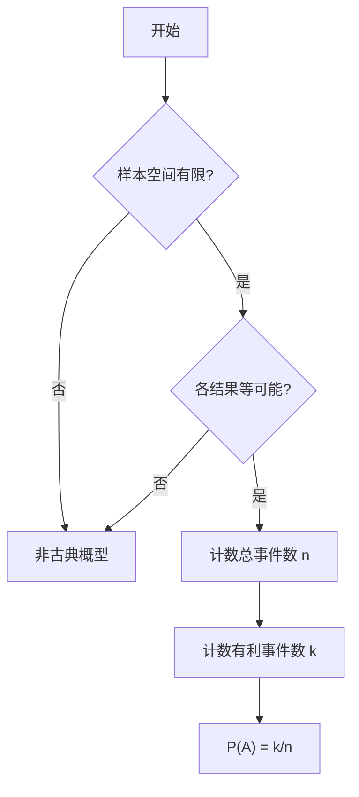

# 古典概型（等可能概型）

## 核心定义与特征

==古典概型（等可能概型）== 是最简单的一类概率模型，其核心在于试验结果的**有限性**与**等可能性**。

> [!IMPORTANT]
> **两个基本特征：**
> 1. **有限性**：样本空间 $S$ 只含有限个基本事件，即 $S = \{e_1, e_2, \dots, e_n\}$；
> 2. **等可能性**：每个基本事件出现的可能性相同，即 $P(e_1) = P(e_2) = \dots = P(e_n) = \frac{1}{n}$。

由此得到**古典概率计算公式**：
$$P(A) = \frac{A \text{ 包含的基本事件数}}{S \text{ 中基本事件总数}} = \frac{k}{n}$$

关键在于：==确保分母（总事件数）与分子（有利事件数）的计数口径一致==。

## 判定流程

## 计算方法与技巧

计数时常用**排列**（有序）或**组合**（无序），选择依据是问题本身是否涉及顺序：

| 模型 | 适用场景 | 总数公式 | 示例 |
|:---|:---|:---|:---|
| **排列** | 书排队、骰子先后掷、编号入座 | $n!$ 或 $A_n^m$ | 10 本书全排列共 $10!$ 种 |
| **组合** | 抽样、选人、摸球（一次性） | $C_n^m$ | 10 人任选 3 人共 $C_{10}^3$ 种 |

> [!TIP]
> **捆绑法**（相邻问题）：将必须相邻的元素视为一个整体参与排列，再乘以内部排列数。
> 
> **对立事件**：当直接计算 $A$ 较复杂时，计算 $P(\bar{A})$，再用 $P(A) = 1 - P(\bar{A})$。

## 典型例题解析

**例**（选自往年考题）：把 10 本不同的书任意放在书架上，求其中指定的 3 本书放在一起的概率。

**思考引导**：这属于排列还是组合问题？如何确保"指定的 3 本"始终相邻？

**解**：
1. **总事件数**：10 本书全排列，$n = 10!$。
2. **有利事件数**：
   - 将指定 3 本书"捆绑"视为 1 个整体，与其余 7 本共 8 个元素排列：$8!$ 种；
   - 捆绑内部 3 本书有顺序：$3!$ 种；
   - 故 $k = 8! \times 3!$。
3. **计算**：
$$P(A) = \frac{8! \times 3!}{10!} = \frac{8! \times 6}{10 \times 9 \times 8!} = \frac{1}{15}$$

## 常见误区警示

> [!WARNING]
> **抽样顺序陷阱**：不放回抽样中，"第二次取到次品"的概率与"第一次取到次品"的概率相同（均为 $\frac{2}{10}$），但**必须在总事件数中考虑顺序**（或用全概率公式分开计算），不能简单认为第二次概率受第一次影响而改变。

> [!CAUTION]
> **伪等可能陷阱**：抛两枚骰子，点数和为 2 至 12 共 11 种结果，但**不是等可能的**（和为 7 有 6 种组合，和为 2 只有 1 种）。此时不能直接用 $\frac{1}{11}$，必须回到 36 个等可能的基本事件 $(i,j)$ 计数。

> [!NOTE]
> **排列 vs 组合不一致**：若分子用组合（不考虑顺序），分母也必须用组合；若分子考虑顺序，分母也必须考虑顺序。混用会导致结果错误。

## 延伸辨析

**几何概型**与古典概型的区别在于样本空间是**无限**的（如区间长度、区域面积），概率通过几何度量（长度/面积/体积）之比计算，而非简单计数。
