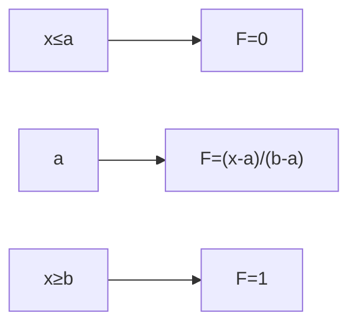

# 均匀分布

## 它是什么

如果随机变量 $X$ 只在区间 $(a,b)$ 里“等可能”地取值，我们就说 $X$ 在 $(a,b)$ 上服从**均匀分布**，记作 $X\sim U(a,b)$。这里的“均匀”不是说每个点概率相等（连续型取单点概率都是 0），而是说：落在 $(a,b)$ 内任意**等长度**的子区间里的概率相同。

想一想：如果整个区间长度是 $b-a$，概率密度总积分要等于 1，那密度该是多少？

## 怎么做：密度与分布函数

由上面一想就知道，密度在 $(a,b)$ 内必须是常数，且高度为区间长度的倒数：

$$f(x)=\begin{cases}\dfrac{1}{b-a}, & a<x<b\\[4pt] 0, & \text{其它}\end{cases}$$

分布函数由定义 $F(x)=\int_{-\infty}^{x}f(t)\,dt$ 积分得到：

$$F(x)=\begin{cases}0,&x\le a\\[4pt]\dfrac{x-a}{b-a},&a<x<b\\[4pt]1,&x\ge b\end{cases}$$

期望和方差也要记牢：

| 分布 | 概率密度 | 期望 $E(X)$ | 方差 $D(X)$ |
|---|---|---|---|
| 均匀分布 $U(a,b)$ | $\frac{1}{b-a},\,x\in(a,b)$ | $\frac{a+b}{2}$ | $\frac{(b-a)^2}{12}$ |

## 为什么需要 & 相近概念区别

均匀分布用来对“在某个范围内随机、且无明显偏向”的连续量建模，例如舍入误差在 $(-0.5,0.5)$ 内、电阻标称值在 $900\Omega\sim1100\Omega$ 之间。

> [!NOTE]
> 和离散的“掷骰子”不同：离散是等可能取各点；连续均匀分布是等可能落进等长子区间，单点概率为零。

## 常见的坑

> [!WARNING]
> 求落入子区间概率时直接用长度比：$P(c<X<d)=\frac{d-c}{b-a}$（要求 $[c,d]\subseteq[a,b]$）；千万别去单点积分。

> [!CAUTION]
> $D(X)=\frac{(b-a)^2}{12}$ 分母是 12 不是 6；若已知期望和方差反推区间，用 $\frac{a+b}{2}$ 与 $\frac{(b-a)^2}{12}$ 联立。

## 一个算对了的例子

设电阻 $R\sim U(900,1100)$，求密度及 $P(950<R<1050)$。

密度：$f_R(r)=\frac{1}{1100-900}=\frac{1}{200},\;900<r<1100$，其它为 0。

概率：

$$P(950<R<1050)=\frac{1050-950}{1100-900}=\frac{100}{200}=0.5$$

> [!TIP]
> 遇到“区间长度比”就是均匀分布最快的解题技巧。

> [!IMPORTANT]
> 核心结论：==$f(x)=\frac{1}{b-a}$ 仅当 $a<x<b$；求概率用区间长度之比；期望是中点、方差是长度平方除 12==。
