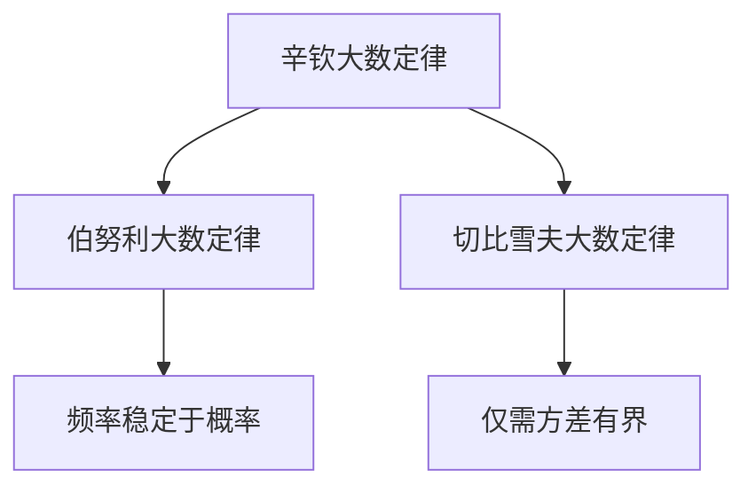

# 大数定律（切比雪夫大数定律、伯努利大数定律、辛钦大数定律）

## 它是什么

在实际问题中，我们经常关心"大量随机现象**总的平均结果**"。单次试验是随机的，但当试验次数 $n$ 很大时，平均值 $\overline{X}=\frac1n\sum_{k=1}^n X_k$ 会"稳定"下来。==大数定律就是研究这种平均结果稳定性的定理==，它把"**频率 / 样本均值**"与"**概率 / 期望**"用极限联系起来。

先要有一个工具：**依概率收敛**。若对任意 $\varepsilon>0$ 都有

$$\lim_{n\to\infty}P\{|Y_n-a|<\varepsilon\}=1,\quad\text{记作 } Y_n\xrightarrow{P}a .$$

为什么需要？它给出了"==用频率估计概率、用样本均值估计期望=="的理论依据——这是后面**矩估计**与**测量取平均值**的基础。

## 三个大数定律

**切比雪夫大数定律**　设 $X_1,\dots,X_n,\dots$ 相互独立，期望 $E(X_k)$ 与方差 $D(X_k)$ 都存在，且方差**一致有界**（$D(X_k)\le C$），则

$$\frac1n\sum_{k=1}^n X_k \xrightarrow{P} \frac1n\sum_{k=1}^n E(X_k).$$

**辛钦（Khinchin）大数定律**　设 $X_1,\dots,X_n,\dots$ ==独立同分布==，$E(X_k)=\mu$ 存在，则对任意 $\varepsilon>0$，

$$\lim_{n\to\infty}P\left\{\left|\frac1n\sum_{k=1}^nX_k-\mu\right|<\varepsilon\right\}=1,\qquad\text{即 }\overline{X}\xrightarrow{P}\mu .$$

**伯努利大数定律**　设 $f_A$ 是 $n$ 次独立重复试验中事件 $A$ 发生的次数，$p=P(A)$，则

$$\lim_{n\to\infty}P\left\{\left|\frac{f_A}{n}-p\right|<\varepsilon\right\}=1 .$$

> [!TIP]
> 伯努利大数定律 ==是辛钦大数定律的重要推论==：把每次试验中 $A$ 是否发生看作 $0\text{-}1$ 变量 $X_k$，则 $f_A/n=\overline X$，$E(X_k)=p$。

> [!NOTE]
> **切比雪夫 vs 辛钦**：切比雪夫要求**方差存在且有界**，但可以**不同分布**；辛钦只要求**同分布且期望存在**（==方差可以不存在==）。两者是"互补"的两条路线。

## 怎么用

看到"证明服从大数定律 / 计算依概率极限"的题，套路是：

> [!TIP]
> **判别 → 套定理 → 写极限**：先看序列是否**独立同分布**（→辛钦）；否则看是否**方差一致有界**（→切比雪夫）；若考事件频率（→伯努利）。结论一般写成 $\overline X_n\xrightarrow{P}\mu$ 或 $\lim P(\cdot)=1$。

## 算一个例子

设 $X_1,\dots,X_n$ 独立同分布于 $U(0,2)$（均匀分布），求 $\overline X_n\xrightarrow{P}?$

由均匀分布 $E(X)=\frac{0+2}{2}=1$。因为独立同分布且期望存在，由**辛钦大数定律**

$$\overline X_n=\frac1n\sum_{k=1}^nX_k\xrightarrow{P}E(X)=1 .$$

## 常见的坑

> [!WARNING]
> - 辛钦大数定律不要求方差存在，但**期望必须存在**；切比雪夫要求**方差一致有界**，仅有 $D(X_k)$ 存在还不够。
> - "依概率收敛"写的是 $P\{|Y_n-a|<\varepsilon\}\to1$，别把不等号方向写反成 $\ge\varepsilon\to1$。
> - 大数定律的结论是**平均值 $\overline X_n$ 收敛**，不是"每个 $X_k$ 收敛"。

> [!CAUTION]
> 大数定律 ≠ 中心极限定理：前者只说 $\overline X_n\xrightarrow{P}\mu$（==稳定性==），后者给出 $\frac{\sum X_k-n\mu}{\sqrt n\sigma}\Rightarrow N(0,1)$ 的**极限分布形状**。
