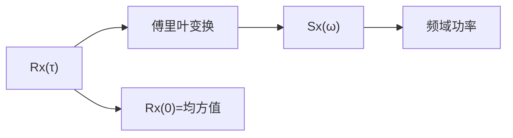

# 平稳随机过程的功率谱密度

## 它是什么：从相关函数到功率谱

平稳随机过程 $X(t)$ 的功率谱密度 $S_X(\omega)$ 描述平均功率在频域的分布。由维纳–辛钦定理，若 $R_X(\tau)=E[X(t)X(t+\tau)]$ 为自相关函数，则

$$
S_X(\omega)=\int_{-\infty}^{+\infty}R_X(\tau)e^{-i\omega\tau}\,d\tau
=2\int_{0}^{+\infty}R_X(\tau)\cos\omega\tau\,d\tau
$$

且由反演得均方值 $E[X^2(t)]=R_X(0)=\frac{1}{2\pi}\int_{-\infty}^{+\infty}S_X(\omega)\,d\omega$，这就是**平均功率**。

## 为什么需要、怎么做

时域里 $R_X(\tau)$ 只刻画时间相差 $\tau$ 的相关性；要问“功率集中在哪些频率上”，必须在频域看 $S_X(\omega)$。做题时通常直接对 $R_X(\tau)$ 用上述积分。

| 相近概念 | 记号 | 区别 |
| --- | --- | --- |
| 自相关函数 | $R_X(\tau)$ | 时域偶函数，$R(0)$ 为均方值 |
| 功率谱密度 | $S_X(\omega)$ | 频域非负偶函数，积分给功率 |
| 互谱密度 | $S_{XY}(\omega)$ | 一般为复数，$S_{YX}=-S_{XY}$ 可见 |

## 常见的坑

> [!WARNING]
> 一定要用课件记号 $S_X(\omega)=2\int_0^{\infty}R_X(\tau)\cos\omega\tau d\tau$，别漏掉系数 2；也别和单边谱密度混为一谈。

> [!CAUTION]
> 若把 $R_X(\tau)$ 直接当 $S_X(\omega)$ 或忘记 $\cos$ 变换，会丢一半系数；考试填空常因此出错。

## 一个算对了的例子

填空题：已知 $R_X(\tau)=\cos\tau$，求 $S_X(\omega)$。

由偶函数性质：

$$
S_X(\omega)=2\int_0^{+\infty}\cos\tau\cos\omega\tau\,d\tau
=\int_0^{+\infty}[\cos((\omega+1)\tau)+\cos((\omega-1)\tau)]\,d\tau
$$

在广义函数意义下 $\int_0^{\infty}\cos k\tau\,d\tau=\pi\delta(k)$，故

$$
S_X(\omega)=\pi[\delta(\omega+1)+\delta(\omega-1)]
$$

即功率集中在 $\omega=\pm1$ 两根谱线上，与 $R_X(\tau)=\cos\tau$ 对应。

> [!IMPORTANT]
> 核心结论：南邮课程中 ==$S_X(\omega)=2\int_0^{\infty}R_X(\tau)\cos\omega\tau d\tau$==，且 ==$E[X^2(t)]=\frac{1}{2\pi}\int S_X(\omega)d\omega$==。

> [!TIP]
> 记忆：先相关函数 $R$，再乘 2 余弦变换；三角函数型 $R$ 得 $\delta$ 谱线，指数型 $e^{-a|\tau|}$ 得 $\frac{2a}{\omega^2+a^2}$（填空 11 答案）。
