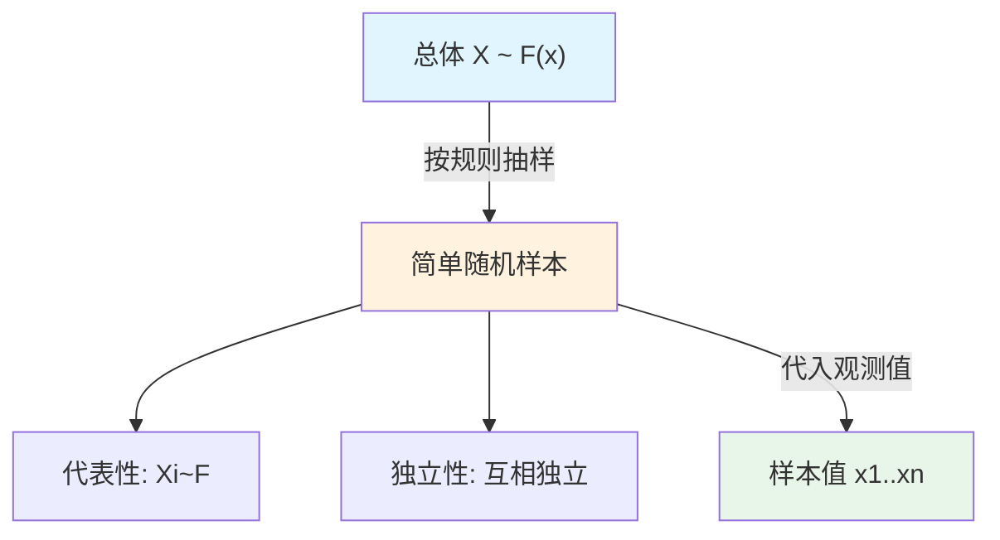

# 总体、个体、简单随机样本与样本容量

---
title: 总体、个体、简单随机样本与样本容量
requires: [概率论与数理统计/随机变量及其分布]
---

在正式学习参数估计和假设检验前，我们需要先弄清楚：我们到底在研究谁？又凭什么去研究它？这就引出了数理统计中最基础的四个概念。

## 总体与个体

想象你要研究南邮仙林校区所有本科生的月生活费。你不可能挨个去问两万人，但这两万人的数据确实客观存在。

- **总体**：试验的全部可能的观察值。在这个例子里，就是“南邮仙林校区所有本科生月生活费的全体”。
- **个体**：总体中的每个可能观察值。即“某一个具体学生的月生活费”。

> [!NOTE]
> 统计研究中，我们关心的往往不是“人”本身，而是人所携带的某项==数量指标==。因此，总体本质上就是一个随机变量 $X$ 及其分布函数 $F(x)$。若包含的个体总数有限则为有限总体；极大时可近似看作无限总体。

## 简单随机样本与样本容量

既然无法获取整个总体的信息，我们就必须从中抽取一部分来“以小见大”。怎么抽才靠谱？如果只抽大一学生，或者只抽认识的人，结果显然有偏差。为了保证推断的科学性，抽样必须满足两个核心条件：

1. **代表性**：抽出的每一个 $X_i$ 都必须与总体 $X$ 具有相同的分布函数 $F$。
2. **独立性**：每次抽取互不影响，即 $X_1, X_2, \cdots, X_n$ 相互独立。

满足这两个条件的样本 $(X_1, X_2, \cdots, X_n)$ 称为从总体 $X$ 中得到的**简单随机样本**（简称样本），而其中个体的个数 $n$ 就是**样本容量**。一次具体抽样后得到的实际数值 $(x_1, x_2, \cdots, x_n)$ 则称为**样本值**。

> [!IMPORTANT]
> 简单随机样本的本质是 $n$ 个独立同分布（i.i.d.）的随机变量。只有基于这种样本做出的统计推断才是有效的。

## 易混概念辨析

| 概念 | 本质属性 | 举例说明 |
| :--- | :--- | :--- |
| **总体** | 理论上的完整分布 | 全校学生寿命分布 $F(x)$ |
| **样本** | 一组随机变量 $(X_1,\dots,X_n)$ | 还没去测，代表一种机制 |
| **样本值** | 一组具体的常数 $(x_1,\dots,x_n)$ | 实际测出的 75岁, 80岁… |
| **统计量** | 不含未知参数的样本函数 | $\bar{X} = \frac{1}{n}\sum X_i$ |

> [!WARNING]
> 不要把“样本”和“样本值”混为一谈！考试填空时，写联合分布律或联合密度函数用的是大写的样本 $(X_1, \dots, X_n)$；而计算具体数值时用的是小写的样本值 $(x_1, \dots, x_n)$。

## 算对一道题

**题目**：设总体 $X$ 服从参数为 $\lambda(\lambda>0)$ 的指数分布，$(X_1, X_2, \cdots, X_n)$ 是来自总体的简单随机样本，求样本 $(X_1, X_2, \cdots, X_n)$ 的联合概率密度。

**解析**：
第一步，写出总体的密度函数：
$$f(x)=\begin{cases}\lambda e^{-\lambda x}, & x>0 \\ 0, & x\leq0\end{cases}$$

第二步，利用简单随机样本的定义。既然是简单随机样本，那么 $X_1, X_2, \cdots, X_n$ 就满足==相互独立且与总体同分布==。因此，每个 $X_i$ 的边缘密度都是 $f(x_i)$。

第三步，由独立性，联合密度等于边缘密度的乘积：
$$f(x_1, x_2, \cdots, x_n) = \prod_{i=1}^{n} f(x_i) = \begin{cases} \lambda^n e^{-\lambda \sum_{i=1}^n x_i}, & x_i > 0\ (i=1,2,\dots,n) \\ 0, & \text{其他} \end{cases}$$

> [!TIP]
> 遇到求样本联合分布的题目，直接默念口诀：“独立同分布，连乘就完事”。只要确认了是“简单随机样本”，立刻拆解为各分量密度的乘积即可。
