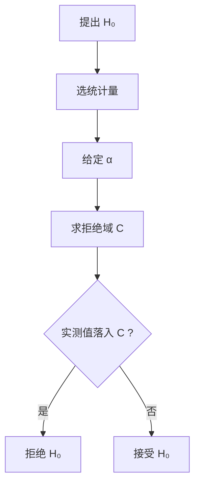

# 显著性水平α与拒绝域

> [!IMPORTANT]
> 显著性水平 $\alpha$ 是“弃真”错误的概率上限，拒绝域 $C$ 是统计量落入后必须否定 $H_0$ 的区域。

## 为什么需要这两个概念

假设检验的本质是用样本推断总体。但样本具有随机性：即使原假设 $H_0$ 为真，极端样本也可能出现，导致我们错误地拒绝它（第一类错误 / 弃真错误）。

问自己一个问题：我们能完全消除这种“以真为假”的错误吗？不能。那该怎么办？——**提前划定一条容忍底线**。这条底线就是显著性水平 $\alpha$，而根据 $\alpha$ 划出的“危险区域”就是拒绝域。

$$P\{\text{当 } H_0 \text{ 为真，拒绝 } H_0\} \leq \alpha$$

常取 $\alpha = 0.1,\; 0.05,\; 0.01$。$\alpha$ 越小，拒绝域越窄，$H_0$ 越难被拒绝。

## 它们分别是什么

- **显著性水平 $\alpha$**：控制犯第一类错误概率的阈值。
- **拒绝域 $C$**：使统计量观测值落入其中的概率恰好等于 $\alpha$ 的区域。边界点称为**临界点**。

决策逻辑如下：

> [!TIP]
> 记忆口诀：**小概率事件原理**。若 $H_0$ 成立，统计量落入 $C$ 是小概率事件；一旦实测值真的落进去了，就认为 $H_0$ 不可信，从而否定它。

## 怎么求拒绝域

按课件步骤，核心操作是：==在 $H_0$ 为真的前提下，利用统计量的已知分布，由 $\alpha$ 反解出临界点==。

以正态总体均值检验为例（方差未知）：

1. **选统计量**：$T = \dfrac{\bar{X} - \mu_0}{S / \sqrt{n}}$，当 $H_0:\mu=\mu_0$ 为真时，$T \sim t(n-1)$。
2. **定类型**：看备择假设 $H_1$。双边检验拒绝域在两侧，单边检验在一侧。
3. **查表求临界点**：例如双边检验 $H_1: \mu \neq \mu_0$，拒绝域为 $|T| \geq t_{\alpha/2}(n-1)$。

## 与相近概念的区别

| 概念 | 含义 | 发生前提 |
| :--- | :--- | :--- |
| 第一类错误（弃真） | 拒绝了实际上成立的 $H_0$ | $H_0$ 为真 |
| 第二类错误（纳伪） | 接受了实际上不成立的 $H_0$ | $H_0$ 为假 |
| 显著性水平 $\alpha$ | 犯第一类错误的**概率上限** | 人为设定 |

> [!WARNING]
> $\alpha$ 只控制弃真错误，不控制纳伪错误！减小 $\alpha$ 会使拒绝域缩小，从而降低弃真风险，但同时会**增大纳伪风险**。

## 常见易错坑

> [!CAUTION]
> 单边还是双边？这是最容易写错拒绝域的地方。$H_1: \mu > \mu_0$ 对应右侧单尾，临界点用 $t_\alpha$ 而非 $t_{\alpha/2}$；$H_1: \mu \neq \mu_0$ 才用双侧。

> [!NOTE]
> 方差已知用 $Z$（标准正态），方差未知用 $T$（$t$ 分布）。选错统计量会导致分布和临界点全错。

## 算对了的例子

**题目**：矿石中某元素含量服从正态分布，均值和方差均未知。测定容量 $n=16$ 的样本，$\bar{X}, S^2$ 为样本均值和方差。在显著性水平 $\alpha$ 下检验 $H_0: \mu = 0.49$，所用检验统计量是什么？

**解析**：
1. 总体正态，方差 $\sigma^2$ 未知，检验单个总体均值，应选用 $t$ 检验。
2. 构造统计量：
$$T = \frac{\bar{X} - \mu_0}{S / \sqrt{n}} = \frac{\bar{X} - 0.49}{S / \sqrt{16}} = \frac{\bar{X} - 0.49}{S / 4}$$
3. 当 $H_0$ 为真时，$T \sim t(15)$。
4. 若备择假设为 $H_1: \mu \neq 0.49$（双边），则拒绝域为 $|T| \geq t_{\alpha/2}(15)$。代入样本数据算出 $T$ 的实测值，若落入该区域则拒绝 $H_0$，否则接受。
