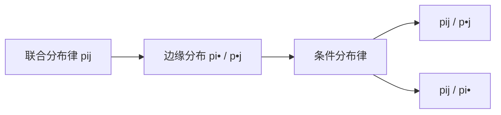
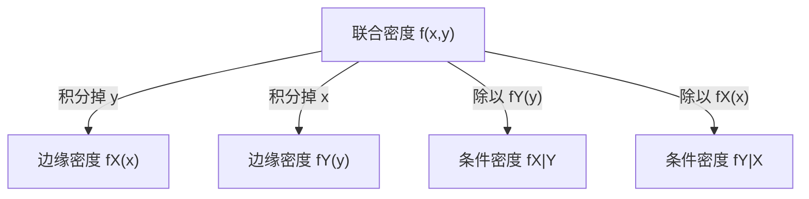

# 条件分布（离散型条件分布律、连续型条件概率密度）

## 条件分布

对二维随机变量 $(X,Y)$，我们常关心：已知其中一个变量取某个值后，另一个变量会如何分布？这就是条件分布。例如已知某同学高数考了 90 分，他的概率统计成绩大致落在什么范围？条件分布正是刻画这类“给定信息后的分布”。

先想一个问题：若 $(X,Y)$ 是离散型，已知 $Y=y_j$ 已经发生，求 $X$ 取 $x_i$ 的概率，能直接用条件概率公式吗？完全可以——因为 $P(Y=y_j)>0$。但若 $(X,Y)$ 是连续型，$P(Y=y)=0$，条件概率公式失效，必须换一条路。

## 离散型条件分布律

设 $(X,Y)$ 的联合分布律为 $p_{ij}=P(X=x_i,Y=y_j)$，边缘分布律为 $p_{i\bullet}=P(X=x_i)$、$p_{\bullet j}=P(Y=y_j)$。

在 $Y=y_j$ 条件下，$X$ 的条件分布律为

$$
P(X=x_i \mid Y=y_j)=\frac{p_{ij}}{p_{\bullet j}},\quad i=1,2,\cdots
$$

在 $X=x_i$ 条件下，$Y$ 的条件分布律为

$$
P(Y=y_j \mid X=x_i)=\frac{p_{ij}}{p_{i\bullet}},\quad j=1,2,\cdots
$$

直观理解：联合概率除以“条件方”的边缘概率，本质就是在条件事件的“总量”里重新归一化。条件分布律的每一行（或每一列）之和必为 $1$。

> [!TIP]
> 记忆口诀：**“联合除以边缘，按条件的方向归一”**。以“$Y=y_j$ 条件下”为例，分母是 $Y$ 的边缘 $p_{\bullet j}$；以“$X=x_i$ 条件下”为例，分母是 $X$ 的边缘 $p_{i\bullet}$。

## 连续型条件概率密度

对连续型 $(X,Y)$，联合密度为 $f(x,y)$，边缘密度为 $f_X(x)$、$f_Y(y)$。由于 $P(Y=y)=0$，不能再用比值定义条件概率，但可以在 $Y=y$ 的“小邻域”内取极限，得到条件概率密度：

$$
f_{X|Y}(x|y)=\frac{f(x,y)}{f_Y(y)},\quad f_Y(y)>0
$$

对称地，

$$
f_{Y|X}(y|x)=\frac{f(x,y)}{f_X(x)},\quad f_X(x)>0
$$

对应的条件分布函数为

$$
F_{X|Y}(x|y)=P(X\le x \mid Y=y)=\int_{-\infty}^{x}\frac{f(t,y)}{f_Y(y)}\,dt
$$

即条件密度从 $-\infty$ 到 $x$ 积分。

> [!IMPORTANT]
> ==连续型条件分布的核心公式：条件密度 = 联合密度 ÷ 边缘密度==。形式与离散型完全对应，区别只是把“概率”换成“概率密度”。

三者的关系可概括为：

## 一个算对的例子

设 $(X,Y)$ 的联合密度为

$$
p(x,y)=\begin{cases}
\dfrac{21}{4}x^2y,&x^2\le y\le1\\[6pt]
0,&\text{其他}
\end{cases}
$$

求 $p(y\mid x)$ 及 $P(Y\ge 0.75 \mid X=0.5)$。

**第一步：求边缘密度 $p_X(x)$。** 注意 $y$ 的范围是 $x^2\le y\le1$，且必有 $-1\le x\le1$。

$$
p_X(x)=\int_{x^2}^{1}\frac{21}{4}x^2y\,dy
=\frac{21}{4}x^2\cdot\frac{1-x^4}{2}
=\frac{21}{8}x^2(1-x^4),\quad -1\le x\le1
$$

**第二步：求条件密度。**

$$
p(y\mid x)=\frac{p(x,y)}{p_X(x)}
=\frac{\frac{21}{4}x^2y}{\frac{21}{8}x^2(1-x^4)}
=\frac{2y}{1-x^4},\quad x^2\le y\le1
$$

**第三步：代入 $x=0.5$ 求条件概率。**

$$
p(y\mid 0.5)=\frac{2y}{1-0.5^4}=\frac{2y}{15/16}=\frac{32y}{15},\quad 0.25\le y\le1
$$

于是

$$
P(Y\ge0.75\mid X=0.5)=\int_{0.75}^{1}\frac{32y}{15}\,dy
=\frac{16}{15}y^2\Big|_{0.75}^{1}
=\frac{16}{15}\left(1-0.5625\right)=\frac{7}{15}
$$

> [!WARNING]
> 求条件密度后，**务必写出条件变量的取值范围**。这里的范围来自联合密度非零区域的“截面”：固定 $x$ 后，$y$ 只能取 $x^2\le y\le1$。漏写范围是常见错误。

## 与边缘分布、独立性的区别

| 概念 | 含义 | 关注点 |
| --- | --- | --- |
| 边缘分布 | 只研究其中一个变量，忽略另一个 | “不看”另一个变量 |
| 条件分布 | 已知一个变量取值后研究另一个 | “给定条件”下的分布 |
| 独立性 | $f(x,y)=f_X(x)f_Y(y)$ 处处成立 | 一个变量对另一个毫无信息 |

当且仅当 $X$ 与 $Y$ 独立时，条件分布等于边缘分布：

$$
f_{X|Y}(x|y)=f_X(x),\qquad f_{Y|X}(y|x)=f_Y(y)
$$

> [!NOTE]
> 条件期望 $E(X\mid Y)$ 来自条件分布：$E(X\mid Y=y)=\int x f_{X|Y}(x|y)\,dx$。它是 $y$ 的函数，再对 $Y$ 求期望，有 ==$E\big[E(X\mid Y)\big]=E(X)$==——这一性质在后续计算中经常使用。
