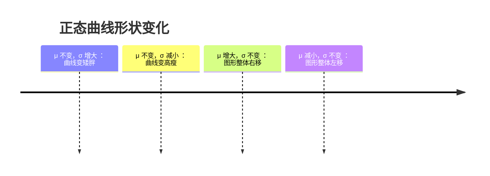

# 正态分布与标准正态分布（含3σ准则）

## 正态分布与标准正态分布

正态分布是概率论中最重要的一种分布。它最早由德莫佛在寻找二项分布的近似公式时发现，后由高斯深入研究，故又称高斯分布。

为什么它如此重要？因为自然界和工程中，若某变量受大量微小、独立的随机因素叠加影响，该变量往往近似服从正态分布。例如测量误差、人的身高体重、产品的尺寸、炮弹的弹落点等，都呈现“中间多、两头少”的钟形特征。

> [!IMPORTANT]
> 正态分布由两个参数唯一确定：均值 $\mu$ 和方差 $\sigma^2$，记为 $X \sim N(\mu, \sigma^2)$。$\mu$ 决定对称轴位置，$\sigma$ 决定曲线的“胖瘦”。

### 概率密度与图形特点

正态分布的密度函数为：
$$f(x) = \frac{1}{\sigma\sqrt{2\pi}} e^{-\frac{(x - \mu)^2}{2\sigma^2}}, \quad -\infty < x < \infty$$

其图形是一条关于 $x = \mu$ 对称的钟形曲线。在 $x = \mu$ 处达到最大值，向两侧逐渐下降，以 $x$ 轴为渐近线。

下面用示意图帮助理解曲线形状与参数变化：

### 标准正态分布与标准化变换

直接计算一般正态分布的概率很繁琐。为解决这个问题，我们引入了**标准正态分布**。

当 $\mu = 0$，$\sigma = 1$ 时，称为标准正态分布，记为 $N(0,1)$。其密度函数习惯用 $\phi(x)$ 表示，分布函数用 $\Phi(x)$ 表示。

> [!TIP]
> 任意正态分布 $X \sim N(\mu, \sigma^2)$ 只需做线性变换 $Z = \frac{X - \mu}{\sigma}$，就有 $Z \sim N(0,1)$。这就是**标准化**。

标准化后，一切概率计算都可转化为查标准正态分布表。
对称性是一个常用的简化技巧：$\Phi(-x) = 1 - \Phi(x)$。

### 3σ 准则

标准化也揭示了一个直观规律：正态随机变量的取值高度集中在 $\mu$ 附近。

> [!IMPORTANT]
> 无论 $\mu$ 和 $\sigma$ 取何值，$X$ 落在区间 $(\mu - 2\sigma, \mu + 2\sigma)$ 内的概率约为 95.4%，落在 $(\mu - 3\sigma, \mu + 3\sigma)$ 内的概率约为 99.7%。

这就是==3σ 准则==。在实际应用中，我们常认为正态随机变量的取值几乎不会超过 $(\mu - 3\sigma, \mu + 3\sigma)$。

### 常见误区与辨析

> [!WARNING]
> **计算概率前务必先标准化。** 直接对原始变量 $X$ 查 $\Phi$ 表是常见的严重错误。必须牢记：$\Phi$ 表是为 $N(0,1)$ 设计的，所以必须先将 $X$ 转化为 $Z = (X-\mu)/\sigma$。

> [!CAUTION]
> 正态分布的密度函数 $f(x)$ 在单点的值并不是概率，连续型随机变量在任一点的概率为 0。若要计算 $X$ 落在某区间的概率，一定要用分布函数值相减。

### 算例：已知均值和概率，求方差

考题常反过来考查：已知某概率和均值，反求 $\sigma$，再计算新概率。

**题目**：假设考生数学成绩服从正态分布，平均成绩 72 分，96 分以上的占 2.3%。求成绩在 60 至 84 分的概率。（已知 $\Phi(1)=0.841$，$\Phi(2)=0.977$）

**解**：

**第一步：建立模型并标准化**
设 $X \sim N(72, \sigma^2)$。由 $P(X \geq 96) = 0.023$ 得：
$P(X < 96) = 0.977$

标准化：$P\left( \frac{X - 72}{\sigma} < \frac{96 - 72}{\sigma} \right) = 0.977$
即 $\Phi\left(\frac{24}{\sigma}\right) = 0.977$

**第二步：反查表求 $\sigma$**
已知 $\Phi(2) = 0.977$，对比得 $\frac{24}{\sigma} = 2$，即 $\sigma = 12$。

**第三步：计算目标概率**
目标概率 $P(60 \leq X \leq 84)$ 标准化为：
$P\left( \frac{60-72}{12} \leq \frac{X-72}{12} \leq \frac{84-72}{12} \right) = P(-1 \leq Z \leq 1)$

利用对称性：
$P(-1 \leq Z \leq 1) = \Phi(1) - \Phi(-1) = \Phi(1) - [1 - \Phi(1)]$
$= 2\Phi(1) - 1 = 2 \times 0.841 - 1 = 0.682$

**结论**：该考生成绩在 60 至 84 分之间的概率约为 0.682。
