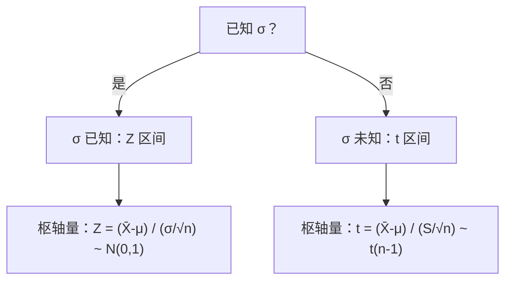

# 单个正态总体均值的区间估计（σ已知用Z，σ未知用t）

## 什么是一个好问题？

你有一个正态总体，想知道它的均值 μ 是多少。但你不能测量全部个体，只能抽 n 个样品算一个样本均值 \$\bar{X}\$。问题就来了：  
这个 \$\bar{X}\$ 离真正的 μ 到底差多远？

==区间估计==做的事，不是猜一个点，而是用样本画出一个范围，让这个范围以预先设定的把握把 μ 兜住。

> [!IMPORTANT]
> **核心定义**  
> 设总体 \$X \sim N(\mu, \sigma^2)\$，\$X_1, \dots, X_n\$ 是样本。对给定的置信水平 \$1-\alpha\$，如果能找到两个统计量 \$\hat{\theta}_1 < \hat{\theta}_2\$，使得  
> \$P(\hat{\theta}_1 < \mu < \hat{\theta}_2) = 1-\alpha\$，  
> 则 \$(\hat{\theta}_1, \hat{\theta}_2)\$ 称为 μ 的置信水平为 \$1-\alpha\$ 的**置信区间**。

---

## 分岔路口：σ 已知还是未知？

这一步直接决定用 Z 还是 t。

> [!TIP]
> **记忆口诀**：  
> “σ 知，Z 值；σ 不知，t 值；t 要自由度 n-1。”

---

## σ 已知：Z 区间

**适用条件**：总体正态，σ 已知，任何 n 都行（中心极限定理下，非正态大样本也可近似）。

**枢轴量**：

$$
Z = \frac{\overline{X} - \mu}{\sigma / \sqrt{n}} \sim N(0,1)
$$

### 双侧置信区间

从 \$P(|Z| < z_{\alpha/2}) = 1-\alpha\$ 反解 μ：

$$
\overline{X} \pm z_{\alpha/2} \cdot \frac{\sigma}{\sqrt{n}}
$$

### 单侧置信上限 / 下限

- 置信**上限**（只关心 μ 最大不超过多少）：  
  \$\ \overline{X} + z_{\alpha} \cdot \frac{\sigma}{\sqrt{n}}\$
- 置信**下限**（只关心 μ 最小不低于多少）：  
  \$\ \overline{X} - z_{\alpha} \cdot \frac{\sigma}{\sqrt{n}}\$

注意单侧用 \$z_{\alpha}\$，双侧用 \$z_{\alpha/2}\$，==别把 α 和 α/2 搞混==。

> [!WARNING]
> **常见的坑**  
> 题目给的是 **方差 1**，你开根号才得到 σ=1。  
> 题目给 \$u_{0.975}=1.96\$，这是 \$z_{0.025}\$ 还是 \$z_{0.975}\$？画个图：右边尾巴 0.025 的分位点是 1.96，所以 \$z_{0.025}=1.96\$，而 \$z_{0.975}=-1.96\$。

---

## σ 未知：t 区间

现实里 σ 几乎不会白送给你，得用样本标准差 S 来估，这就引入了额外的不确定性——用 t 分布来兜底。

**枢轴量**：

$$
t = \frac{\overline{X} - \mu}{S / \sqrt{n}} \sim t(n-1)
$$

自由度是 **n-1**，不是 n。

### 双侧置信区间

$$
\overline{X} \pm t_{\alpha/2}(n-1) \cdot \frac{S}{\sqrt{n}}
$$

### 单侧置信上限

$$
\overline{X} + t_{\alpha}(n-1) \cdot \frac{S}{\sqrt{n}}
$$

---

## 一个算对了的例子

题目：9 个清漆样品干燥时间（小时）：6.0, 5.7, 5.8, 6.5, 7.0, 6.3, 5.6, 6.1, 5.0。总体 \$N(\mu, \sigma^2)\$，σ 未知，求 μ 的 95% 置信区间。

1. 给定 \$1-\alpha = 0.95\$ ⇒ \$\alpha = 0.05\$
2. n=9，自由度 8，查表 \$t_{0.025}(8) = 2.306\$
3. 算样本：\$\overline{x}=6.0\$，\$s\approx 0.5744\$
4. 代入公式：

$$
6.0 \pm 2.306 \times \frac{0.5744}{\sqrt{9}} = 6.0 \pm 0.442
$$

得 **(5.558, 6.442)**。

> [!NOTE]
> **辨析**  
> 同一批数据，σ=0.6 已知时的 Z 区间是 (5.608, 6.392)，比 t 区间窄。  
> 因为 t 分布尾巴更厚，要用更宽的区间才能达到同样的置信水平——这正是“σ 未知”带来的代价。

---

## Z ↔ t 对比一览

| 条件 | 用哪个 | 区间公式 | 查表关键 |
|:---|:---|:---|:---|
| σ 已知 | Z | \$\bar{X} \pm z_{\alpha/2} \cdot \frac{\sigma}{\sqrt{n}}\$ | 标准正态分位数 |
| σ 未知 | t | \$\bar{X} \pm t_{\alpha/2}(n-1) \cdot \frac{S}{\sqrt{n}}\$ | t 分布分位数，自由度 n-1 |
| 单侧上限（σ 已知） | Z | \$\bar{X} + z_{\alpha} \cdot \frac{\sigma}{\sqrt{n}}\$ | 用 α，不是 α/2 |
| 单侧上限（σ 未知） | t | \$\bar{X} + t_{\alpha}(n-1) \cdot \frac{S}{\sqrt{n}}\$ | 用 α，自由度 n-1 |

> [!CAUTION]
> **高危误区**  
> 1. 题目说“方差为 1”，你忘了开方，σ=1 而非 σ=1？不对，σ=√1=1，但换个数（比如方差 4）就容易写 σ=4。  
> 2. 双侧用 \$z_{\alpha/2}\$，单侧用 \$z_{\alpha}\$，==混用是经典扣分点==。  
> 3. t 区间分母是 \$\sqrt{n}\$，不是 n；自由度是 n-1，不是 n。
