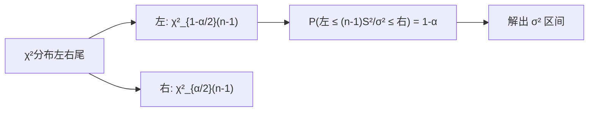

# 单个正态总体方差的区间估计（用χ²分布）

## 单个正态总体方差的区间估计

在学了均值的区间估计之后，一个新的问题自然出现：**如果要估计总体的波动大小，该怎么用样本给出一个区间？**

波动大小在统计中用 ==方差 $\sigma^2$== 衡量。当我们只知道一组样本，而总体均值 $\mu$ 未知时，自然想到用样本方差 $S^2$ 去估计 $\sigma^2$。关键是要找出 $S^2$ 与 $\sigma^2$ 之比的分布，才能构造置信区间。

### 枢轴量的构造

我们从样本方差出发：

$$S^2 = \frac{1}{n-1}\sum_{i=1}^{n}(X_i - \bar{X})^2$$

可以证明：

$$\frac{(n-1)S^2}{\sigma^2} \sim \chi^2(n-1)$$

其中 $\chi^2(n-1)$ 是自由度为 $n-1$ 的卡方分布。这个结论是推导区间的基础——它把未知的 $\sigma^2$ 与已知的样本量 $S^2$ 通过一个已知分布连接起来。

> [!IMPORTANT]
> 核心枢轴量：$\frac{(n-1)S^2}{\sigma^2}$ 服从自由度为 $n-1$ 的卡方分布。自由度减 1 是因为用一个样本均值 $\bar{X}$ 代替了未知的 $\mu$。

### 区间公式怎么来

给定置信水平 $1-\alpha$，我们希望在卡方分布中间截取面积为 $1-\alpha$ 的一段，两端各留出 $\alpha/2$。

查表得两个分位点：

- ==上侧分位点== $\chi_{\alpha/2}^2(n-1)$：右侧面积 $\alpha/2$，数值较大
- ==下侧分位点== $\chi_{1-\alpha/2}^2(n-1)$：右侧面积 $1-\alpha/2$，数值较小

由 $P\left\{\chi_{1-\alpha/2}^2(n-1) \leq \frac{(n-1)S^2}{\sigma^2} \leq \chi_{\alpha/2}^2(n-1)\right\} = 1-\alpha$，解出 $\sigma^2$：

$$\left[\frac{(n-1)S^2}{\chi_{\alpha/2}^2(n-1)},\quad \frac{(n-1)S^2}{\chi_{1-\alpha/2}^2(n-1)}\right]$$

> [!WARNING]
> 常见坑：分母越大值越小，所以 ==$\chi_{\alpha/2}^2$ 对应的反而是**下限**==，$\chi_{1-\alpha/2}^2$ 对应**上限**。初学很容易写反，查表后代入时多留个心。

### 与均值区间估计的关键区别

| 对比项 | 单个正态总体均值 $\mu$（$\sigma^2$ 未知） | 单个正态总体方差 $\sigma^2$（$\mu$ 未知） |
|---|---|---|
| 枢轴量 | $\frac{\bar{X}-\mu}{S/\sqrt{n}}$ | $\frac{(n-1)S^2}{\sigma^2}$ |
| 服从分布 | $t(n-1)$ | $\chi^2(n-1)$ |
| 查表 | $t_{\alpha/2}(n-1)$ 对称 | $\chi_{\alpha/2}^2(n-1)$ 与 $\chi_{1-\alpha/2}^2(n-1)$ 不对称 |
| 区间形状 | $\bar{X} \pm d$ 对称 | 非对称，分母不同 |

> [!TIP]
> 记忆口诀：均值用 $t$ 对称加减，方差用 $\chi^2$ 一大一小分母别反过来。

### 一个算得对的完整例子

某厂生产的零件长度服从正态分布，抽取 $n=10$ 件，测得样本方差 $s^2 = 75.73$。设总体均值未知，求 $\sigma^2$ 的 $95\%$ 置信区间（取 $\alpha = 0.05$）。

**一步步来：**

① 确定自由度和分位点

$n=10$，自由度 $=9$，$\alpha/2 = 0.025$，$1-\alpha/2 = 0.975$

查表：$\chi_{0.025}^2(9) = 19.0$，$\chi_{0.975}^2(9) = 2.7$

② 计算分母

$(n-1)S^2 = 9 \times 75.73 = 681.6$

③ 代入公式

下限 $= \dfrac{681.6}{19.0} = 35.87$

上限 $= \dfrac{681.6}{2.7} = 252.44$

④ 结论

$\sigma^2$ 的 $95\%$ 置信区间为 $(35.87, 252.44)$。

> [!NOTE]
> $\chi^2$ 分布不对称，所以方差的置信区间也不对称——这个区间长度不小，但确实以 $95\%$ 的置信水平覆盖了真实的 $\sigma^2$。当样本容量增大时，区间会变窄。

**填空题的标准写法**

设总体 $X \sim N(\mu,\sigma^2)$，$\mu$ 与 $\sigma^2$ 均未知，样本容量为 $n$，则 $\sigma^2$ 的置信水平为 $1-\alpha$ 的置信区间是：

$$\left[\frac{(n-1)S^2}{\chi_{\alpha/2}^2(n-1)},\quad \frac{(n-1)S^2}{\chi_{1-\alpha/2}^2(n-1)}\right]$$

==上下限的分母不要搞反==：$\alpha/2$ 上侧分位点（大数）放下限，$1-\alpha/2$ 下侧分位点（小数）放上限。
