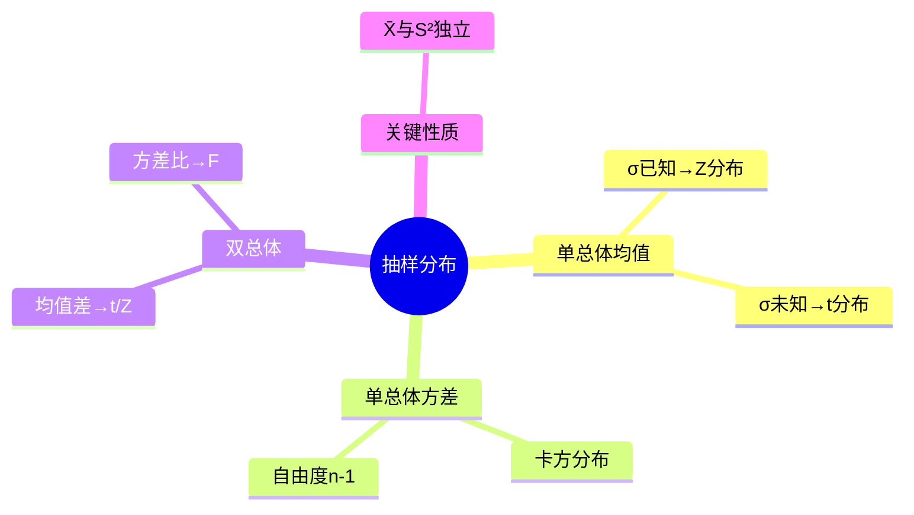

# 正态总体的抽样分布定理（单个总体与两个总体的样本均值、样本方差分布）

## 它是什么与为什么需要

在参数估计与假设检验中，我们常需判断样本统计量（如 $\overline{X}, S^2$）偏离总体参数的程度。若总体服从正态分布 $N(\mu, \sigma^2)$，其样本均值与方差并非任意分布，而是遵循严格的==抽样分布定理==。这些定理是后续构造置信区间和检验统计量的理论基石，没有它们，推断统计就失去了“标尺”。

## 核心定理体系

> [!IMPORTANT]
> 四大定理构成了正态总体推断的完整框架，务必区分适用条件。

| 定理 | 统计量形式 | 分布 | 自由度/条件 |
| :--- | :--- | :--- | :--- |
| 定理一 | $\frac{\overline{X}-\mu}{\sigma/\sqrt{n}}$ | $N(0,1)$ | $\sigma$ 已知 |
| 定理二 | $\frac{(n-1)S^2}{\sigma^2}$ | $\chi^2(n-1)$ | $\overline{X}$ 与 $S^2$ 独立 |
| 定理三 | $\frac{\overline{X}-\mu}{S/\sqrt{n}}$ | $t(n-1)$ | $\sigma$ 未知，用 $S$ 替代 |
| 定理四 | $\frac{S_1^2/\sigma_1^2}{S_2^2/\sigma_2^2}$ | $F(n_1-1, n_2-1)$ | 两独立正态总体 |

## 怎么做：解题关键步骤

面对题目时，先问自己两个问题：**总体是否正态？** **$\sigma$ 是否已知？**

1.  **识别总体与参数**：确认 $X \sim N(\mu, \sigma^2)$，提取 $n, \mu, \sigma^2$。
2.  **选择对应定理**：根据待求概率涉及的统计量和已知条件匹配上表。
3.  **标准化变换**：将原不等式转化为标准分布（$Z, \chi^2, t, F$）的形式。
4.  **查表或计算**：利用分位数或分布函数求解。

> [!TIP]
> 样本方差 $S^2$ 的期望恒为 $\sigma^2$（无偏性），但其方差 $D(S^2) = \frac{2\sigma^4}{n-1}$ 仅在正态总体下成立，切勿滥用。

## 易错坑与辨析

> [!WARNING]
> 定理二中 $\chi^2$ 分布的自由度是 ==$n-1$== 而非 $n$！这是因为 $S^2$ 计算中使用了 $\overline{X}$ 代替 $\mu$，损失了 1 个自由度。

> [!CAUTION]
> 只有当总体严格服从正态分布时，上述四个定理才精确成立。若仅凭中心极限定理近似，则不能使用 $\chi^2$、$t$、$F$ 的精确分布。

## 算对了的例子

以真题填空第9题为例：$X_i \sim N(0,9)$，$n=9$，求 $P(\overline{X}>1)$ 及 $E(S^2)$。

**分析**：$\sigma^2=9$ 已知，故 $\overline{X} \sim N(\mu, \sigma^2/n) = N(0, 1)$。注意此处方差为 $9/9=1$，标准差为 1。

$$
P(\overline{X}>1) = P\left(\frac{\overline{X}-0}{1} > 1\right) = 1 - \Phi(1) = 1 - 0.8413 = 0.1587
$$

对于 $E(S^2)$，由样本方差的无偏性直接得 $E(S^2) = \sigma^2 = 9$。无需复杂推导，这是抽样分布的基本性质。

> [!NOTE]
> 此题同时考查了定理一的标准化与 $S^2$ 的无偏性，是检验基础概念掌握程度的典型题。若误将 $\overline{X}$ 方差当作 9，结果将完全错误。
