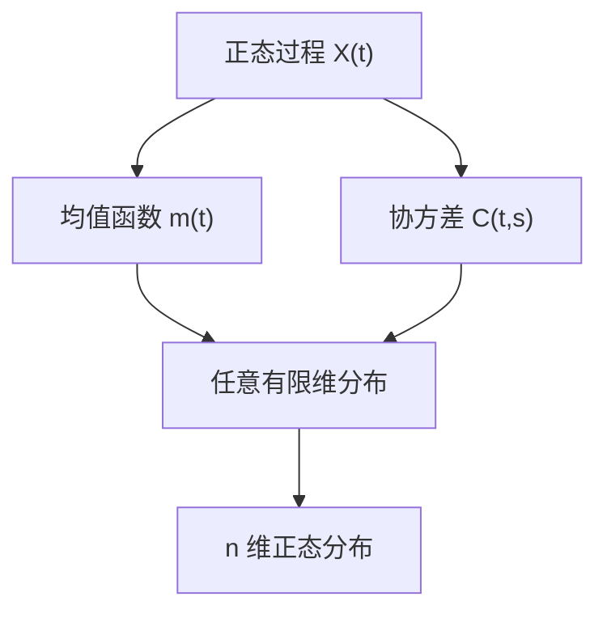

# 正态过程（高斯过程）

概率论与数理统计的课程体系中，前面学习的随机变量与随机过程，大多靠"求均值、算方差"来刻画特征。但有一类过程非常特殊：它的所有统计规律，都可以被**前两阶矩（均值和协方差）完全确定**——这就是本节的主角：正态过程（高斯过程）。

先思考一个问题：一个正态分布 $N(\mu,\sigma^2)$ 由 $\mu$ 和 $\sigma^2$ 两个参数决定，那么一个"取值是正态分布的过程"，应该由什么决定？

## 定义

随机过程 $\{X(t), t\in T\}$ 称为 ==正态过程（高斯过程）==，如果它的**任意有限维分布都是正态分布**。

用数学语言表达：对任意整数 $n\ge 1$ 及任意 $t_1,t_2,\dots,t_n\in T$，随机向量

$$
\big(X(t_1),X(t_2),\dots,X(t_n)\big)
$$

服从 $n$ 维正态分布 $N(\boldsymbol{\mu},\boldsymbol{\Sigma})$，其中

$$
\boldsymbol{\mu}=\big(m_X(t_1),\dots,m_X(t_n)\big)^\top,\quad
\boldsymbol{\Sigma}=\big(C_{XX}(t_i,t_j)\big)_{n\times n}.
$$

> [!IMPORTANT]
> 正态过程的**全部统计特性**完全由 ==均值函数== $m_X(t)$ 和 ==协方差函数== $C_{XX}(t,s)$ 确定，这是它区别于一般随机过程的根本优势。

## 为什么需要它

一般随机过程（如泊松过程的某个变换）知道均值和相关函数**不足以**确定分布；但只要声明"它是正态过程"，一维、二维乃至 $n$ 维分布立刻全部锁定。因此在通信、信号处理、滤波理论里，"高斯假设"能把大量问题化为矩阵运算。

> [!NOTE]
> ==维纳过程是正态过程==（布朗运动）。它是高斯过程最经典的例子，考试常以此作判断题。

## 和相近概念的区别

| 概念 | 要求 | 结论 |
| --- | --- | --- |
| 正态随机变量 | 一维分布为 $N$ | 只管一个时刻 |
| 正态过程 | 任意有限维分布都是 $N$ | 管任意时刻组合 |
| 正交增量过程 | 增量正交 | 不一定是正态 |

> [!WARNING]
> 只验证 $X(t)$ 每个时刻都服从正态分布**不能**判定它是正态过程，必须验证任意 $n$ 个时刻的联合分布。常用技巧：把 $X(t)$ 写成若干独立正态变量的线性组合，由"正态向量的线性变换仍为正态"直接得证。

## 例题（真题改编）

设 $X(t)=A\cos\omega t+B\sin\omega t,\ t\in(-\infty,\infty)$，其中 $A,B$ 独立且均服从 $N(0,\sigma^2)$，$\omega$ 为常数。证明 $X(t)$ 为正态过程并求 $m_X(t)$、$R_{XX}(t_1,t_2)$。

**证**：对任意 $t_1,\dots,t_n$，

$$
X(t_i)=A\cos\omega t_i+B\sin\omega t_i,\quad i=1,\dots,n,
$$

是独立正态变量 $(A,B)$ 的线性变换，故 $(X(t_1),\dots,X(t_n))$ 服从 $n$ 维正态分布，即 $X(t)$ 是正态过程。

由 $E[A]=E[B]=0$，

$$
m_X(t)=E[X(t)]=0.
$$

又 $E[A^2]=E[B^2]=\sigma^2$，$E[AB]=0$，故

$$
R_{XX}(t_1,t_2)=E[X(t_1)X(t_2)]=\sigma^2\big(\cos\omega t_1\cos\omega t_2+\sin\omega t_1\sin\omega t_2\big)=\sigma^2\cos\omega(t_1-t_2).
$$

> [!TIP]
> 真题填空常简化为 $\sigma^2=1$、只保留 $\cos$ 项：此时 $X(t)\sim N\big[0,(\cos\omega t)^2\big]$，$C_{XX}(t_1,t_2)=\cos\omega t_1\cos\omega t_2$。做题先算**均值**，再算**二阶矩**，分布交给"正态过程"定义去填。

## 常见坑

- 忘记检验"任意 $n$ 维"，只写一维分布。
- 把相关函数 $R_{XX}$ 与协方差 $C_{XX}$ 混用：正态过程 $m_X\equiv 0$ 时二者相等。
- 以为"每个时刻正态 $\Rightarrow$ 正态过程"，反例存在。
