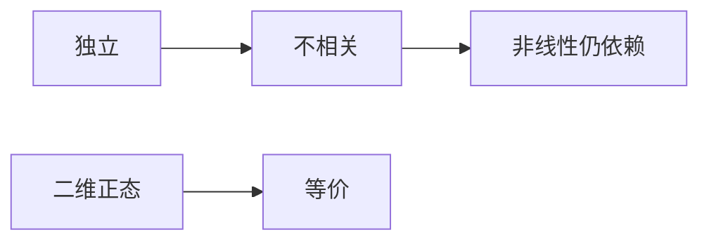

# 相关系数及其性质（不相关的概念）

## 它是什么：协方差与相关系数

前面我们学过一个变量的“波动大小”用方差 $D(X)$ 表示。现在有两个变量 $X,Y$，我们想知道它们是不是“一起变大一起变小”。

协方差定义为：

$$\operatorname{Cov}(X,Y)=E\{[X-E(X)][Y-E(Y)]\}=E(XY)-E(X)E(Y)$$

它衡量 ==两个变量变化的同步性==。但协方差的单位是“$X$ 单位 × $Y$ 单位”，尺度不同不好比，所以再除以标准差，得到相关系数：

$$\rho_{XY}=\frac{\operatorname{Cov}(X,Y)}{\sqrt{D(X)D(Y)}}$$

相关系数范围是 $[-1,1]$。$\rho=0$ 时叫 ==不相关==；$|\rho|=1$ 时叫完全线性相关。

## 为什么需要它：和“独立”有什么区别

先看一个问题：如果我已经知道 $X,Y$ 独立，那它们一定不相关吗？反过来，不相关能推出独立吗？

[!IMPORTANT]
> 核心结论：==独立一定不相关，但不相关不一定独立==。
> 唯一例外：若 $(X,Y)$ 服从二维正态分布，则不相关和独立等价。

不相关只是“没有线性关系”，但还可能有非线性关系。课件里的经典例子就说明了这点。

| | 含义 | 能否互推 |
|---|---|---|
| 独立 | 联合分布等于边缘分布乘积 | 独立 ⇒ 不相关 |
| 不相关 | $\rho_{XY}=0$ | 不相关 ⇏ 独立 |

## 常见坑与性质

[!WARNING]
> 非线性依赖时，$\rho=0$ 不代表没关系。
> 例如 $Y=X^2$ 且 $X$ 对称分布时，$Cov(X,Y)=0$，但明显不独立。

[!TIP]
> 计算相关系数常用两条路：
> 1. 已知 $D(X),D(Y),Cov(X,Y)$ 直接代公式；
> 2. 已知 $D(X),D(Y),D(X-Y)$ 先求 $Cov(X,Y)=\frac{1}{2}[D(X)+D(Y)-D(X-Y)]$。

用 `mermaid` 表示关系：

## 一个算对了的例子

已知 $D(X)=4,\ D(Y)=9,\ D(X-Y)=17$，求 $\rho_{XY}$。

由
$$D(X-Y)=D(X)+D(Y)-2Cov(X,Y)=17$$
得
$$Cov(X,Y)=\frac{1}{2}[4+9-17]=-2$$
所以
$$\rho_{XY}=\frac{-2}{\sqrt{4}\sqrt{9}}=\frac{-2}{2\times3}=-\frac{1}{3}$$

这就是课件“计算 5”的完整做法：先挖出协方差，再套相关系数定义。
