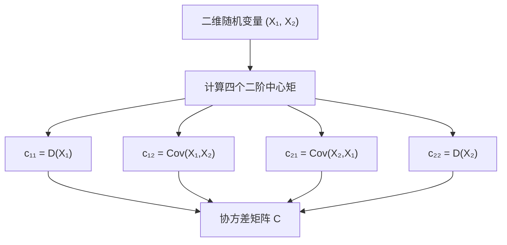

# 矩（原点矩、中心矩）与协方差矩阵

## 从“平均位置”到“离散形状”

前面我们学了期望和方差。期望告诉我们随机变量“大概在哪儿”，方差告诉我们“散得有多开”。但如果想把一个分布刻画得更精细，单靠一阶和二阶信息还不够——这就引出了**矩**的概念。

想象你在物理里描述一个物体的质量分布：一阶矩是重心，二阶中心矩是转动惯量。概率里的矩几乎完全对应这些直觉。

### 三种核心矩

| 类型 | 记号 | 含义 |
| :--- | :--- | :--- |
| **k 阶原点矩** | $E(X^k)$ | 以原点为参考的 $k$ 次方平均 |
| **k 阶中心矩** | $E\bigl[(X-E(X))^k\bigr]$ | 以期望为中心的偏离程度 |
| **$k+l$ 阶混合中心矩** | $E\bigl[(X-E(X))^k(Y-E(Y))^l\bigr]$ | 两个随机变量联合偏离中心的程度 |

`[!IMPORTANT]`
> 期望 $E(X)$ 就是 **一阶原点矩**；  
> 方差 $D(X)$ 就是 **二阶中心矩**；  
> 协方差 $\operatorname{Cov}(X,Y)$ 就是 **二阶混合中心矩**。

### 为什么需要协方差矩阵？

如果只研究一维变量，一个方差就够了。但是一旦涉及二维乃至 $n$ 维，每一对分量之间都可能存在关联。==协方差矩阵就是将这些二阶混合中心矩集中管理的一张“关系表”==。

对于二维随机变量 $(X_1, X_2)$，把四个二阶中心矩排成矩阵：

$$
C = \begin{pmatrix}
c_{11} & c_{12} \\
c_{21} & c_{22}
\end{pmatrix}
$$

其中：
- $c_{11} = D(X_1)$ —— 自己跟自己的协方差就是方差
- $c_{22} = D(X_2)$
- $c_{12} = c_{21} = \operatorname{Cov}(X_1, X_2)$ —— 互协方差

推广到 $n$ 维 $(X_1, X_2, \dots, X_n)$，矩阵的元素是：

$$
c_{ij} = \operatorname{Cov}(X_i, X_j), \quad i, j = 1, 2, \dots, n
$$

`[!TIP]`
> **记忆口诀**：协方差矩阵的第 $i$ 行第 $j$ 列，就是第 $i$ 个和第 $j$ 个随机变量的协方差。对角线全是方差，非对角线是协方差，==矩阵一定是对称的==（$c_{ij} = c_{ji}$），而且非负定。

### 一个算对的例子

已知二维随机变量 $(X, Y)$ 的联合密度：

$$
f(x, y) = \frac{6}{7} \left(x^2 + \frac{xy}{2}\right), \quad 0 \leq x \leq 1, \, 0 \leq y \leq 2
$$

先算需要的各个量：

- 边缘期望通过积分分别求得：$E(X) = \frac{5}{7}$，$E(Y) = \frac{8}{7}$
- $E(XY) = \int_0^1 \int_0^2 \frac{6}{7} xy \left(x^2 + \frac{xy}{2}\right) \, dy \, dx = \frac{17}{21}$
- 协方差：
  
  $\operatorname{Cov}(X, Y) = E(XY) - E(X)E(Y) = \frac{17}{21} - \frac{5}{7} \cdot \frac{8}{7} = -\frac{1}{147}$

- 继续算出 $D(X) = \frac{23}{490}$，$D(Y) = \frac{46}{147}$

于是协方差矩阵为：

$$
C = \begin{pmatrix}
\dfrac{23}{490} & -\dfrac{1}{147} \\
-\dfrac{1}{147} & \dfrac{46}{147}
\end{pmatrix}
$$

`[!WARNING]`
> **常见坑**：算协方差时不要忘记减去 $E(X)E(Y)$ 这一项。另外矩阵的右下角一定是 $D(Y)$ 而不是又写一遍 $D(X)$，对角元必须对应各自的方差。

### 协方差矩阵有什么用？

一个直接应用就是**写多维正态分布的概率密度**。比如二维正态的密度非常冗长，但引入协方差矩阵 $C$ 和均值向量 $\mu$ 之后，可以简洁地写成矩阵形式：

$$
f(\boldsymbol{x}) = \frac{1}{(2\pi)^{n/2} |C|^{1/2}} \exp\left[ -\frac{1}{2} (\boldsymbol{x} - \boldsymbol{\mu})^T C^{-1} (\boldsymbol{x} - \boldsymbol{\mu}) \right]
$$

通过协方差矩阵，就能把一维方差的思路完整迁移到多维情形，统一研究各分量的离散程度和分量间的相关关系。
