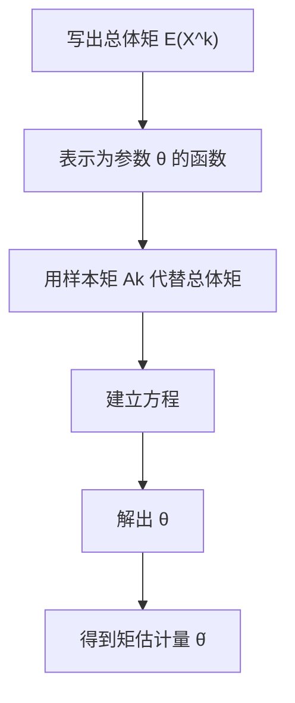

# 矩估计法
### 它是什么

参数估计的目标是：已知总体的分布形式，但其中含有未知参数 $\theta$，希望通过样本 $X_1, X_2, \cdots, X_n$ 来估计 $\theta$。

矩估计法的核心思想非常朴素：

> [!IMPORTANT]
> ==用样本矩代替总体矩==，从而解出未知参数的估计值。

总体矩是理论上的期望，比如：

- 一阶原点矩：$E(X)$
- 二阶原点矩：$E(X^2)$

对应的样本矩是：

- 一阶样本原点矩：$\overline{X} = \dfrac{1}{n}\sum_{i=1}^{n}X_i$
- 二阶样本原点矩：$A_2 = \dfrac{1}{n}\sum_{i=1}^{n}X_i^2$

“代替”之后得到一个含未知参数的方程，解方程即得矩估计量。

### 为什么需要

在统计问题中，最大似然估计法通常具有更好的理论性质（如渐近有效性），但有时似然函数求导困难、计算复杂甚至无解析解。矩估计法计算简单、直观易懂，在==最大似然法不方便使用==时是很好的替代选择。

### 怎么做

矩估计法的步骤可以梳理成以下流程：

具体按“参数个数”分两种情况：

1. **一个未知参数**：只需一个方程
   $$
   E(X) = \overline{X}
   $$

2. **两个未知参数**：需要两个方程
   $$
   \begin{cases}
   E(X) = \overline{X} \\[4pt]
   E(X^2) = \dfrac{1}{n}\sum_{i=1}^{n}X_i^2
   \end{cases}
   $$

> [!TIP]
> 多个参数时按同样模式：需要估计 $k$ 个参数，就取前 $k$ 阶原点矩建立 $k$ 个方程。

### 一个算对了的例子

> 设总体 $X$ 的密度函数为
> $$
> p(x; \theta)=
> \begin{cases}
> \dfrac{1}{\theta}e^{-x/\theta}, & x>0 \\[6pt]
> 0, & x \leq 0
> \end{cases}
> $$
> 其中 $\theta > 0$，求 $\theta$ 的矩估计量。

**第一步：求总体一阶矩**

该分布是指数分布 $\text{Exp}(1/\theta)$，直接有

$$
E(X) = \theta
$$

若不熟悉结论，也可以积分：

$$
E(X) = \int_{0}^{\infty} x \cdot \frac{1}{\theta}e^{-x/\theta}\,dx = \theta
$$

**第二步：用样本矩代替总体矩**

$$
\theta = E(X) \approx \overline{X}
$$

**第三步：写出矩估计量**

$$
\hat{\theta} = \overline{X} = \frac{1}{n}\sum_{i=1}^{n}X_i
$$

验证：指数分布的均值确实是 $\theta$，而样本均值是均值的自然估计，结果合理。

### 与最大似然估计的区别

| 比较项 | 矩估计法 | 最大似然估计法 |
| --- | --- | --- |
| 核心思想 | 样本矩 = 总体矩 | 使样本出现概率最大 |
| 计算难度 | 通常简单 | 可能复杂 |
| 理论性质 | 一般（有时偏弱） | 通常更优（渐近有效） |
| 使用顺序 | 常用作补充 | 统计问题中优先使用 |

### 常见的坑

> [!WARNING]
> 矩估计量的形式可能不唯一。

比如当总体分布有两个参数时，既可以用一阶矩与二阶中心矩（即方差）建立方程：

$$
E(X) = \overline{X}, \quad D(X) = S_n^2
$$

也可以用一阶矩与二阶原点矩：

$$
E(X) = \overline{X}, \quad E(X^2) = A_2
$$

两种做法得到的估计量有时相同，有时不同。考试时按题目要求的形式建立方程即可。

> [!CAUTION]
> 矩估计求的是**估计量**（样本的函数），而不是一个具体的数值。写答案时要写成 $\hat{\theta} = \overline{X}$，而不是代入某组样本数据算出某个数。

再回头看这道题：

> 设 $X$ 的密度函数为 $p(x)=\begin{cases}e^{-(x-\theta)}, & x \geq \theta \\ 0, & \text{其它}\end{cases}$，求 $\theta$ 的矩估计量。

这个分布实际上是“指数分布右移 $\theta$ 个单位”，所以

$$
E(X) = \theta + 1
$$

令 $E(X) = \overline{X}$，解得

$$
\hat{\theta} = \overline{X} - 1
$$

这就是未知参数 $\theta$ 的矩估计量。
