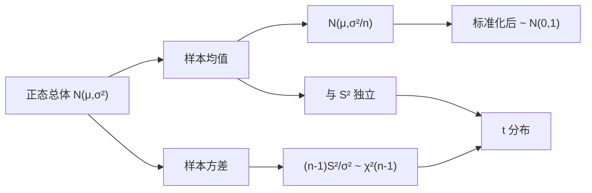

# 统计量的概念及常用统计量（样本均值、样本方差、样本矩）

## 统计量的概念

从一个简单问题开始：从某年级学生中抽 10 人记录身高，你拿到 10 个数。这 10 个数本身是**样本**，但真正有用的往往不是这串原始数据，而是由它们算出来的**概括性数值**——比如平均身高、身高的分散程度。

抽象地说：设 $X_1, X_2, \cdots, X_n$ 是来自总体 $X$ 的样本。若函数

$$
T = g(X_1, X_2, \cdots, X_n)
$$

**不含有未知参数**，则称 $T$ 为一个**统计量**。统计量只依赖样本，一旦样本观测值确定，统计量的值就完全确定。

> [!IMPORTANT]
> 统计量是样本的函数，且==不允许含有未知参数==。例如 $\frac{\bar X - \mu}{\sigma / \sqrt n}$ 含未知参数 $\mu$ 和 $\sigma$，它不是统计量；而 $\bar X$、$S^2$ 都是统计量。

统计量的作用在于：总体的真实分布或参数往往未知，我们只能通过样本构造合适的统计量来**估计、检验或推断**总体的性质。统计量是我们从"样本"通往"总体结论"的桥梁。

---

## 常用统计量

设 $X_1, X_2, \cdots, X_n$ 是来自总体 $X$ 的样本。

### 样本均值

$$
\bar X = \frac{1}{n}\sum_{i=1}^{n} X_i
$$

它是总体均值 $E(X) = \mu$ 最自然的估计量。若总体 $X \sim N(\mu, \sigma^2)$，则

$$
\bar X \sim N\left(\mu, \frac{\sigma^2}{n}\right)
$$

这说明样本量 $n$ 越大，$\bar X$ 围绕 $\mu$ 波动越小。

### 样本方差与样本标准差

$$
S^2 = \frac{1}{n-1}\sum_{i=1}^{n}(X_i - \bar X)^2, \qquad S = \sqrt{S^2}
$$

> [!WARNING]
> 分母是 $n-1$ 而不是 $n$，这是为了==保证 $E(S^2) = \sigma^2$==，即样本方差是总体方差的无偏估计。用 $n$ 作分母的 $\frac{1}{n}\sum_{i=1}^{n}(X_i - \bar X)^2$ 会系统性偏小。

$S^2$ 反映了总体方差的信息：它衡量样本数据围绕样本均值的离散程度。

### 样本 $k$ 阶原点矩

$$
A_k = \frac{1}{n}\sum_{i=1}^{n} X_i^{k}, \qquad k = 1, 2, \cdots
$$

显然 $A_1 = \bar X$。

### 样本 $k$ 阶中心矩

$$
B_k = \frac{1}{n}\sum_{i=1}^{n}(X_i - \bar X)^{k}, \qquad k = 1, 2, \cdots
$$

显然 $B_2 = \frac{n-1}{n}S^2$。注意原点矩分母是 $n$、中心矩分母也是 $n$，而样本方差 $S^2$ 分母特殊地取 $n-1$，这是矩与 $S^2$ 记号的常见混淆点。

---

## 正态总体的抽样分布

这些分布是后续区间估计与假设检验的理论基础。

四条核心结论：

| 统计量 | 分布 |
|:--:|:--:|
| $\bar X$ | $N(\mu, \sigma^2/n)$ |
| $\dfrac{\bar X - \mu}{\sigma / \sqrt n}$ | $N(0, 1)$ |
| $\dfrac{(n-1)S^2}{\sigma^2} = \dfrac{1}{\sigma^2}\sum_{i=1}^{n}(X_i - \bar X)^2$ | $\chi^2(n-1)$ |
| $\dfrac{\bar X - \mu}{S / \sqrt n}$ | $t(n-1)$ |

其中第三个结论的关键在于：虽然用 $\bar X$ 代替了 $\mu$，自由度损失 1，因此是 $\chi^2(n-1)$ 而非 $\chi^2(n)$。

---

## 一个算对了的例子

自总体 $X$ 抽得容量为 5 的样本：$8, 2, 5, 3, 7$，求样本均值、样本方差和经验分布函数。

**样本均值：**

$$
\bar X = \frac{8+2+5+3+7}{5} = 5
$$

**样本方差：**

$$
\begin{aligned}
S^2 &= \frac{1}{5-1}\left[(8-5)^2 + (2-5)^2 + (5-5)^2 + (3-5)^2 + (7-5)^2\right] \\
&= \frac{1}{4}(9+9+0+4+4) = \frac{26}{4} = 6.5
\end{aligned}
$$

**经验分布函数：** 先排序为 $2, 3, 5, 7, 8$，则

$$
F_s(x) = \begin{cases}
0, & x < 2 \\
1/5, & 2 \leq x < 3 \\
2/5, & 3 \leq x < 5 \\
3/5, & 5 \leq x < 7 \\
4/5, & 7 \leq x < 8 \\
1, & x \geq 8
\end{cases}
$$

> [!TIP]
> 计算样本方差时，先求 $\bar X$，再逐项求偏差平方和，最后除以 $n-1$。容易出错的地方是分母忘记减 1 或忘记先求均值。
