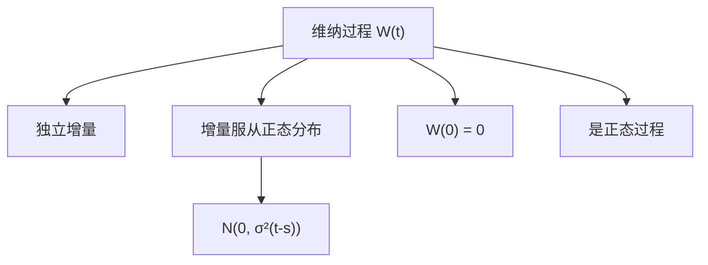

# 维纳过程（布朗运动）

## 维纳过程是什么

维纳过程（Wiener process）又叫**布朗运动**，是一类重要的**独立增量过程**。它常用于描述布朗运动、通信中的电流热噪声等物理现象。

> [!IMPORTANT]
> 维纳过程是**二阶矩过程** $\{W(t), t \geq 0\}$，满足以下三条：
> 1. 具有独立增量；
> 2. 对任意 $t > s \geq 0$，增量 $W(t) - W(s) \sim N(0, \sigma^2(t - s))$；
> 3. $W(0) = 0$。

其中 $\sigma > 0$ 为参数。当 $\sigma = 1$ 时称为**标准维纳过程**。

## 为什么需要它

在通信系统中，电子器件内部载流子的随机热运动会产生**热噪声**。这种噪声在任意时刻的取值服从正态分布，且不同时段的扰动相互独立。维纳过程正是这类"连续累积的随机扰动"的数学模型——把无穷多独立的小扰动累加起来，就得到一条连续但处处"毛糙"的样本曲线。

## 统计特性怎么推

由定义可直接求出数字特征：

**均值函数：**
$$E[W(t)] = E[W(t) - W(0)] = 0$$

**方差函数：**
$$D_W(t) = E[W^2(t)] = \sigma^2 t$$

**自协方差函数：** 对 $s \leq t$，利用增量独立性，
$$
\begin{aligned}
C_W(s,t) &= E[W(s)W(t)] \\
&= E[W(s)(W(t)-W(s))] + E[W^2(s)] \\
&= E[W(s)]E[W(t)-W(s)] + \sigma^2 s \\
&= \sigma^2 s
\end{aligned}
$$

> [!TIP]
> 统一写成 $C_W(s,t) = R_W(s,t) = \sigma^2 \min\{s,t\}$。因为均值为零，所以自相关函数与协方差函数相等。

## 与泊松过程的对比

两者都是独立增量过程，但增量分布不同：

| 特性 | 泊松过程 | 维纳过程 |
|------|---------|---------|
| 增量分布 | 泊松分布 $\pi(\lambda(t-s))$ | 正态分布 $N(0,\sigma^2(t-s))$ |
| 均值函数 | $\lambda t$ | $0$ |
| 方差函数 | $\lambda t$ | $\sigma^2 t$ |
| 协方差函数 | $\lambda\min\{s,t\}$ | $\sigma^2\min\{s,t\}$ |
| 样本轨道 | 阶梯状跳跃 | 连续但不可微 |

> [!WARNING]
> 泊松过程的均值和方差都是 $\lambda t$；维纳过程均值为 $0$、方差为 $\sigma^2 t$。不要把 $\sigma^2$ 的位置写错。

## 常见考点与易错点

> [!CAUTION]
> 维纳过程是**正态过程**——任意有限维分布都是正态分布。这是由独立增量+正态增量直接推出的，填空题常考。

> [!NOTE]
> 有的教材把参数为 $\sigma^2$ 的维纳过程记作 $X(t) = \sigma W(t)$，其中 $W(t)$ 是标准维纳过程。此时 $C_X(s,t) = \sigma^2\min\{s,t\}$，不要漏掉 $\sigma^2$。

## 例题

**题目：** 设 $\{X(t), t \geq 0\}$ 是参数为 $\sigma^2$ 的维纳过程，求其协方差函数 $C_X(s,t)$。

**解：** 由维纳过程的定义，对任意 $s,t \geq 0$，

当 $s \leq t$ 时，把 $X(t)$ 拆成 $X(s)$ 与独立增量 $X(t)-X(s)$ 之和：

$$
\begin{aligned}
C_X(s,t) &= E[X(s)X(t)] - E[X(s)]E[X(t)] \\
&= E[X(s)(X(t)-X(s))] + E[X^2(s)] - 0 \\
&= E[X(s)]\cdot E[X(t)-X(s)] + D_X(s) \\
&= 0 + \sigma^2 s
\end{aligned}
$$

同理当 $t < s$ 时 $C_X(s,t) = \sigma^2 t$。故

$$C_X(s,t) = \sigma^2\min\{s,t\}$$

这就是标准答案。
