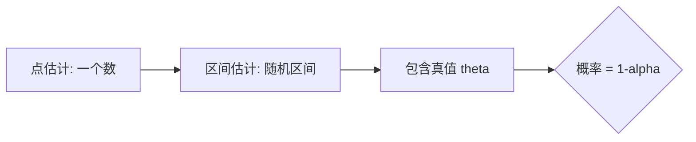

# 置信区间与置信水平（置信度）的概念

## 它是什么：区间估计与置信区间

第6章我们学了总体、样本、统计量、三大抽样分布，目的就是给第7章“参数估计”铺路。点估计只给一个数（如 $\bar X$ 估 $\mu$），但没说“有多准”。于是引入**区间估计**。

> [!IMPORTANT]
> 设总体分布含未知参数 $\theta$，由样本 $X_1,\dots,X_n$ 得到两个统计量 $\underline\theta,\overline\theta$，若
> $$P\{\underline\theta<\theta<\overline\theta\}=1-\alpha$$
> 则称随机区间 $(\underline\theta,\overline\theta)$ 是 $\theta$ 的**置信水平（置信度）为 $1-\alpha$ 的置信区间**；$\underline\theta,\overline\theta$ 叫置信下限、上限。

## 为什么需要：可信度与精度的权衡

$1-\alpha$ 是“区间套住真值 $\theta$”的**可靠程度**。$\alpha$ 很小（如 0.05、0.10），$1-\alpha$ 常取 0.95、0.90。

> [!NOTE]
> 样本量 $n$ 固定时：$1-\alpha$ 越大 → 区间越长 → ==可信程度增大，估计精度降低==。
> $1-\alpha$ 固定时：$n$ 越大 → 区间越短 → 精度提高。

这也是考试常考的辨析：别把“区间长度”和“置信水平”搞反。

## 怎么做：三步通用流程

1. 找 $\theta$ 的好点估计（如 $\bar X$ 估 $\mu$）；
2. 构造含 $\theta$ 与样本的枢轴量，其分布已知（正态用 $Z/U$、方差未知用 $t$、方差用 $\chi^2$）；
3. 给定 $1-\alpha$ 定分位数 $a,b$，变形出 $\underline\theta<\theta<\overline\theta$。

比如 $\sigma^2$ 已知时，$Z=\dfrac{\bar X-\mu}{\sigma/\sqrt n}\sim N(0,1)$，取 $z_{\alpha/2}$ 得分位，得到核心公式：
==$$\left(\bar X\pm \frac{\sigma}{\sqrt n}z_{\alpha/2}\right)$$==
长度 $L=2\frac{\sigma}{\sqrt n}z_{\alpha/2}$。

$\sigma^2$ 未知时用 $S$ 替 $\sigma$ 且分布变 $t(n-1)$：
$$\left(\bar X\pm\frac{S}{\sqrt n}t_{\alpha/2}(n-1)\right)$$

## 相近概念与易错坑

| 项目 | 双侧置信区间 | 单侧置信下限 | 单侧置信上限 |
|---|---|---|---|
| 形式 | $(\underline\theta,\overline\theta)$ | $(\underline\theta,+\infty)$ | $(-\infty,\overline\theta)$ |
| 关心 | 上下都估 | 寿命“至少多少” | 杂质“至多多少” |

> [!WARNING]
> 常见坑：把 $z_{\alpha/2}$ 写成 $z_{\alpha}$；$\sigma$ 未知还套 $Z$ 公式；单侧时只看一侧分位却仍用 $\alpha/2$。

## 算对了的例子

取自测验：$\sigma$ 已知，$1-\alpha=0.95$，$\alpha=0.05$，$\bar X=13$，$\sigma=0.3$，$n=4$。

1. $\Phi(z)=1-\alpha/2=0.975$，查表 $z_{0.025}=1.96$；
2. 误差限 $d=1.96\times\frac{0.3}{\sqrt4}=1.96\times0.15=0.294\approx0.29$；
3. 区间 $(13-0.29,\ 13+0.29)=(12.71,\ 13.29)$。

> [!TIP]
> 记：==已知 $\sigma$ 用 $z$，未知 $\sigma$ 用 $t$，方差用 $\chi^2$，置信度决定分位尾概率==。
