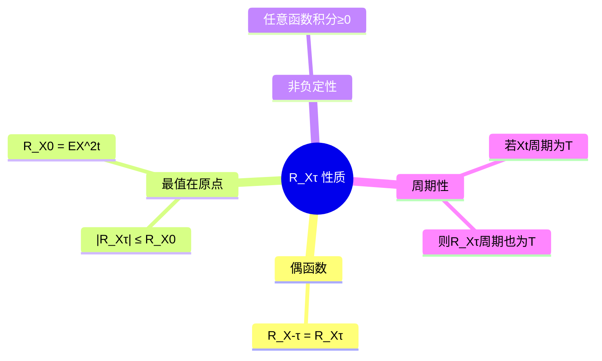

# 自相关函数与自协方差函数
在研究随机过程时，我们常常需要描述**不同时刻**的随机变量之间有多大的关联。自相关函数与自协方差函数就是刻画这种关联的核心工具。

### 是什么

设 $X(t)$ 是一个随机过程。对于任意两个时刻 $t_1, t_2 \in T$：

- **自相关函数**是 $X(t_1)$ 与 $X(t_2)$ 的 ==二阶原点混合矩==：
  $$R_{XX}(t_1, t_2) = E[X(t_1)X(t_2)]$$

- **自协方差函数**是 $X(t_1)$ 与 $X(t_2)$ 的 ==二阶混合中心矩==：
  $$C_{XX}(t_1, t_2) = \operatorname{Cov}[X(t_1), X(t_2)] = E\Big[(X(t_1)-\mu_X(t_1))(X(t_2)-\mu_X(t_2))\Big]$$

两者之间的关系与普通随机变量完全一致：
$$C_{XX}(t_1, t_2) = R_{XX}(t_1, t_2) - \mu_X(t_1)\mu_X(t_2)$$

> [!IMPORTANT]
> 当一个随机过程满足 $\forall t \in T,\; E[X^2(t)] < \infty$ 时，称它为**二阶矩过程**。二阶矩过程的自相关函数一定存在，这是我们后续一切讨论的前提。

### 为什么需要

你可能会问：这两个函数到底能告诉我们什么？

- **自相关函数**衡量两个时刻信号的“共变强度”。取值大，说明 $X(t_1)$ 与 $X(t_2)$ 倾向于同向变化。
- **自协方差函数**在此基础上减去了均值的影响，更纯粹地反映波动之间的关联。

> [!TIP]
> 记忆口诀：相关看“乘积的均值”，协方差看“去均值后乘积的均值”。均值恒为零时，二者相等。

### 两个过程的互相关与互协方差

当涉及两个不同的随机过程 $X(t)$ 与 $Y(t)$ 时，类似地有：

| 概念 | 定义 |
|------|------|
| 互相关函数 | $R_{XY}(t_1, t_2) = E[X(t_1)Y(t_2)]$ |
| 互协方差函数 | $C_{XY}(t_1, t_2) = \operatorname{Cov}[X(t_1), Y(t_2)]$ |

随机过程之和的自相关函数遵循展开规则：
$$Z(t) = X(t) + Y(t) \;\Longrightarrow\; R_{ZZ} = R_{XX} + R_{YY} + R_{XY} + R_{YX}$$

这正是“和的平方展开”在随机意义上的体现。

> [!IMPORTANT]
> **独立**与**不相关**的区别是关键考点：
> - **相互独立**：任意两组不同时刻的有限维分布均独立（非常强的条件）。
> - **不相关**：只需对任意 $t_1, t_2$ 满足 $C_{XY}(t_1, t_2) = 0$。
>
> 独立必定不相关，反之一般不成立。

### 平稳过程下的简化

若过程是宽平稳的，自相关函数就==仅与时间差 $\tau$ 有关==，记作 $R_X(\tau)$，并具备以下性质：

这些性质在通信系统的功率谱分析中极为重要。

### 一个算对了的例子

**题目**：设平稳过程 $X(t)$ 的自相关函数 $R_X(\tau) = 25 + \dfrac{4}{1+6\tau^2}$，求该过程的均值与均方值。

**解**：

平稳过程中，均值 $\mu_X$ 满足：
$$\mu_X^2 = \lim_{|\tau| \to \infty} R_X(\tau) = 25 \quad\Longrightarrow\quad \mu_X = \pm 5$$

均方值由 $\tau=0$ 时的自相关函数给出：
$$E[X^2(t)] = R_X(0) = 25 + \frac{4}{1+0} = 29$$

> [!WARNING]
> 常见坑：用 $R_X(0)$ 求均方值时忘记 $R_X(0)=E[X^2(t)]$ 本身含均值的平方。方差需用 $\operatorname{Var}[X(t)] = R_X(0) - \mu_X^2 = 29-25=4$ 另行计算，切勿混淆。

### 习题中出现的特例：维纳过程

课件中出现的公式 $C_W(s, t) = R_W(s, t) = \sigma^2 \min\{s, t\}$ 是**维纳过程**（布朗运动）的自协方差函数。因为维纳过程的均值为零，所以它的自相关函数与自协方差函数相等，结果为两时刻中较小者乘以 $\sigma^2$。这是一个非平稳过程的典型例子——相关结构依赖于绝对时刻而非时间差。
