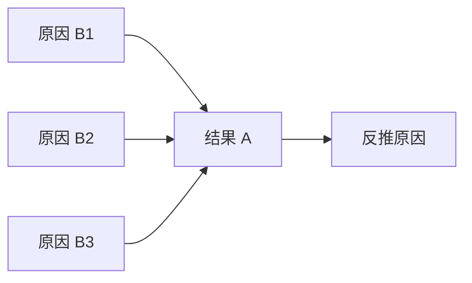

# 贝叶斯公式（逆概率公式）

## 贝叶斯公式是什么

全概率公式解决的是“由原因推结果”：已知各种原因发生的概率，求结果 $A$ 发生的概率。贝叶斯公式则反过来：==结果 $A$ 已经发生，追问它最可能来自哪个原因==，因此也叫逆概率公式。

设 $B_1,B_2,\ldots,B_n$ 是样本空间 $S$ 的一个划分，即各事件两两互不相容，且 $\bigcup_{i=1}^{n}B_i=S$。若 $P(B_i)>0$，$P(A)>0$，则

$$
P(B_j\mid A)
=\frac{P(AB_j)}{P(A)}
=\frac{P(B_j)P(A\mid B_j)}
{\displaystyle\sum_{i=1}^{n}P(B_i)P(A\mid B_i)}.
$$

其中：

- $P(B_j)$：**先验概率**，即观察结果 $A$ 前，对原因 $B_j$ 的认识；
- $P(A\mid B_j)$：在原因 $B_j$ 下出现结果 $A$ 的概率；
- $P(B_j\mid A)$：**后验概率**，即看到结果后，对原因概率的修正。

> [!IMPORTANT]
> 贝叶斯公式的分子是 $P(B_j)P(A\mid B_j)$，分母就是全概率公式算出的 $P(A)$。它不是一套全新的计算方法，而是“条件概率＋乘法公式＋全概率公式”的组合。

## 什么时候使用

把试验看成两步：第一步确定属于哪一种情况，第二步产生观察结果。

- 求第二步某事件 $A$ 的概率：用全概率公式；
- 已知第二步的 $A$ 发生，反求第一步某事件 $B_j$ 的概率：用贝叶斯公式。

例如，知道一个人是色盲，求此人是女性的概率，目标就是 $P(\text{女性}\mid\text{色盲})$，而不是题中直接给出的 $P(\text{色盲}\mid\text{女性})$。

## 与相近公式的区别

| 公式 | 已知与所求 | 典型作用 |
|---|---|---|
| 乘法公式 | 求 $P(AB_j)$ | 计算“某原因且出现结果”的概率 |
| 全概率公式 | 由各 $B_i$ 求 $P(A)$ | 汇总所有原因，由因求果 |
| 贝叶斯公式 | 已知 $A$，求 $P(B_j\mid A)$ | 比较各原因贡献，由果溯因 |

贝叶斯公式中，各原因对结果 $A$ 的“贡献”为 $P(B_i)P(A\mid B_i)$；所求概率就是第 $j$ 个原因的贡献占总贡献的比例。

## 一个算对的例子

男女人数相等，男子色盲率为 $5\%$，女子色盲率为 $0.25\%$。随机选一人，已知此人是色盲，求此人是女性的概率。

设 $A$ 表示“此人是色盲”，$B$ 表示“此人是男性”，则 $\overline B$ 表示“此人是女性”。已知

$$
P(B)=P(\overline B)=0.5,\qquad
P(A\mid B)=0.05,\qquad
P(A\mid\overline B)=0.0025.
$$

先用全概率公式求分母：

$$
P(A)=0.5\times0.05+0.5\times0.0025=0.02625.
$$

再用贝叶斯公式：

$$
P(\overline B\mid A)
=\frac{P(\overline B)P(A\mid\overline B)}{P(A)}
=\frac{0.5\times0.0025}{0.02625}
=\frac1{21}.
$$

虽然男性、女性先验概率相同，但男性色盲率更高，所以已知色盲后，此人是女性的概率只有 $\frac1{21}$。

> [!WARNING]
> 最常见的错误是把 $P(B_j\mid A)$ 与 $P(A\mid B_j)$ 混用，或分母只写 $P(B_j)P(A\mid B_j)$。分母必须遍历划分中的==全部原因==。

> [!TIP]
> 解题时先写清事件符号，再列“先验概率”和“条件下出现结果的概率”。若同时求多个 $P(A_i\mid B)$，它们的分母相同，且算出的后验概率之和应为 $1$，可用来检查计算。
