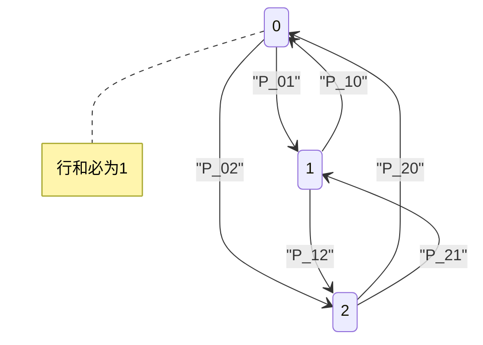

# 一步转移概率与转移概率矩阵

---
requires: [概率论与数理统计/全概率公式, 概率论与数理统计/矩阵乘法]
---

马尔可夫链的核心灵魂是“无后效性”：已知现在，未来与过去无关。那么，我们该如何用数学语言精确描述“从现在走向未来”的规律？答案就是**一步转移概率**与**转移概率矩阵**。

## 什么是一步转移概率

设齐次马氏链 $\{X_n, n \geq 0\}$ 的状态空间为 $I = \{a_1, a_2, \dots, a_N\}$。在时刻 $m$ 处于状态 $a_i$ 的条件下，经过 $n$ 步在时刻 $m+n$ 转移到状态 $a_j$ 的概率称为 $n$ 步转移概率：

$$P_{ij}(n) = P(X_{m+n} = a_j \mid X_m = a_i)$$

当 $n=1$ 时，$P_{ij}(1)$ 简记为 $P_{ij}$，称为==一步转移概率==。它表示系统“走一步”从状态 $i$ 跳到状态 $j$ 的可能性。

> [!IMPORTANT]
> 由于具有平稳性（时齐性），$P_{ij}$ 只与状态 $i, j$ 有关，与起始时刻 $m$ 无关。

将所有状态间的一步转移概率排成一个矩阵，就得到==一步转移概率矩阵== $P$：

$$P = (P_{ij}) = \begin{bmatrix} P_{11} & P_{12} & \cdots & P_{1N} \\ P_{21} & P_{22} & \cdots & P_{2N} \\ \vdots & \vdots & \ddots & \vdots \\ P_{N1} & P_{N2} & \cdots & P_{NN} \end{bmatrix}$$

这个矩阵有两个铁律：
1. **元素非负**：$P_{ij} \geq 0$（概率不能为负）。
2. **行和为 1**：$\sum_{j=1}^N P_{ij} = 1$（从状态 $i$ 出发，下一步必然落在某个状态中）。

我们可以用状态图直观理解：

## 为什么需要转移矩阵

如果只关心“走一步”，查矩阵 $P$ 即可。但如果问：“从状态 $i$ 出发，经过两步到达状态 $j$ 的概率是多少？”

根据全概率公式，中间必须经过某个状态 $k$，因此二步转移概率为：

$$P_{ij}(2) = \sum_{k} P_{ik} P_{kj}$$

这恰好是矩阵乘法的定义！因此，==n 步转移概率矩阵等于一步转移概率矩阵的 n 次方==：

$$P(n) = (P_{ij}(n)) = P^n$$

> [!TIP]
> 考试中**重点掌握** $P^2$、$P^3$ 的计算。算 $P^2$ 时不要死套公式，直接做矩阵乘法 $P \times P$ 最快。

| 概念 | 符号 | 物理意义 | 计算方式 |
| :--- | :--- | :--- | :--- |
| 一步转移概率 | $P_{ij}$ | 走 1 步从 $i$ 到 $j$ | 题目直接给出 |
| $n$ 步转移概率 | $P_{ij}(n)$ | 走 $n$ 步从 $i$ 到 $j$ | 求 $P^n$ 的第 $i$ 行第 $j$ 列 |
| 绝对分布 | $\vec{p}(n)$ | 时刻 $n$ 在各状态的概率 | $\vec{p}(0) \cdot P^n$ |

## 常见误区与辨析

> [!WARNING]
> **行和为 1，不是列和为 1！** 很多同学把转移矩阵和联合分布律搞混。记住：每一行代表“从同一个起点出发的所有可能去向”，总和必须是 1。

> [!CAUTION]
> 计算绝对分布向量时，初始分布 $\vec{p}(0)$ 是**行向量**，应写在左边：$\vec{p}(n) = \vec{p}(0) P^n$。写成 $P^n \vec{p}(0)$ 会导致维度不匹配或结果错误。

## 实战演练

以课件中的综合题为例。设状态空间 $I=\{0,1,2\}$，初始分布 $\vec{p}(0) = (\frac{1}{4}, \frac{1}{2}, \frac{1}{4})$，一步转移概率矩阵为：

$$P = \begin{bmatrix} 0 & 1/2 & 1/2 \\ 1/4 & 1/2 & 1/4 \\ 1/2 & 1/2 & 0 \end{bmatrix}$$

**问题**：求 $P(X_0 = 0, X_2 = 2)$。

**思考路径**：这是联合概率，可以拆解为“初始在 0 的概率”乘以“从 0 走两步到 2 的概率”。

$$P(X_0 = 0, X_2 = 2) = P(X_0 = 0) \cdot P_{02}(2)$$

**第一步**：算 $P^2$ 找 $P_{02}(2)$。只需算 $P^2$ 的第 0 行第 2 列（即第 1 行第 3 列）：

$$P_{02}(2) = P_{00}P_{02} + P_{01}P_{12} + P_{02}P_{22}$$
$$= 0 \times \frac{1}{2} + \frac{1}{2} \times \frac{1}{4} + \frac{1}{2} \times 0 = \frac{1}{8}$$

**第二步**：代入初始概率。

$$P(X_0 = 0, X_2 = 2) = \frac{1}{4} \times \frac{1}{8} = \frac{1}{32}$$

> [!NOTE]
> 观察矩阵 $P^2$ 会发现其所有元素均大于 0（无零元）。根据遍历性的充分条件，存在正整数 $m=2$ 使 $P_{ij}(m)>0$，故该链具有遍历性，且存在唯一的极限分布 $\pi$，满足方程组 $\pi = \pi P$ 且 $\sum \pi_i = 1$。
