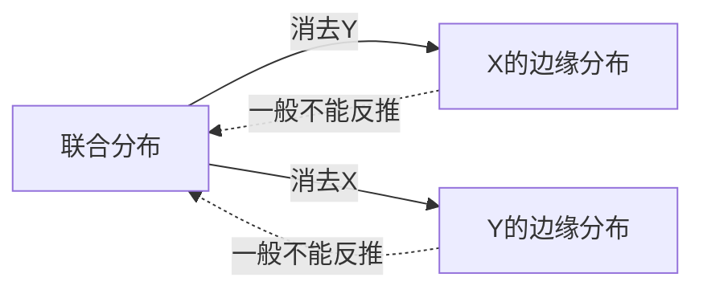

# 边缘分布（边缘分布函数、边缘分布律、边缘概率密度）

---
requires: [多维随机变量及其分布/联合分布]
---

当我们研究二维随机变量 $(X,Y)$ 时，如果只关心其中某一个分量（比如只看 $X$），它的概率规律该怎么求？这就引出了**边缘分布**的概念。

## 它是什么与为什么需要

> [!IMPORTANT]
> 边缘分布，就是由联合分布“压缩”掉另一个变量后，得到的单个随机变量的分布。

从联合分布到边缘分布的关系可以这样理解：

> [!NOTE]
> 联合分布能唯一确定边缘分布，但==边缘分布一般不能确定联合分布==。例如二维正态分布的两个边缘分布都是一维正态分布，且都不依赖于相关系数 $\rho$。不同的 $\rho$ 对应相同的边缘分布，却对应不同的联合分布。

## 怎么算

### 离散型：边缘分布律

设联合分布律为 $P\{X=x_i, Y=y_j\} = p_{ij}$，求关于 $X$ 的边缘分布律，就是把 $Y$ 所有可能的取值“加总”掉：

$$p_{i\bullet} = P\{X=x_i\} = \sum_{j=1}^{\infty} p_{ij} \quad (i=1,2,\cdots)$$

同理，关于 $Y$ 的边缘分布律为 $p_{\bullet j} = \sum_{i=1}^{\infty} p_{ij}$。在联合分布表中，这就是**按行求和**与**按列求和**。

### 连续型：边缘概率密度

设联合概率密度为 $f(x,y)$，关于 $X$ 的边缘概率密度就是对 $y$ 积分：

$$f_X(x) = \int_{-\infty}^{+\infty} f(x,y) \mathrm{d}y$$

同理，$Y$ 的边缘概率密度为 $f_Y(y) = \int_{-\infty}^{+\infty} f(x,y) \mathrm{d}x$。

> [!TIP]
> 记忆口诀：“求谁的边缘，就积掉谁不关心的那个变量”。求 $f_X(x)$，就把 $y$ 积掉；求 $f_Y(y)$，就把 $x$ 积掉。

## 常见的坑

> [!WARNING]
> **连续型积分限的确定是最大失分点！** 不要无脑写 $-\infty$ 到 $+\infty$。必须根据 $f(x,y) \neq 0$ 的区域，结合当前的 $x$（或 $y$）值，重新确定另一个变量的上下限。

| 对比项 | 联合分布 | 边缘分布 |
| :--- | :--- | :--- |
| **描述对象** | $(X,Y)$ 整体 | 单个变量 $X$ 或 $Y$ |
| **离散形式** | $p_{ij}$（表格内部） | $p_{i\bullet}$ 或 $p_{\bullet j}$（表格边缘） |
| **连续形式** | $f(x,y)$（二元函数） | $f_X(x)$ 或 $f_Y(y)$（一元函数） |

## 算对了的例子

来看一道典型的连续型考题。设 $(X,Y)$ 的概率密度为：

$$
f(x,y) = \begin{cases} e^{-y}, & 0 < x < y \\ 0, & \text{其它} \end{cases}
$$

求边缘概率密度 $f_X(x)$ 和 $f_Y(y)$。

**第一步：画区域，定限。**
$f(x,y) \neq 0$ 的区域是 $0 < x < y$（即第一象限直线 $y=x$ 上方）。

**第二步：求 $f_X(x)$（对 $y$ 积分）。**
固定 $x$。当 $x \le 0$ 时，$f_X(x)=0$。
当 $x > 0$ 时，看区域图，$y$ 的范围是从 $x$ 跑到 $+\infty$：

$$f_X(x) = \int_x^{+\infty} e^{-y} \mathrm{d}y = \left[ -e^{-y} \right]_x^{+\infty} = e^{-x}$$

所以：
$$
f_X(x) = \begin{cases} e^{-x}, & x > 0 \\ 0, & \text{其它} \end{cases}
$$

**第三步：求 $f_Y(y)$（对 $x$ 积分）。**
固定 $y$。当 $y \le 0$ 时，$f_Y(y)=0$。
当 $y > 0$ 时，看区域图，$x$ 的范围是从 $0$ 跑到 $y$：

$$f_Y(y) = \int_0^{y} e^{-y} \mathrm{d}x$$

> [!CAUTION]
> 此时是对 $x$ 积分，$e^{-y}$ 相当于常数！千万不要把 $e^{-y}$ 当成 $x$ 的函数去凑微分。

$$f_Y(y) = e^{-y} \cdot x \Big|_0^y = ye^{-y}$$

所以：
$$
f_Y(y) = \begin{cases} ye^{-y}, & y > 0 \\ 0, & \text{其它} \end{cases}
$$

最后别忘了验证：$\int_0^{+\infty} e^{-x}\mathrm{d}x = 1$，$\int_0^{+\infty} ye^{-y}\mathrm{d}y = 1$，归一性成立，计算无误。
