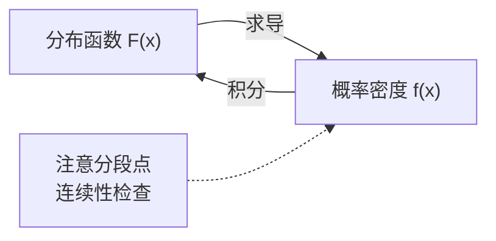

# 连续型随机变量的概率密度函数及其性质

## 概率密度函数：从“点”到“面”的跨越

在离散型随机变量中，我们关注单点概率 $P(X=x_k)$。但对于连续型随机变量（如身高、时间），取任意特定值的概率均为 0。那么，如何描述其分布规律？我们需要引入 ==概率密度函数 (PDF)== $f(x)$。

> [!IMPORTANT]
> **核心定义**：若存在非负可积函数 $f(x)$，使得对任意实数 $x$，分布函数 $F(x) = \int_{-\infty}^{x} f(t)dt$，则称 $X$ 为连续型随机变量，$f(x)$ 为其概率密度。

### 为什么需要 PDF？

想象一下，离散分布是“柱状图”，每个柱子有高度（概率）；而连续分布是“平滑曲线”，单点没有面积（概率为0），但**区间下的面积**代表概率。
$$ P(a < X \leq b) = \int_a^b f(x)dx $$
这就像计算不规则图形的面积，密度越高，落在该区域的可能性越大。

### 两大核心性质

判断一个函数是否为合法的 PDF，或求解未知参数时，必须紧扣以下两点：

| 性质 | 数学表达 | 物理/几何意义 |
| :--- | :--- | :--- |
| **非负性** | $f(x) \geq 0$ | 概率不能为负，曲线在 x 轴上方 |
| **归一性** | $\int_{-\infty}^{+\infty} f(x)dx = 1$ | 总概率为 1，曲线下总面积为 1 |

> [!TIP]
> **解题技巧**：遇到含参 PDF（如填空 5 中的 $A \cos x$），第一步永远是利用 $\int_{-\infty}^{+\infty} f(x)dx = 1$ 求出参数。

### PDF 与 CDF 的关系

两者互为微积分关系，这是计算的核心桥梁：

*   $f(x) = F'(x)$ （在 $f$ 连续处）
*   $F(x) = \int_{-\infty}^{x} f(t)dt$

> [!WARNING]
> **常见坑**：求导时不要忽略定义域！例如计算 2 中，$F(x)=\ln x$ 仅在 $1 \leq x < e$ 有效，其余区间 $f(x)=0$。分段函数的端点值通常不影响积分结果，可任意定义或保持连续。

### 典型例题解析

**题目**：设 $X \sim f(x) = \begin{cases} A \cos x & |x| < \frac{\pi}{2} \\ 0 & \text{其它} \end{cases}$，求 $A$ 及 $P(0 < X < \frac{\pi}{4})$。

**解析**：
1.  **求 A**：利用归一性。
    $$ \int_{-\frac{\pi}{2}}^{\frac{\pi}{2}} A \cos x dx = A [\sin x]_{-\frac{\pi}{2}}^{\frac{\pi}{2}} = A(1 - (-1)) = 2A = 1 \implies A = \frac{1}{2} $$
2.  **求概率**：直接积分。
    $$ P(0 < X < \frac{\pi}{4}) = \int_{0}^{\frac{\pi}{4}} \frac{1}{2} \cos x dx = \frac{1}{2} [\sin x]_0^{\frac{\pi}{4}} = \frac{1}{2} \cdot \frac{\sqrt{2}}{2} = \frac{\sqrt{2}}{4} $$

==核心结论==：处理连续型变量，忘掉“点概率”，紧盯“区间积分”。
