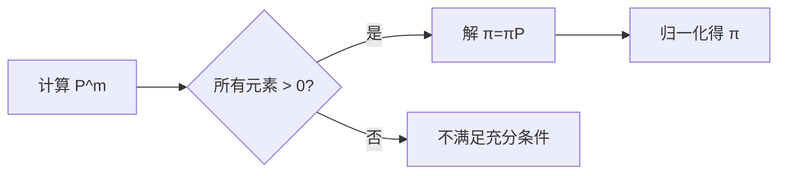

# 有限马氏链遍历性的充分条件

## 什么是遍历性的充分条件

在有限状态马氏链中，我们最关心的是：当时间 $n \to \infty$ 时，转移概率 $P_{ij}(n)$ 是否收敛到一个与初始状态 $i$ 无关的极限 $\pi_j$？若存在且 $\sum \pi_j = 1$，则称链具有==遍历性==，$\boldsymbol{\pi}$ 即为极限分布。

> [!IMPORTANT]
> 遍历性充分条件（正则链判定）
> 若存在正整数 $m$，使得对任意状态 $a_i, a_j \in I$，都有 $P_{ij}(m) > 0$，则该有限齐次马氏链==一定具有遍历性==，且极限分布唯一。

这个条件的直观含义是：经过 $m$ 步转移后，从任何状态都能以正概率到达任何其他状态。此时链“忘记”了起点，长期行为完全由转移矩阵决定。

## 为什么需要这个条件

直接验证 $\lim_{n\to\infty} P_{ij}(n)$ 存在往往困难。而检查某个 $m$ 步转移矩阵 $P^{(m)}$ 是否==全正==，只需有限次矩阵乘法，是可操作的判定手段。更重要的是，它同时保证了极限分布的存在性、唯一性与平稳性，为求解提供了理论依据。

## 如何验证与求解

验证与计算分两步走：

1.  **验证充分条件**：计算 $P^{(m)}$（通常从 $m=1$ 开始试），确认所有元素严格大于零。
2.  **求解极限分布**：解线性方程组 $\pi_j = \sum_{i=1}^{N} \pi_i P_{ij}$，附加约束 $\sum \pi_j = 1$ 且 $\pi_j > 0$。

> [!TIP]
> 解题技巧
> 解 $\boldsymbol{\pi} = \boldsymbol{\pi} P$ 时，将最后一个方程替换为 $\sum \pi_j = 1$，避免系数矩阵奇异导致无穷多解。

## 与相近概念的区别

| 概念 | 核心要求 | 与遍历性关系 |
| :--- | :--- | :--- |
| 不可约 | 任意两状态互通 | 必要但不充分 |
| 非周期 | 各状态周期为1 | 必要但不充分 |
| 遍历性充分条件 | 某 $m$ 步转移矩阵全正 | ==充分条件==，蕴含不可约+非周期 |
| 平稳分布 | 满足 $\pi=\pi P$ | 遍历链的极限分布必为平稳分布 |

> [!NOTE]
> 不可约且非周期的有限马氏链一定遍历，但验证周期性较繁琐。$P^{(m)}>0$ 是更强的条件，可直接跳过周期检验。

## 常见的坑

> [!WARNING]
> 易错点辨析
> -   误以为 $P_{ij}(1)>0$ 才满足条件：实际上只需==某个== $m$ 使 $P^{(m)}>0$ 即可，$m$ 可以大于1。
> -   混淆“极限分布”与“平稳分布”：在非遍历链中平稳分布可能不唯一或不是极限分布；但在本定理条件下二者等价。
> -   忘记验证 $\sum \pi_j = 1$：仅解 $\pi=\pi P$ 得到的是特征向量，必须归一化才是概率分布。

## 算对了的例子

设状态空间 $I=\{0,1\}$，一步转移矩阵为：

$$
P = \begin{pmatrix} 0.7 & 0.3 \\ 0.4 & 0.6 \end{pmatrix}
$$

**验证**：$P$ 本身所有元素 $>0$，取 $m=1$ 即满足充分条件，故链遍历。

**求解**：列方程组
$$
\begin{cases}
\pi_0 = 0.7\pi_0 + 0.4\pi_1 \\
\pi_0 + \pi_1 = 1
\end{cases}
$$
由第一式得 $0.3\pi_0 = 0.4\pi_1$，即 $\pi_0 = \frac{4}{3}\pi_1$。代入归一化条件：$\frac{4}{3}\pi_1 + \pi_1 = 1 \Rightarrow \pi_1 = \frac{3}{7},\ \pi_0 = \frac{4}{7}$。

因此极限分布为 $\boldsymbol{\pi} = \left(\frac{4}{7}, \frac{3}{7}\right)$，且该分布也是唯一的平稳分布。

> [!CAUTION]
> 高危误区
> 若 $P$ 含零元，不要急于否定遍历性！务必继续计算 $P^{(2)}, P^{(3)}, \dots$ 直到找到全正矩阵或证明不存在。许多考题故意设置 $P$ 有零元但 $P^{(2)}>0$ 的情形来考查这一点。
