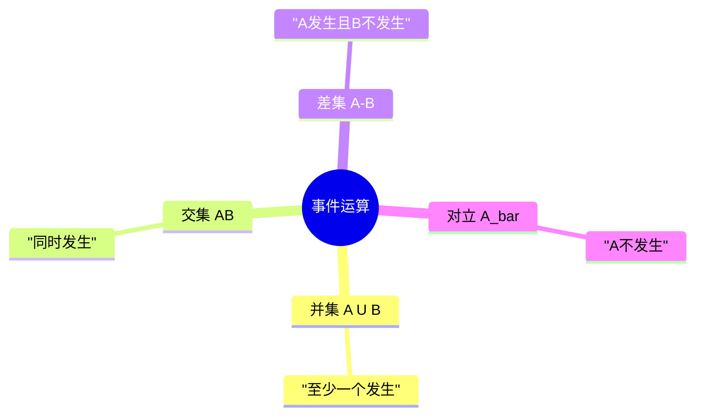

# 随机事件及其运算（并、交、差、对立）

# 随机事件及其运算

在概率论中，我们将试验的每一个可能结果称为样本点，所有样本点的集合构成==样本空间 $\Omega$==。随机事件则是 $\Omega$ 的子集。为了量化复杂事件发生的可能性，我们必须掌握事件的四种基本运算：并、交、差、对立。

## 核心运算定义

想象掷一颗骰子，$\Omega=\{1,2,3,4,5,6\}$。设 $A=$“出现偶数”，$B=$“出现点数小于4”。

*   **和事件（并）** $A \cup B$：$A$ 与 $B$ ==至少有一个== 发生。
*   **积事件（交）** $AB$ 或 $A \cap B$：$A$ 与 $B$ ==同时== 发生。
*   **差事件** $A - B$：$A$ 发生但 $B$ ==不发生==。注意 $A-B = A\bar{B}$。
*   **对立事件** $\bar{A}$：$A$ ==不发生==。满足 $A \cup \bar{A} = \Omega$ 且 $A \bar{A} = \emptyset$。

> [!IMPORTANT]
> **对立 vs 互斥**
> *   **互斥** ($AB=\emptyset$)：不能同时发生，但可以都不发生。
> *   **对立** ($\bar{A}$)：非此即彼，必有一个发生，且仅有一个发生。
> *   ==对立必互斥，互斥未必对立==。

## 德摩根律与复杂事件表示

处理“至少”、“至多”、“恰好”类问题时，直接正面求解往往繁琐，利用==德摩根律 (De Morgan's Laws)== 转化为对立事件是解题关键。

$$ \overline{A \cup B} = \bar{A}\bar{B} \quad \text{(并的对立 = 对立的交)} $$
$$ \overline{AB} = \bar{A} \cup \bar{B} \quad \text{(交的对立 = 对立的并)} $$

推广到三个事件 $A,B,C$：
*   “至少有一个发生”：$A \cup B \cup C$
*   “都不发生”：$\bar{A}\bar{B}\bar{C} = \overline{A \cup B \cup C}$
*   “恰有一个发生”：$A\bar{B}\bar{C} \cup \bar{A}B\bar{C} \cup \bar{A}\bar{B}C$

> [!TIP]
> **解题技巧**
> 遇到“至多”、“至少”字样，优先思考其==对立事件==。例如，“至多两个发生”的对立是“三个都发生”，即 $\overline{ABC}$。

## 典型例题解析

**题目**：设 $P(A)=P(B)=P(C)=1/4$，$P(AB)=P(AC)=1/8$，$P(BC)=0$。求 $A,B,C$ 都不发生的概率。

**分析**：
“都不发生”即求 $P(\bar{A}\bar{B}\bar{C})$。根据德摩根律，这等价于 $1 - P(A \cup B \cup C)$。

**步骤**：
1.  **确定隐含条件**：由 $P(BC)=0$ 且概率非负，可知 $P(ABC)=0$。
2.  **应用容斥原理**：
    $$
    \begin{aligned}
    P(A \cup B \cup C) &= \sum P(A_i) - \sum P(A_i A_j) + P(ABC) \\
    &= \left(\frac{1}{4}+\frac{1}{4}+\frac{1}{4}\right) - \left(\frac{1}{8}+\frac{1}{8}+0\right) + 0 \\
    &= \frac{3}{4} - \frac{1}{4} = \frac{1}{2}
    \end{aligned}
    $$
3.  **求对立概率**：
    $$ P(\bar{A}\bar{B}\bar{C}) = 1 - P(A \cup B \cup C) = 1 - \frac{1}{2} = \frac{1}{2} $$

> [!WARNING]
> **常见陷阱**
> 1. 混淆 $A-B$ 与 $\bar{A}-\bar{B}$。
> 2. 计算“恰有 $k$ 个发生”时，遗漏某些组合或错误包含“全发生”的情况（如将“恰有两个”误写为 $AB \cup BC \cup AC$，未排除 $ABC$）。
> 3. 忽略 $P(BC)=0 \implies P(ABC)=0$ 这一隐含推导。
