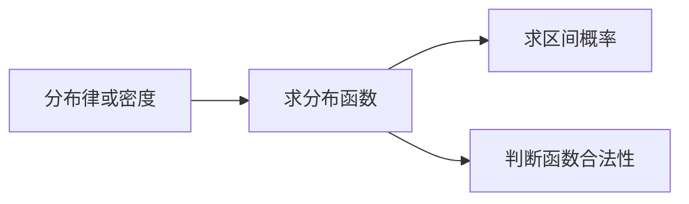

# 随机变量的分布函数及其性质

## 它是什么

分布函数（CDF）把随机变量 $X$ 的所有概率信息压缩成一个普通实函数：

$$
F(x)=P\{X\le x\},\qquad x\in\mathbb R.
$$

它回答的是“$X$ 落在 $x$ 及其左侧的总概率”。有了它，不必分别记忆分布律或密度，也能统一处理离散型、连续型随机变量。

> [!IMPORTANT]
> 定义中的等号不能丢：==$F(x)$ 包含 $X=x$ 这一点的概率==。

## 为什么需要

分布律适合逐点列概率，密度适合积分求概率；分布函数则把二者统一起来，并直接给出区间概率：

$$
P\{a<X\le b\}=F(b)-F(a).
$$

对连续型随机变量，

$$
F(x)=\int_{-\infty}^{x}f(t)\,dt,\qquad f(x)=F'(x)
$$

（在 $f$ 连续处成立）。对离散型随机变量，

$$
F(x)=\sum_{x_k\le x}p_k.
$$

因此，离散型的 $F(x)$ 是阶梯函数，每到一个取值点就向上跳一次，跳跃高度就是该点概率。

## 必须掌握的性质

| 性质 | 数学表达 | 直观含义 |
|---|---|---|
| 有界 | $0\le F(x)\le1$ | 它是概率 |
| 单调不减 | $x_1<x_2\Rightarrow F(x_1)\le F(x_2)$ | 左侧范围扩大，概率不减少 |
| 两端极限 | $F(-\infty)=0,\ F(+\infty)=1$ | 最终覆盖全部概率 |
| 右连续 | $F(x+0)=F(x)$ | 分段时常写“左闭右开” |

反过来，一个函数要成为分布函数，也必须满足这些条件。由右连续还可得

$$
P\{X=x_0\}=F(x_0)-F(x_0-0).
$$

连续型随机变量没有跳点，故 $P\{X=x_0\}=0$，区间端点开闭不影响概率；离散型则不能随意改端点。

> [!WARNING]
> 常见错误是把 $P\{a<X\le b\}$ 写成 $F(b)-F(a-0)$，或把离散型分段区间写成 $0<x\le1$。记住：==区间概率看端点，分布函数看右连续==。

## 一个算对了的例子

从学校到火车站经过 3 个相互独立的交通岗，每次遇红灯概率均为 $\frac15$。设 $X$ 为遇红灯次数，则 $X\sim B(3,\frac15)$，分布律为

$$
P\{X=k\}=\binom3k\left(\frac15\right)^k
\left(\frac45\right)^{3-k},\quad k=0,1,2,3.
$$

即

| $X$ | 0 | 1 | 2 | 3 |
|---|---:|---:|---:|---:|
| $P$ | $\frac{64}{125}$ | $\frac{48}{125}$ | $\frac{12}{125}$ | $\frac1{125}$ |

逐段累加得

$$
F(x)=
\begin{cases}
0,&x<0,\\[2pt]
\dfrac{64}{125},&0\le x<1,\\[4pt]
\dfrac{112}{125},&1\le x<2,\\[4pt]
\dfrac{124}{125},&2\le x<3,\\[4pt]
1,&x\ge3.
\end{cases}
$$

例如 $P\{1<X\le3\}=F(3)-F(1)=1-\frac{112}{125}=\frac{13}{125}$，恰为 $P\{X=2\}+P\{X=3\}$。

> [!TIP]
> 求离散型分布函数可按“列取值—算概率—从左累加—检查右连续与 $F(+\infty)=1$”四步完成。
