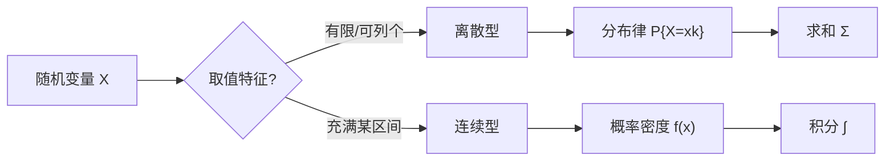

# 随机变量的概念与分类（离散型、连续型）

## 为什么需要随机变量

当我们面对“抛硬币正反面”或“天气阴晴”这类非数量化的随机事件时，如何运用微积分等数学工具进行计算？核心思路就是==将随机事件映射为实数==。这种定义在样本空间上的实值函数 $X=X(e)$ 即为**随机变量**。它架起了概率论与高等数学之间的桥梁，使我们能用分析的方法研究随机现象。

## 离散型与连续型的本质区别

根据取值特点，随机变量主要分为两类，它们的描述工具截然不同：

| 对比维度 | 离散型随机变量 | 连续型随机变量 |
| :--- | :--- | :--- |
| **取值** | 有限个或无限可列个 | 连续充满某个区间 |
| **描述工具** | 分布律 $P\{X=x_k\}=p_k$ | 概率密度 $f(x)$ |
| **单点概率** | $P\{X=a\} = p_k > 0$ | ==$P\{X=a\} = 0$== |
| **概率计算** | $P\{a<X<b\} = \sum p_k$ | $P\{a<X<b\} = \int_a^b f(x)\mathrm{d}x$ |
| **分布函数** | 阶梯状右连续函数 | 连续函数 $F(x)=\int_{-\infty}^x f(t)\mathrm{d}t$ |

> [!IMPORTANT]
> 连续型随机变量取任一特定值的概率恒为零，即 $P\{X=a\}=0$。因此对连续型而言，$P\{a<X<b\} = P\{a \le X \le b\}$，==区间开闭不影响概率值==。但这并不意味着 $\{X=a\}$ 是不可能事件，只是其测度为零。

## 如何正确求解分布参数

解题关键在于识别类型并选用对应工具。对于连续型，常通过分布函数 $F(x)$ 反推密度 $f(x)=F'(x)$；对于离散型，则直接利用分布律的归一性 $\sum p_k = 1$。

> [!WARNING]
> 切勿混淆两类变量的运算规则！对离散型求概率用“求和”，对连续型用“积分”。在由 $F(x)$ 求 $f(x)$ 时，务必注意 $F(x)$ 的不可导点（如分段点），这些点处 $f(x)$ 可任意定义，通常写为 0。

### 算对了的例子

已知随机变量 $X$ 服从区间 $[a,b]$ 上的均匀分布，且 $E(X)=3, D(X)=\frac{4}{3}$，求区间 $[a,b]$。

**解：**
均匀分布 $X \sim U(a,b)$ 的期望与方差公式为：
$$E(X)=\frac{a+b}{2}, \quad D(X)=\frac{(b-a)^2}{12}$$
代入已知条件得方程组：
$$\begin{cases} \frac{a+b}{2}=3 \\ \frac{(b-a)^2}{12}=\frac{4}{3} \end{cases} \Rightarrow \begin{cases} a+b=6 \\ (b-a)^2=16 \end{cases}$$
因 $b>a$，故 $b-a=4$。联立解得 $a=1, b=5$。
所以区间为 $[1,5]$。

> [!TIP]
> 此题是典型的“由数字特征反推分布参数”题型。熟记常见分布（均匀、正态、指数、二项、泊松）的 $E(X)$ 和 $D(X)$ 公式，是快速解题的前提。本题中若误用离散型均匀分布公式，将导致完全错误的结果。
