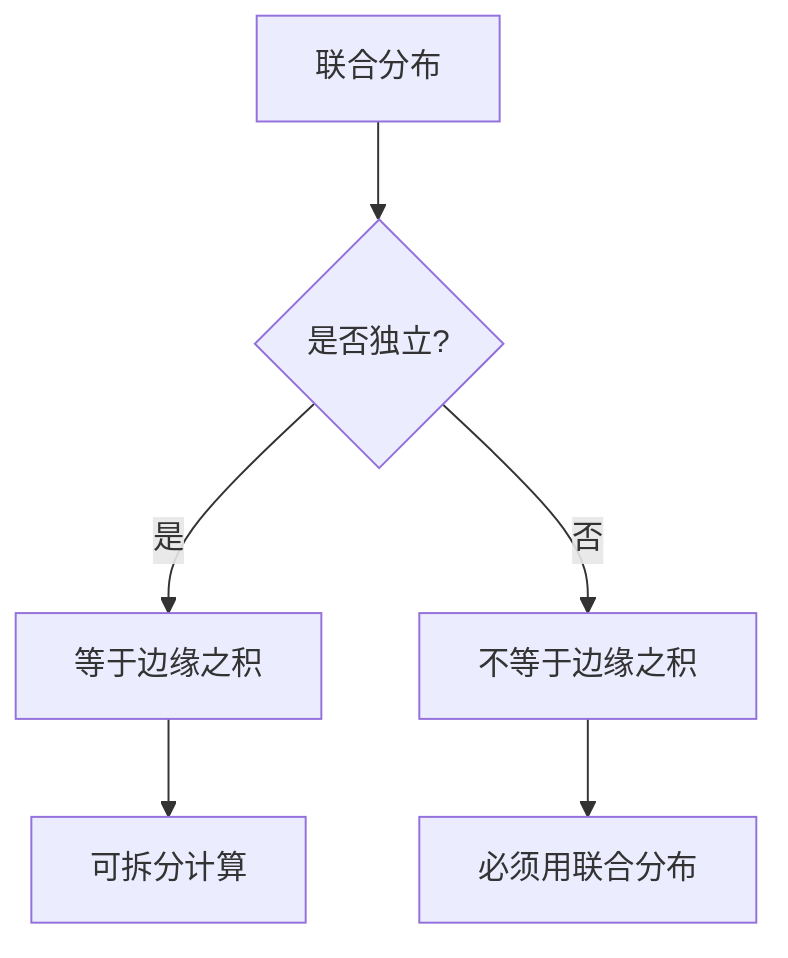

# 两个随机变量的相互独立性

> [!IMPORTANT]
> 两个随机变量 $X$ 与 $Y$ 相互独立，是指其中一个变量的取值完全不影响另一个变量的分布。

## 它是什么

回想一下：如果已知 $X$ 的值后，$Y$ 的分布规律和不知道时一模一样，这意味着什么？意味着两者“互不干涉”。

用数学语言描述，设 $(X,Y)$ 的联合分布函数为 $F(x,y)$，边缘分布函数分别为 $F_X(x), F_Y(y)$。若对任意实数 $x,y$ 都有：
$$F(x,y) = F_X(x) \cdot F_Y(y)$$
则称 $X$ 与 $Y$ ==相互独立==。

根据类型不同，判定条件等价于：

| 类型 | 独立性判定公式 |
| :---: | :---: |
| **离散型** | $p_{ij} = p_{i\cdot} \cdot p_{\cdot j}$（对所有 $i,j$ 成立） |
| **连续型** | $f(x,y) = f_X(x) \cdot f_Y(y)$（几乎处处成立） |

## 为什么需要

判断独立性是为了==降维简化==。如果 $X, Y$ 独立，求二维概率、算期望方差、甚至求 $Z=X+Y$ 的卷积公式时，都能拆成两个一维问题分别处理。后续章节中，最大值 $Z=\max(X,Y)$ 的分布函数 $F_Z(z)=F_X(z)F_Y(z)$，其前提正是 $X,Y$ 相互独立。

## 怎么做

判断或证明独立性，核心步骤只有三步：

1. **求边缘**：由联合分布求出 $f_X(x)$ 和 $f_Y(y)$（或离散的 $p_{i\cdot}, p_{\cdot j}$）。
2. **作乘积**：计算 $f_X(x) \cdot f_Y(y)$。
3. **比大小**：看乘积是否恒等于联合密度 $f(x,y)$。

> [!TIP]
> 离散型只需找到==一个==格子使得 $p_{ij} \neq p_{i\cdot} p_{\cdot j}$，即可直接判定不独立。连续型则需比较表达式或支撑集（非零区域）。

## 算对了的例子

以南邮真题为例：设二维连续型随机变量 $(X,Y)$ 的概率密度为
$$f(x,y) = \begin{cases} \frac{1}{\pi}, & x^2+y^2 \leq 1 \\ 0, & \text{其它} \end{cases}$$
判断 $X$ 与 $Y$ 是否相互独立。

**第一步：求边缘密度**
$$f_X(x) = \int_{-\infty}^{+\infty} f(x,y)dy = \begin{cases} \int_{-\sqrt{1-x^2}}^{\sqrt{1-x^2}} \frac{1}{\pi} dy = \frac{2}{\pi}\sqrt{1-x^2}, & |x| \leq 1 \\ 0, & \text{其它} \end{cases}$$
同理可得 $f_Y(y) = \frac{2}{\pi}\sqrt{1-y^2}, |y| \leq 1$。

**第二步：作乘积并比较**
在单位圆内（$x^2+y^2 \leq 1$），乘积为：
$$f_X(x)f_Y(y) = \frac{4}{\pi^2}\sqrt{(1-x^2)(1-y^2)}$$
显然 $\frac{4}{\pi^2}\sqrt{(1-x^2)(1-y^2)} \neq \frac{1}{\pi}$，故 $f(x,y) \neq f_X(x)f_Y(y)$。

**结论**：$X$ 与 $Y$ ==不独立==。

## 相近概念的区别

| 概念 | 含义 | 关系 |
| :--- | :--- | :--- |
| **相互独立** | $f(x,y) = f_X(x)f_Y(y)$ | 强条件，推出不相关 |
| **不相关** | $\text{Cov}(X,Y) = 0$ | 弱条件，推不出独立 |

> [!NOTE]
> 唯一例外：若 $(X,Y)$ 服从二维正态分布，则“不相关”与“相互独立”等价。

## 常见的坑

> [!WARNING]
> 连续型不仅要比表达式，还要比==支撑集==！即使表达式碰巧相等，若联合密度的非零区域不是矩形（如本题的圆形），乘积的非零区域却是矩形，两者定义域不同，依然不独立。

> [!CAUTION]
> 离散型判断不独立时，切忌只算一个格子就下结论说“独立”。要证独立，必须验证==所有==格子都满足等式；要证不独立，找一个反例即可。
