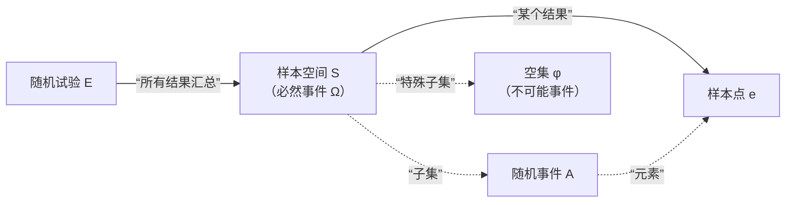

# 随机试验与样本空间

## 随机试验

我们面对的现象，有的在相同条件下必然发生（如“标准大气压下，水加热至 100℃ 会沸腾”），有的却无法预知结果。后一类，比如掷一枚硬币，可能出现正面也可能出现反面，我们称之为**随机现象**。

如何用数学工具来研究这种“不确定”？第一步，就是把它抽象成**随机试验**，通常记作 $E$。

一个过程要被称为随机试验，必须同时满足三个特性：

| 特性 | 通俗理解 | 一句话检验 |
| :--- | :--- | :--- |
| **可重复性** | 试验可以在**相同条件**下反复进行 | 能不能再来一次？ |
| **结果多样性** | 试验前已知**所有可能**的结果，但不知具体哪一个会发生 | 你知道有哪几种可能吗？ |
| **不可预知性** | 每次试验前，**无法确定**哪个结果会出现 | 你能提前说准是哪一个吗？ |

> [!IMPORTANT]
> 随机试验是概率论最底层的基石。我们后面要讲的所有事件、概率，都必须先明确它们属于哪个随机试验。**第一步永远是“先认清你在做哪个试验”**。

---

## 样本空间

认清了随机试验，下一步就要把它所有可能的基本结果打包成一个集合，这个集合就是**样本空间**，通常记为 $S$ 或 $\Omega$。

样本空间里的每一个元素 $e$，叫做一个**样本点**。你可以把样本空间想象成一个“结果仓库”，每一次试验，你只能从这个仓库里取出恰好一个样本点。

$$
S = \{ e_1, e_2, e_3, \dots \}
$$

### 样本空间的形态

样本空间并不拘泥于数字，根据试验不同，它可以是多种多样的。识别样本空间的类型，对你后续用**排列组合**还是用**几何度量**来算概率至关重要。

| 类型 | 示例试验 | 样本空间 $S$ |
| :--- | :--- | :--- |
| **有限离散** | 掷一颗骰子，观察点数 | $\{ 1, 2, 3, 4, 5, 6 \}$ |
| | 两个球放入甲乙两盒，计球数 | $\{ (0,2), (1,1), (2,0) \}$ |
| **无限可列** | 记录 110 一小时内呼叫次数 | $\{ 0, 1, 2, 3, \dots \}$ |
| **不可列（连续）** | 测汽车通过某点的速度 | $\{ v \mid v \ge 0 \}$ |
| **多维** | 向单位圆内随机投点 | $\{ (x,y) \mid 0 \le x^2+y^2 \le 1 \}$ |

> [!WARNING]
> **最常见的坑：用错样本空间。**
> 比如“接连抛两次骰子，看点数和”，样本空间是 $\{2, 3, \dots, 12\}$，还是 $\{(1,1), (1,2), \dots, (6,6)\}$？
>
> 如果你只想研究**和**的大小，用前者足矣。但如果你要算“点数和为 7”的概率，==必须回到后者==，因为 36 个基本结果出现的可能性相等，而“和为 7”只不过是其中 6 个结果的集合。若错把前者当等可能样本空间，就会得出“和为 7”的概率是 $\frac{1}{11}$ 的错误结论。

---

## 随机事件

有了样本空间，我们就可以讨论**随机事件**了。一个随机事件，就是样本空间 $S$ 的某个子集。当一次试验的结果（样本点 $e$）落入了这个子集，就说该事件**发生**了。

比如掷骰子试验中：
- 事件 A：“出现偶数点” → $A = \{2, 4, 6\}$
- 事件 B：“点数小于 3” → $B = \{1, 2\}$

两个极端情况值得专门看看：
- **必然事件**：样本空间 $S$ 本身，每次试验必然发生。
- **不可能事件**：空集 $\emptyset$，每次试验绝不可能发生。

> [!NOTE]
> 你说“必然事件就是 $S$，不可能事件就是 $\emptyset$，这不是废话吗？”
>
> 在概率的公理化定义里，这两者就是 $S$ 和 $\emptyset$。把确定性结果也看作事件的极端情况，使得我们可以用统一的集合论语言描述所有问题，就像计算机世界里的“0”和“1”一样基础。

---

## 一个算对了的完整例子

> 将 $a, b$ 两个球随机地放入甲、乙两个盒子中去。设事件 $A$ 表示“甲盒中至少有一个球”。
>
> (1) 写出该随机试验的样本空间 $S$。
> (2) 用 $S$ 的子集表示事件 $A$。

**解：**

我们先把动作拆解成基本结果。用有序对 $(甲盒球数, 乙盒球数)$ 来记录。两个球往两个盒子里放，无非三种可能：

- 两个球全进了乙盒：$(0, 2)$
- 每盒一个球：$(1, 1)$
- 两个球全进了甲盒：$(2, 0)$

于是，
$$
S = \{ (0,2), (1,1), (2,0) \}
$$

事件 $A$ 是“甲盒中至少有一个球”，也就是甲盒球数 $\ge 1$。在 $S$ 的三个结果中扫一眼，$(1,1)$ 和 $(2,0)$ 都满足。因此，

$$
A = \{ (1,1), (2,0) \}
$$

> [!TIP]
> 写样本空间时，务必**先确定用什么形式记录结果**（有序对、数的集合、区间），再穷举或描述。每一个样本点必须互斥且完整覆盖所有可能。
