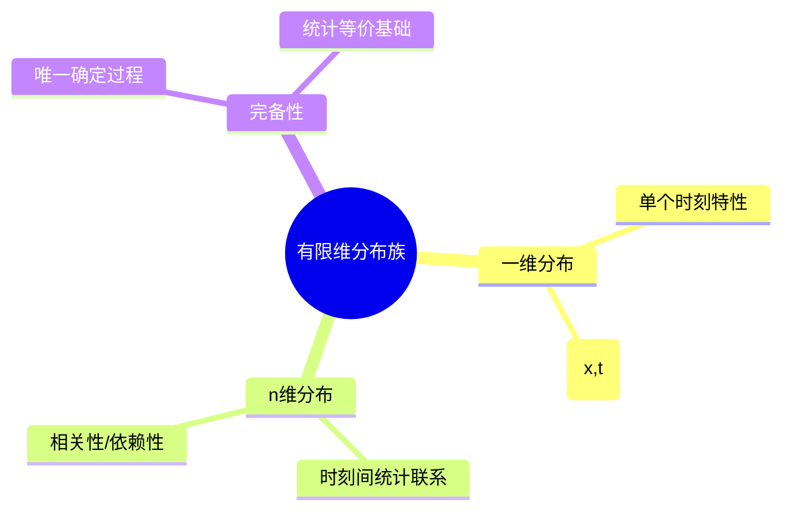

# 随机过程的有限维分布函数族
随机过程 $X(t)$ 本质上是无穷多个随机变量的集合。要完整描述它的统计规律，仅看某一时刻是不够的，必须考察任意有限个时刻联合起来的统计特性。这就是**有限维分布函数族**。

### 它是什么？

对于任意正整数 $n$ 和任意时刻 $t_1, t_2, \dots, t_n \in T$，随机变量 $(X(t_1), X(t_2), \dots, X(t_n))$ 的联合分布函数称为 $X(t)$ 的 **$n$ 维分布函数**：

$$
F_n(x_1, \dots, x_n; t_1, \dots, t_n) = P\{X(t_1) \leq x_1, \dots, X(t_n) \leq x_n\}
$$

当 $n$ 取遍所有正整数，且 $t_i$ 取遍参数集 $T$ 时，所有这些分布函数的全体构成了**有限维分布函数族**。

> [!IMPORTANT]
> ==核心结论==：有限维分布函数族完全确定了随机过程的统计特性。若两个过程的有限维分布族相同，则它们在统计意义上是等价的。

### 为什么需要它？

想象你在观察南京的气温变化。
- **一维分布** $F_1(x, t)$ 只能告诉你“今天下午2点气温低于25度的概率”，反映的是**个别时刻**的统计特性。
- 但如果你想知道“下午2点低于25度 **且** 下午4点高于20度”的概率，一维分布就失效了。你需要**二维分布**来描述不同时刻状态之间的**统计联系**（相关性）。

### 怎么做？（计算步骤）

1.  **固定时刻**：选取 $n$ 个特定时刻 $t_1, \dots, t_n$。
2.  **视为随机向量**：将 $X(t_1), \dots, X(t_n)$ 看作一个 $n$ 维随机向量。
3.  **求联合概率**：计算该向量落在区域 $(-\infty, x_1] \times \dots \times (-\infty, x_n]$ 的概率。

> [!TIP]
> 解题时，先写出随机过程的具体表达式，代入时刻得到具体的随机变量组合，再利用已知分布（如正态、均匀）求联合分布。

### 常见坑与辨析

| 概念 | 描述 | 易错点 |
| :--- | :--- | :--- |
| **一维分布族** | $\{F_X(x,t), t \in T\}$ | 仅反映边际分布，丢失时序依赖信息 |
| **$n$ 维分布** | 固定 $n$ 个时刻的联合分布 | $n$ 越大，计算越复杂，但信息越全 |
| **严平稳过程** | 分布随时间平移不变 | ==注意==：严平稳要求**所有**有限维分布都平移不变，不仅是均值方差 |

> [!WARNING]
> 不要混淆“分布函数”与“数字特征”。均值和自相关函数（二阶矩）虽然常用，但通常不足以唯一确定非高斯过程的分布；只有**有限维分布族**才是完备的描述。

### 典型例题演示

**题目**：设随机过程 $X(t) = A \cos(\omega t)$，其中 $A \sim N(0, \sigma^2)$，$\omega$ 为常数。求其一维分布函数。

**解析**：
1.  固定时刻 $t$，$X(t)$ 是随机变量 $A$ 的线性变换：$X(t) = k A$，其中 $k=\cos(\omega t)$。
2.  若 $k \neq 0$，由正态分布性质，$X(t) \sim N(0, k^2\sigma^2)$。
3.  其一维分布函数为标准正态分布函数的缩放形式：
    $$
    F_X(x, t) = \Phi\left(\frac{x}{|\cos(\omega t)|\sigma}\right)
    $$
    （注：若 $\cos(\omega t)=0$，则 $X(t)\equiv 0$，分布为退化分布。）

此例展示了如何从随机变量的分布推导过程在特定时刻的一维分布，这是构建有限维分布族的基础单元。
