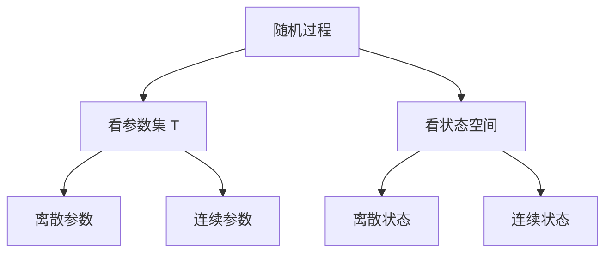

# 随机过程的分类（按状态空间与参数集）

## 为什么要给随机过程分类

随机过程 $\{X(t),t\in T\}$ 是一族依赖于参数 $t\in T$ 的随机变量：固定 $t$，$X(t)$ 是随机变量；固定一次试验结果，则得到样本函数 $x(t)$。不同过程可能“时间连续、取值离散”，也可能“时间离散、取值连续”，因此需要分别从**参数集**和**状态空间**两个维度分类。

这里，$T$ 称为参数集，常把 $t$ 看作时间；$X(t)$ 称为时刻 $t$ 时过程的状态。对一切 $t\in T$，$X(t)$ 所有可能取值的全体称为==状态空间==。

## 按参数集与状态空间分类

分类时分别问两个问题：

- **时间怎样变化？** $T$ 是离散点集，还是连续区间？
- **状态怎样取值？** 状态空间是离散集合，还是连续取值集合？

| 参数集 $T$ | 状态空间 | 过程类型 | 典型情形 |
|---|---|---|---|
| 离散 | 离散 | 离散参数、离散状态过程 | 每天观察设备是否故障 |
| 离散 | 连续 | 离散参数、连续状态过程 | 每天测量某处噪声电压 |
| 连续 | 离散 | 连续参数、离散状态过程 | 任意时刻统计正在通话的人数 |
| 连续 | 连续 | 连续参数、连续状态过程 | 任意时刻测量电阻热噪声电压 |

> [!IMPORTANT]
> ==参数集描述“何时观察”，状态空间描述“观察到什么”==。二者必须分别判断，不能混为一谈。

通常，$T=\{0,1,2,\ldots\}$ 或 $T=\{\ldots,-1,0,1,\ldots\}$ 表示离散参数；$T=[0,+\infty)$ 或 $T=(-\infty,+\infty)$ 表示连续参数。状态只取整数、有限个类别等，属于离散状态；状态可取某区间内任意实数，属于连续状态。

## 一个判断正确的例子

设某随机过程表示任意时刻 $t\geq 0$ 某设备输出端的噪声电压，电压可在实数范围内连续取值，则

$$
T=[0,+\infty),
$$

状态空间也是连续实数集。因此，该过程是**连续参数、连续状态随机过程**。

若改为每天记录一次该电压，则参数集变为 $T=\{1,2,3,\ldots\}$，虽然电压仍连续取值，过程却变为**离散参数、连续状态随机过程**。可见，只改变观测时间，分类就可能改变。

> [!WARNING]
> 不要把“随机变量离散”与“样本函数由离散点组成”混淆。样本函数 $x(t)$ 是一次试验得到的确定函数，不是状态空间，也不能仅凭图像是否光滑判断状态是否连续。

## 与相近分类的区别

按状态空间和参数集分类，只描述过程的**时间结构与取值结构**，并不说明不同时刻随机变量之间的概率关系。

| 分类依据 | 关注的问题 | 能否由本知识点直接推出 |
|---|---|---|
| 参数集、状态空间 | 时间是否离散，状态是否离散 | 本节直接判断 |
| 独立增量过程 | 不重叠区间上的增量是否独立 | 不能 |
| 二阶矩过程 | 二阶矩是否存在 | 不能 |

例如，给定二阶矩过程 $X(t),t\in[0,+\infty)$，称 $X(t)-X(s)$（$0<s<t$）为区间 $(s,t]$ 上的增量。若对 $0\leq t_0<t_1<\cdots<t_n$，相应的 $n$ 个增量皆独立，才称为独立增量过程。即使两个过程同属连续参数、连续状态，也不一定都是独立增量过程。

> [!TIP]
> 解题时写成“两步结论”：先写 $T$ 的形式，判断参数离散或连续；再写 $X(t)$ 的取值范围，判断状态离散或连续。不要只答“离散随机过程”，应明确是哪一维离散。
